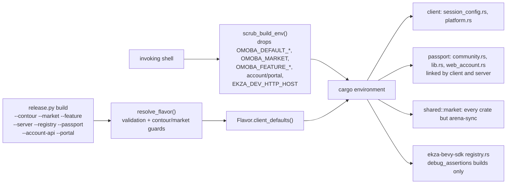
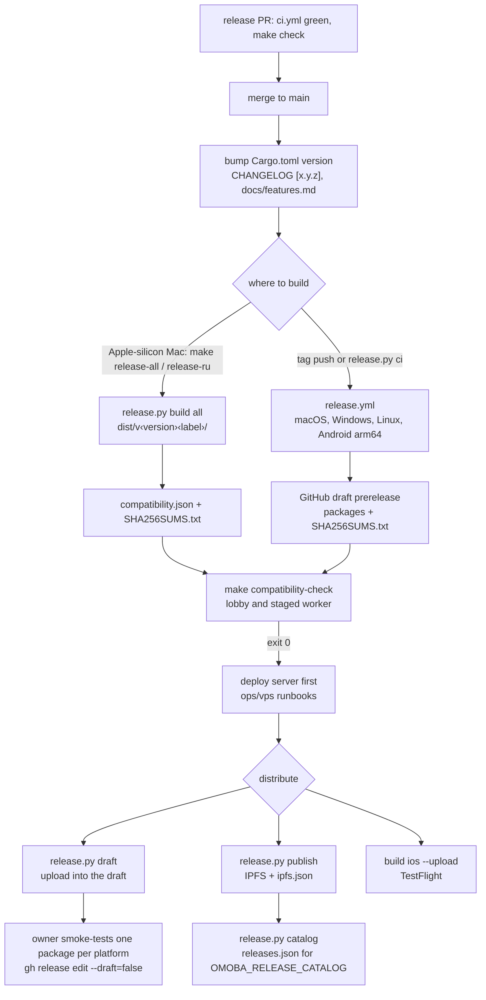

# Build and release pipeline

This page shows how OMOBA source becomes shipped binaries and packages. It covers the Cargo workspace and its features, every compile-time setting and what sets it, the `scripts/release.py` builder and its two build axes (contour × market), the per-platform packagers, versioning, the GitHub Actions workflows, the Makefile release wrappers, and how the player portal (repository `o-moba/omoba-web`) is built and deployed. It covers structure and intent. The step-by-step procedures are in [RELEASING.md](../RELEASING.md), [release-compatibility.md](../release-compatibility.md), [markets.md](../markets.md), [connection-profiles.md](../connection-profiles.md), [mobile/ios/TESTFLIGHT.md](../../mobile/ios/TESTFLIGHT.md) and the `ops/vps` runbooks.

Snapshot: game dev 6d34f98, portal dev 604bc34, 2026-10-24. See [README](README.md).

## Map

| Concern | Source of truth | Details |
|---|---|---|
| Package builder for every platform | [scripts/release.py](../../scripts/release.py) | [RELEASING.md](../RELEASING.md) |
| Contours (prod/dev): identities and dev endpoints | [scripts/contours.py](../../scripts/contours.py) | [connection-profiles.md](../connection-profiles.md) |
| Markets (global/ru/cn): features, servers, platforms | [scripts/markets.py](../../scripts/markets.py), which mirrors [shared/src/market.rs](../../shared/src/market.rs) | [markets.md](../markets.md) |
| Android APK without Gradle | [mobile/android/build.py](../../mobile/android/build.py) | [mobile/README.md](../../mobile/README.md) |
| iOS archive (Xcode build phase) | [mobile/ios/xcode_build.py](../../mobile/ios/xcode_build.py), `Omoba.xcodeproj`, [Omoba.xcconfig](../../mobile/ios/Omoba.xcconfig) | [TESTFLIGHT.md](../../mobile/ios/TESTFLIGHT.md) |
| Source guard for prod-contour iOS archives | [scripts/ios_release_guard.py](../../scripts/ios_release_guard.py) | TESTFLIGHT.md |
| Client/server compatibility contract | `shared/src/compatibility.rs`, `shared/examples/compatibility.rs` | [release-compatibility.md](../release-compatibility.md) |
| Tests that check the builder | [scripts/test_release.py](../../scripts/test_release.py), `mobile/android/test_build.py`, `mobile/ios/test_*.py` | — |
| CI workflow mechanics | `.github/workflows/{ci,release,ios-check,bot-sim}.yml` | this page, [CI workflows](#ci-workflows) |
| Pre-PR gate (`make check` and the other local targets) and build-cache policy | [Makefile](../../Makefile) | [methodology.md › What to run before a PR](methodology.md#what-to-run-before-a-pr), [› Build cache and disk policy](methodology.md#build-cache-and-disk-policy) |
| Release wrappers | [Makefile](../../Makefile) `release-*` | this page, [Makefile release wrappers](#makefile-release-wrappers) |
| Server deployment that uses the packages | `ops/vps/`. The production files sit at its root ([README.md](../../ops/vps/README.md), `omoba-lobby.service`); there is no `ops/vps/prod/` | [production](../../ops/vps/README.md), [dev](../../ops/vps/dev/README.md), [ru](../../ops/vps/ru/README.md) |
| Portal build and deploy | `omoba-web`: `next.config.ts`, `package.json`, `scripts/vercel-dev.sh`, `scripts/start.mjs` | `omoba-web` `docs/vercel.md`, `docs/markets.md` |

Decisions recorded for this area: [ADR-002](decisions.md#adr-002-separate-production-and-omoba-dev-apps-contour-pinned-endpoints-no-server-picker-in-production) (separate production and OMOBA Dev apps), [ADR-003](decisions.md#adr-003-markets-are-a-compile-time-build-axis) (markets as a compile-time build axis), [ADR-005](decisions.md#adr-005-free-markets-gate-whole-plugins-and-close-endpoints-the-ekza-sdk-stays-a-dependency) (free markets gate plugins and close endpoints) and [ADR-013](decisions.md#adr-013-a-compatibility-preflight-before-every-session-deploy-the-server-first) (compatibility preflight; deploy the server first).

## Workspace

[Cargo.toml](../../Cargo.toml) defines one workspace with resolver 2 and edition 2024. Every crate takes its version from `[workspace.package].version` (0.44.0 at the snapshot). [rust-toolchain.toml](../../rust-toolchain.toml) pins the toolchain to 1.95.0 with rustfmt and clippy. `Cargo.lock` is committed.

These commands pass `--locked`:

- the packaging paths: release.py `cargo_release()`, the Docker and offline Linux builds, `write_compatibility_manifest()`, Android `cargo rustc --locked`, iOS `cargo build --locked`
- `make test`, `make practice-server`, `make compatibility-*`, and `make play`/`practice` (through `package_native.build_executables()`)
- most CI build and test steps

These commands do not pass `--locked`:

- the Makefile's `lint` and `check-no-qa` (Makefile:50,53)
- `verify-gameplay` and `verify-task-12` (`cargo build -p server`, `cargo test -p harness`, Makefile:186,194-195)
- the local run targets `server`, `server-dev`, `game`, `game2d`, `start`, `start-release` and `bots`
- the two clippy steps of the CI `rust` job (ci.yml:35,37)

| Crate (package name) | Targets | Where it ends up |
|---|---|---|
| `client` | lib + bin `client`. Android builds the lib as a `cdylib` through `cargo rustc` | Every client package: the desktop executable, Android `libclient.so`, the iOS executable `client` |
| `server` | bins `server`, `migrate-career` | `server` ships in every desktop package as the practice host. The dev and RU lobbies run the `omoba-server` from their contour or market Linux package. The production lobby is built separately (see [Release flow](#release-flow)) |
| `account-api` (`omoba-account-api`) | lib + bin `omoba-account-api`. Examples `hero-supporter-fixture`, `seed-local-portal` | Linux packages of the dev contour and of the free markets (ru, cn) (`DEV_LINUX_TOOLS`, `MARKET_LINUX_TOOLS` in release.py). It is not in the global Linux package |
| `shared` | lib. Examples `compatibility`, `export_workshop` | Linked by every crate except `arena-sync`, whose only dependencies are reqwest, serde_json, sha2 and base64. `compatibility` writes and checks the manifest |
| `common` | lib. Feature `test-support`, test `bot_difficulty_sim` (`required-features = ["test-support"]`) | Linked by client and server |
| `passport` (`omoba-passport`) | lib + operator bins (`avatar-pack-install`, `passport-import`, `validate-runtime-vrm`, `weapon-build`, `weapon-import`) | The lib is linked by client **and server**. The bins are not packaged |
| `career-store` (`omoba-career-store`) | lib | Linked by server and account-api |
| `harness` | lib + bin `bots` | Not shipped. Used by the CI `harness` job and `make bots` |
| `arena-sync` | bin | Not shipped |

Build-relevant settings:

- **Cargo features.** `client` has a `qa` feature, on by default ([client/Cargo.toml](../../client/Cargo.toml)). It compiles the opt-in native QA harnesses in `client/src/qa/`, which run only when an environment variable triggers them. No packager passes `--no-default-features`, so shipped clients contain this code. CI and `make check-no-qa` also run clippy on the client lib without it. `common` has `test-support` for the bot simulator.
- **Profiles.** `[profile.dev]` uses `opt-level = 1`, and every dependency gets `opt-level = 3`. Debug assertions keep Cargo's dev default (on). Release builds use the default release profile.
- **Patches and pins.** `cpal` is vendored as `third_party/cpal-0.17.3` (Linux ALSA recovery, [OMOBA-PATCH.md](../../third_party/cpal-0.17.3/OMOBA-PATCH.md)). `ekza-bevy-sdk` is a git dependency pinned to one commit. `make sdk-pin-check` ([scripts/check_sdk_pin.py](../../scripts/check_sdk_pin.py)) proves that a fresh clone can fetch that commit.
- **Generated code.** On every target, [client/build.rs](../../client/build.rs) generates the i18n registry, the typed Verdant UI tokens and the UI asset table into `OUT_DIR`. On iOS (`build_ios_bridges`) it also compiles five Swift bridges into one static library, `libOmobaStoreKit.a` (module `OmobaStoreKit`): `SupporterStoreKit`, `BrowserBridge`, `OmobaGameController`, `PhoneLayoutPreview` and `FramePacing`. The compiler is `swiftc`, found through `xcrun --find swiftc`.
- **Build cache in the scripts.** The contributor cache and disk policy is on [methodology.md](methodology.md#build-cache-and-disk-policy). The scripts encode part of it:
  - `shared_target()` in release.py resolves the primary checkout's `target/` through `git rev-parse --git-common-dir`. It keeps the Android work dir, the cargo-xwin cache (`XWIN_CACHE_DIR`, setdefault) and `target/linux-docker` there.
  - Native macOS, Windows and Linux builds (`cargo_release`) do not set `CARGO_TARGET_DIR`. They use the caller's value, or else the checkout's own `target/`.
  - `write_compatibility_manifest()` keeps a caller's `CARGO_TARGET_DIR` (setdefault), so the manifest builds in whichever shared cache the caller chose. It falls back to the primary `target/` only when none is set.
  - `xcode_build.py` `cargo_cache()` uses `OMOBA_CARGO_TARGET_DIR` or `CARGO_TARGET_DIR` when set, and otherwise the primary checkout's `target/`.
  - `build all` refuses to start with less than `OMOBA_MIN_FREE_GIB` free (default 20); a single-platform build does not check. `mobile/android/build.py` refuses with less than 6 GiB.

## Compile-time settings

Every compile-time setting in the workspace is read with `option_env!`. The pinned SDK reads one more. None of them is a secret.

| Variable | Read by | Effect | Set by |
|---|---|---|---|
| `OMOBA_DEFAULT_GAME_SERVER_ADDR` | `client/src/session_config.rs` `COMPILED_GAME_SERVER_ADDR` | The lobby compiled into the connection profile | `release.py --server`, the dev default `DEV_LOBBY` or a market preset's `lobby`. On iOS, `xcode_build.py` sets it from the `OMOBA_GAME_SERVER` Xcode setting, or from the Debug-only LAN rehearsal file |
| `OMOBA_DEFAULT_REGISTRY_URL` | `passport/src/community.rs` `COMPILED_REGISTRY_URL` (otherwise the SDK's `DEFAULT_REGISTRY_URL`) | The Ekza Registry origin | `--registry`, the dev default, the Debug LAN rehearsal |
| `OMOBA_DEFAULT_PASSPORT_URL` | `passport/src/lib.rs` `COMPILED_PASSPORT_URL` (otherwise the SDK default) | The Ekza passport API | `--passport`. The dev contour uses a closed loopback port (`DEV_PASSPORT`) |
| `OMOBA_DEFAULT_CONFIG_DIR_SUFFIX` | `client/src/platform.rs` `CONFIG_DIR_SUFFIX` (a compile-time `assert!` checks the format), `session_config.rs` `BUILD_CONTOUR`, `passport/src/web_account.rs` `WebAccountApi::new` | Marks a contour build: the settings-folder suffix, the window title `OMOBA DEV`, the Dev/Local/Custom profiles, and the refusal of production endpoints | The dev contour (`"dev"`) |
| `OMOBA_ACCOUNT_API_URL`, `OMOBA_PORTAL_ORIGIN` | `passport/src/web_account.rs` `WebAccountApi::from_env`. A runtime value wins over the compiled one. A dev-contour build accepts only the exact dev pair (`validate_contour_endpoints`); a prod-contour build accepts any trusted HTTPS pair | The Account API and portal used for website pairing and VK sign-in | `--account-api`/`--portal`, a market preset, the dev defaults (`DEV_ACCOUNT_API`, `DEV_PORTAL_ORIGIN`). iOS gets them only in the dev contour (`compile_defaults('dev')`) |
| `OMOBA_MARKET` | `shared/src/market.rs` `MARKET`. It is a `const`, so a bad value is a compile error | The market for **every crate** that links `shared` (client, server, Account API) | `--market` (left unset for global) |
| `OMOBA_FEATURE_EKZA`, `_SUPPORTER`, `_VK_SIGN_IN` | `shared/src/market.rs` `FEATURES` (`on`/`off`; empty keeps the preset) | Overrides one feature of the market preset | `--feature NAME=on\|off`. It is emitted only when it differs from the preset (`markets.market_env`) |
| `EKZA_DEV_HTTP_HOST` | ekza-bevy-sdk `src/registry.rs` `allowed_web_scheme`. The runtime value wins over the compiled one. It is honoured only when `cfg!(debug_assertions)`, which is true for dev-profile builds: Xcode Runs and every Android APK (see [Platform builders](#platform-builders)) | Allows plain HTTP to one private IPv4 LAN host | `xcode_build.py` `ekza_build_settings`, only for Debug Runs (not Archive), from `.ekza-lan/client.json`. [scripts/ekza_lan.py](../../scripts/ekza_lan.py) writes that file. At run time, `ekza_lan.py` also sets the variable (with `SERVER_ADDR` and `OMOBA_REGISTRY_URL`) for the LAN practice game-server process it starts, not for a client |

How the scrub works:

- **No build made through release.py inherits these settings from the shell.** `scrub_build_env()` drops everything in `BUILD_TIME_ENVS`, plus anything named `OMOBA_DEFAULT_*`, before a Flavor sets its own values. This holds for:
  - native macOS, Windows and Linux builds
  - the cargo-xwin Windows build
  - Docker Linux builds: only the Flavor's values reach the container, through `-e` (`linux_docker_env_args`)
  - Android: release.py hands `build.py` a scrubbed environment
  - the iOS archive: release.py scrubs before `xcodebuild`, and `xcode_build.py` scrubs again before Cargo

  A direct `mobile/android/build.py` run (`make android`) scrubs less; see [Open questions](#open-questions).
- **The list stays in step with the sources.** `test_every_compile_time_setting_in_the_sources_is_scrubbed` git-greps every `option_env!("…")` in `*.rs`. It fails `make test-scripts` and CI when release.py does not list one. Other tests check that the market presets and setting names match the Rust modules, and that the CI `dev-contour` job uses exactly the dev contour's values.
- **One cargo invocation, one set of values.** The Flavor's environment applies to the whole invocation. So `server` and `omoba-account-api` in a Linux package carry the same market. `server` also links `omoba-passport`, so it carries the same registry and passport defaults as the client.
- **Runtime overrides are desktop-only.** `connection_profile::desktop_override` reads `GAME_SERVER_ADDR` and similar variables, and returns nothing on Android and iOS. See [connection-profiles.md](../connection-profiles.md).

## Build axes: contour × market (`Flavor`)

`Flavor` (release.py) is what one build compiles in: `contour`, `market`, feature overrides, `server`, `registry`, `passport`, `account_api`, `portal` and the settings-folder suffix. `Flavor.label` goes after the version in every file and folder name: `""`, `-ru`, `-dev` or `-ru-dev`.

**Contours** ([contours.py](../../scripts/contours.py)):

| Contour | Compiled in | App |
|---|---|---|
| `prod` (default) | Nothing unless the build asks for it (`--server` and the other endpoint flags). The client has no server selection | The production app |
| `dev` | `lobby.dev.omoba.io:4100`, `https://registry.dev.ekza.io`, the closed passport `http://127.0.0.1:9/api/passport`, suffix `dev`, `https://account.dev.omoba.io`, `https://app.dev.omoba.io` | The separate **OMOBA Dev** app on every platform, with the Dev/Local/Custom connection profiles |

**Markets** ([markets.py](../../scripts/markets.py), the [markets.md](../markets.md) table):

| Market | Features (ekza / supporter / vk_sign_in) | Servers compiled in | Platforms | State |
|---|---|---|---|---|
| `global` | on / on / off | None by default (the client's built-in public lobby) | macOS, Windows, Linux, Android, iOS | Live |
| `ru` | off / off / on | `lobby.ru.omoba.io:4000`, `account.ru.omoba.io`, `app.ru.omoba.io` (zone `ru.omoba.io`) | macOS, Windows, Linux, Android (no iOS) | Packaged. `preflight` shows whether the servers answer |
| `cn` | off / off / off | Not decided | None | `blocked` |

`blocked` is checked only in `resolve_flavor()`:

- `build` refuses a blocked market.
- `ci` refuses the free markets (ru, cn).
- `preflight --market cn` returns a not-ready report with exit code 1.
- `markets` lists cn.
- `publish`, `draft` and `catalog` call only `market_presets.market()` or `release_tag()`, and neither checks `blocked`. Neither does a direct `mobile/android/build.py --market cn`.

`resolve_flavor()` validates the endpoints and refuses to mix contours or markets:

| Rule | Detail |
|---|---|
| Endpoint syntax | `--server` must be `host:port`. `--registry`, `--passport`, `--account-api` and `--portal` must use `https`, or `http` on loopback only, with no credentials, query or fragment. The passport URL must end in `/api/passport`. The Account API and portal must be exact origins without a path |
| Features | `--registry`/`--passport` need the `ekza` feature. `--account-api` and `--portal` go together |
| Markets | Another market's zone in `--server`, `--account-api` or `--portal` is refused. A free market (ru, cn) refuses the global public lobby (`BETA_LOBBY`). A prod market build defaults to its preset's lobby, Account API and portal |
| Dev contour | Defaults come from `contours.py`. Production hosts are refused: `PROD_VPS_IPS`, and `omoba.io`/`ekza.io` outside `dev.omoba.io`/`dev.ekza.io`. The passport must be a dev or loopback host. `--account-api` is refused, because OMOBA Dev always uses the dev Account API. A dev build for a free market (ru, cn) runs these checks through a recursive `resolve_flavor("dev", …)`, and drops the registry and passport when the market has no `ekza` feature |
| Prod contour, global market | A dev-zone name or `$DEV_IP` is refused for `--server`, `--registry` and `--passport`. `--account-api`/`--portal` are **not** checked against dev hosts: the `if account_api:` branch re-validates only the other three |
| Prod contour, free market (ru, cn) | No dev-host check at all. The market branch returns before it, so only the other-market-zone and global-lobby rules apply |
| Phone endpoints | Every iOS archive and every dev Android build refuse `--registry`/`--passport` that differ from the contour's own (`mobile_endpoints_check`) |

The client repeats only part of this at run time. A dev-contour build refuses a non-dev Account API/portal pair (`validate_contour_endpoints`); a prod-contour build does not check the pair against dev hosts.

`build_targets()` intersects the market's platform list with the contour's (`DEV_PLATFORMS` for dev, `PLATFORMS` for prod) and refuses a named platform outside that set. With `all`, it builds only the platforms in the set that `check` reports as buildable on this host. The dev contour adds no platform restriction of its own (`DEV_PLATFORMS = PLATFORMS`); the market's platform list still applies, so a global dev build includes iOS and an RU dev build does not.

### Identities

| App | Contour / market | Identity | Name / icon | Settings folder |
|---|---|---|---|---|
| Phone production app | prod / global | `space.ekza.omoba.beta` (iOS and Android) | "Omoba Beta", `AppIcon`, `res/` | `omoba-bevy` |
| Phone OMOBA Dev | dev / any market | `space.ekza.omoba.dev` | "OMOBA Dev", `AppIconDev`, `res-dev/` (DEV ribbon, `scripts/make_dev_icons.py`) | `omoba-bevy[-<market>]-dev` |
| Android RU | prod / ru | `space.ekza.omoba.ru` (`Market.android` override) | "OMOBA", `res/` | `omoba-bevy-ru` |
| macOS | any | `space.ekza.omoba.desktop[.<market>][.dev]` (`Flavor.bundle_id`) | `Omoba.app` / `Omoba Dev.app`. The icon is converted from the iOS app icon set | as above |
| Windows / Linux | any | — | `Omoba.exe` / `omoba`. Dev builds title the window `OMOBA DEV` (`platform.rs` `desktop_window_title`) | as above |

On Android, `identity_for()` and `manifest_for()` set the package and label from the contour or market, and `resource_dir()` chooses `res/` or `res-dev/`. On iOS, `Omoba.xcconfig` chooses the bundle id and icon from the `OMOBA_CONTOUR` build setting (empty means prod). The shared schemes are:

- **Omoba**: Debug/Release, `OMOBA_CONTOUR = prod`, product `OmobaBeta`
- **Omoba Dev**: Debug Dev/Release Dev, `OMOBA_CONTOUR = dev`, product `OmobaDev`

`xcode_build.py` `contour()` refuses a contour/bundle-id mismatch.

## `scripts/release.py`

| Command | What it does | Side effects |
|---|---|---|
| `check` | Prints a JSON report: version, host, `git_dirty`, buildable platforms, `gh` availability, free GiB and setup hints | None |
| `build <platform\|all>` | Resolves the Flavor, writes `compatibility.json`, builds each package, then writes `SHA256SUMS.txt` | Writes `dist/`. `--upload` (iOS only) sends to App Store Connect |
| `build … --dry-run` | Prints the plan: compiled defaults, resolved features, settings folder, Linux binaries and package paths | None |
| `notes` | Prints the `CHANGELOG.md` section for the current version, or else `[Unreleased]` | None |
| `draft` | Rewrites `SHA256SUMS.txt` over the dist folder, then runs `gh release create --draft --prerelease` against `o-moba/omoba-bevy`. If the release exists, it runs `gh release upload --clobber` instead. Notes come from CHANGELOG. The target defaults to `main` (dev contour: `dev`). A market gets its own tag and title | Creates or updates a **draft** |
| `ci` | Runs `gh workflow run release.yml --ref <branch> -f tag=…` (+ `contour`/`server`/`registry`). `--branch` defaults to `main`, or `dev` for the dev contour; `--ref` names the tag. Global market only | Starts a workflow |
| `publish` | Pins each package in the dist folder (iOS `.ipa` included) to IPFS through Pinata. The `PINATA_JWT` token goes to curl on stdin. It then downloads each package back through the gateway (`--gateway`, default `https://ekza.mypinata.cloud`), compares SHA-256 and records `ipfs.json`. Packages already pinned with the same hash are skipped | Network; pins |
| `markets` | Prints every market's features, servers, platforms and `blocked` state | None |
| `preflight [--market ru]` | Checks DNS of the market's lobby, `GET <account_api>/health/ready` and `GET <portal>/`. `--market` defaults to `ru` | Read-only network; exits 1 when not ready |
| `catalog [--market ru]` | Turns `ipfs.json` receipts into `releases.json` in the Account API download schema (`OMOBA_RELEASE_CATALOG`, [account-api/README.md#downloads](../../account-api/README.md#downloads)). Covers macOS, Windows, Linux and Android only; prod contour; HTTPS URL and SHA-256 required. `--market` defaults to `ru`. Every Android entry is labelled `universal` (`CATALOG_PLATFORMS`), even for an arm64-only APK | Writes `dist/…/releases.json` |

Nothing publishes on its own. `draft` makes drafts only, `publish` pins to IPFS, and `build ios --upload` is the only step that uploads to Apple. Each has to be asked for explicitly (module docstring, RELEASING.md).

When `check` counts a platform as buildable (`check_report`):

| Platform | Buildable when |
|---|---|
| macOS | arm64 macOS host |
| Windows | Windows host, or macOS with `cargo-xwin` and `clang-cl` (`xwin_env`) and the `x86_64-pc-windows-msvc` target |
| Linux | Linux host, or macOS with `docker` |
| Android | `ANDROID_HOME` with build-tools 35.0.0 and android-35, an NDK, `java`, and the Rust Android targets (all three with `OMOBA_ANDROID_UNIVERSAL=1`, otherwise arm64) |
| iOS | macOS with `xcodebuild` and the `aarch64-apple-ios` target |

### `build` step by step (`command_build`)

1. `resolve_flavor()` and `check_report()`, then `build_targets()`.
2. `dist_dir()` creates `dist/v<version><label>/`. `build all` checks free disk space first.
3. `write_compatibility_manifest()` runs `cargo run --locked -p shared --example compatibility -- manifest`. It refuses when the manifest's `release` differs from the workspace version.
4. Each platform builder runs. With `all`, a failure is recorded and the other platforms continue, and the exit code is 1 only when nothing was built. A single-platform build fails fast.
5. `write_checksums()` writes `SHA256SUMS.txt` over every file in the dist folder, even after some platforms failed. A JSON summary with `built` and `failed` is printed.

The shared desktop staging step (`stage_common`) copies **only tracked** `client/assets` (`git ls-files`). It runs the fail-closed asset content gate `validate_candidate_assets.validate()` against `client/assets/config/asset_policy.json`. It then adds the legal notices (`package_licenses`), `ATTRIBUTION.md` and a generated player `README.txt`.

### Artifact and dist naming

The names come from `artifact_name()` and `dist_path()`, where `<label>` is `[-<market>][-dev]`:

| Platform | Package in `dist/v<v><label>/` | Contents |
|---|---|---|
| macOS | `Omoba-<v><label>-macos-arm64.zip` | `Omoba[ Dev].app` (`Contents/MacOS/client`, `server`, `Resources/assets`, `Omoba.icns`), `Host Practice Server.command`, `legal/`, README |
| Windows | `Omoba-<v><label>-windows-x64.zip` | `Omoba.exe`, `omoba-server.exe`, `assets/`, `Host Practice Server.bat`, `legal/`, README |
| Linux | `omoba-<v><label>-linux-x64.tar.gz` | `omoba`, `omoba-server`, plus `omoba-account-api` for the dev contour or a free market (ru, cn), `assets/`, `host-practice.sh`, `omoba-practice.service`, `legal/`, README |
| Android | `Omoba-<v><label>-android-{universal\|arm64}.apk` | `universal` when `OMOBA_ANDROID_UNIVERSAL=1` (`make release-all`, `release-ru`, `release-publish`, `release-ru-publish`) |
| iOS | `Omoba-<v><label>-ios.ipa` when export succeeds; always `Omoba-<v><label>-ios-<build>.xcarchive` | — |
| Shared | `compatibility.json` and `SHA256SUMS.txt`, then `ipfs.json` (publish) and `releases.json` (catalog). `draft` writes `dist/<tag>-notes.md` | — |

### Platform builders

| Platform | Builder | How |
|---|---|---|
| macOS (Apple silicon) | `build_macos` | macOS host only. Runs `cargo build --locked --release -p client -p server` with the Flavor environment. Assembles the `.app` and `Info.plist` (`LSMinimumSystemVersion` 12.0, `CFBundleShortVersionString` = the version without pre-release). Signs ad hoc (`codesign --sign -`, not notarized) and zips with `ditto` |
| Windows x64 | `build_windows` | Native on Windows. On macOS it is cross-built with **cargo-xwin**: `xwin_env` puts `cargo-xwin` and `clang-cl` on PATH, sets `XWIN_CACHE_DIR` in the shared target, `+crt-static` and `CARGO_INCREMENTAL=0`. `stage_windows` checks that both executables are x64 PE. Unsigned |
| Linux x64 | `build_linux` | Native on Linux. On macOS it builds inside Docker `rust:<toolchain>-bookworm` (`linux/amd64`, toolchain read from `rust-toolchain.toml`, cache `target/linux-docker`). See the offline fallback below |
| Android | `build_android` → [mobile/android/build.py](../../mobile/android/build.py) | No Gradle; details below |
| iOS | `build_ios` → `xcodebuild archive` → build phase [xcode_build.py](../../mobile/ios/xcode_build.py) | macOS + Xcode; details below |

**Linux offline fallback.** When `docker pull` fails, `linux_offline_prepare`:

- runs `cargo fetch --locked` on the host
- downloads the ALSA/udev `.deb`s, checksummed against the Debian `Packages.xz` index
- builds with `--network none` from a toolchain unpacked in `target/linux-docker/toolchain-<ver>`. The base image comes from `OMOBA_LINUX_IMAGE`, or else a local glibc `rust` image

`target/linux-docker/release` is shared by every flavor, so each package is staged right after its build.

**Android** (`build_android` → `mobile/android/build.py`):

- **Compile.** `cargo rustc --locked -p client --lib --crate-type cdylib` runs once per ABI: `arm64-v8a`, plus `armeabi-v7a` and `x86_64` with `--universal`. `CARGO_TARGET_DIR` is `<output>/cargo`.
- **Dev profile.** This uses the **dev profile** (`CARGO_PROFILE_DEV_DEBUG=0`, build.py:217). So APKs get opt-level 1 for the client and 3 for dependencies, and `debug_assertions` is on. Two consequences:
  - The SDK's LAN plain-HTTP exception (`allowed_web_scheme`, gated by a runtime or compiled `EKZA_DEV_HTTP_HOST`) is compiled into release APKs.
  - The build-info label reads `Debug` (`client/src/build_info.rs`).
- **Link and strip.** Link flags: 16 KiB page size, `--no-undefined`, `-lc++abi`. Each `libclient.so` is stripped with `llvm-strip --strip-debug` (build.py:244).
- **Package and sign.** `aapt2 compile/link` with `-A client/assets`. `libclient.so` is stored uncompressed per ABI, legal notices are added, then `zipalign -P 16` and `apksigner` sign and verify. minSdk 26, targetSdk 35.
- **Version code.** `versionCode` comes from `android_version_code()`, passed by release.py.
- **Signing key.** release.py signs with one stable playtest key: `OMOBA_ANDROID_KEYSTORE_BASE64`, or else the keystore described in RELEASING.md, generated if missing.
- **Environment.** `identity_for()`/`manifest_for()` set the package and label, and `resource_dir()` chooses `res/` or `res-dev/`. `contour_env()` only builds Cargo's compile-time environment:
  1. It refuses a shell `OMOBA_MARKET` that does not match `--market`.
  2. It removes the shell's contour settings: every `OMOBA_DEFAULT_*` and `EKZA_DEV_HTTP_HOST` for dev, only `OMOBA_DEFAULT_CONFIG_DIR_SUFFIX` for prod.
  3. It applies `compile_defaults()`, `OMOBA_MARKET`, and for a prod market the market's lobby, Account API and portal (setdefault).

**iOS** (`build_ios` → `xcodebuild archive` → `xcode_build.py`):

- **Team and build number.** `DEVELOPMENT_TEAM` comes from the ignored `mobile/ios/Omoba.local.xcconfig`, copied from the primary checkout if missing. The build number is `--ios-build`, or else the local `CURRENT_PROJECT_VERSION` + 1.
- **Source guard.** Prod-contour archives first pass `require_production_source()`: a clean tree, `main` or detached HEAD, an exact stable `vX.Y.Z` tag, reachable from `origin/main`. release.py checks it before and after the archive. The build phase checks it again around Cargo for every prod Archive (`ACTION=install`), Xcode GUI archives included.
- **Command-line settings.** The command line (`ios_settings`) passes `DEVELOPMENT_TEAM`, `CURRENT_PROJECT_VERSION`, `OMOBA_CARGO_PROFILE=release`, `CODE_SIGN_STYLE=Automatic`, `OMOBA_CONTOUR` and `OMOBA_GAME_SERVER`. These beat the local xcconfig, so a contour, server or cargo profile left there for Xcode Runs never reaches an archive. Other local values, such as `OMOBA_CARGO_TARGET_DIR`, still apply.
- **Build phase.** The phase runs `cargo build --locked -p client --bin client --target aarch64-apple-ios --profile <dev|release>` in the `cargo_cache()` directory. It stages the tracked assets, the legal notices, a matching dSYM and the build report `assets/legal/XCODE-BUILD.json` inside the `.app`. It refuses a source change during the build. The Xcode default `OMOBA_CARGO_PROFILE = dev` applies to Xcode Runs.
- **Identity check and export.** release.py then checks the archive's bundle id (`check_archive_identity`) and exports with `method app-store-connect` (`destination upload` with `--upload`).
- **Export fallback.** If the command-line export is refused, the signed archive is copied into Xcode Organizer's archive folder and opened there, and its build number counts as used.

Packagers outside release.py:

- `make android` / `android-universal` run `build.py` directly. They write to `target/mobile/android` of the current checkout and sign with a per-output `local-debug.keystore`, not the playtest key. They pass no `--version-code`, so the APK's `versionCode` is build.py's default, 1.
- `make iphone` uses `mobile/ios/build_device.py` for an unsigned device package.
- `scripts/package_native.py` is an older host-only packager. Its `build_executables()` (`cargo build --workspace --locked`) is still used by `make play`/`practice` (`scripts/play_local.py`) and by the showcase, demo and UI-audit capture scripts.

## Versioning

- **Version.** `[workspace.package].version` in Cargo.toml (SemVer) is the only version. `workspace_version()` (release.py), `build.py` and `build_device.py` `app_info` read it with the same regex. The client shows `CARGO_PKG_VERSION` in two places: the build-info overlay (`client/src/build_info.rs`) and the localized compatibility status line (`ClientSession::compatibility_summary` in `client/src/net/session.rs`). On the wire, the pre-game compatibility probe (`client/src/net/transport.rs` `verify_server_compatibility`) sends `shared::compatibility::ReleaseContract::current()`. Its `release` field is the `shared` crate's `CARGO_PKG_VERSION`. `0.x` releases are playtest prereleases, and `1.0.0` is reserved for the public launch ([RELEASING.md](../RELEASING.md)).
- **Tags** (`release_tag()`):
  - `v<version>` for prod/global
  - `v<version>-<market>` for a market (prod contour only)
  - `v<version>-dev.N` for the dev contour (required, never on a prod-contour tag)

  `release.yml` `draft` checks the dev/prod split again.
- **Changelog.** [CHANGELOG.md](../../CHANGELOG.md) keeps `[Unreleased]` at the top. A release moves it into `## [x.y.z] - date`, and `notes`/`draft` take that section. The release-documentation rules (features.md, progress notes) are on [methodology.md](methodology.md#release-documentation-and-versioning).
- **Platform numbers.**

  | Platform | Fields |
  |---|---|
  | macOS | `CFBundleShortVersionString` = the version core, `CFBundleVersion` = the full version |
  | Android | `versionName` = the version. `versionCode = ((major*1000+minor)*1000+patch)*10 + (9 final \| 0 pre-release)`, so a final release sorts after its own pre-releases. This applies only through release.py; direct `build.py` runs default to 1 |
  | iOS | `CFBundleShortVersionString` = the version core, `CFBundleVersion` = the build number (`prepare_testflight.validate_build_number`, 1..9999 with optional `.x[.y]`) |
- **Compatibility manifest.** `shared/src/compatibility.rs` defines the contract: `handshake`, `release` (= `CARGO_PKG_VERSION`), `protocol`, `catalog`, `geometry`, `gameplay`. `compare()` deliberately ignores `release`, so compatible patches can differ. Every non-dry-run `build` saves the contract as `compatibility.json`. The example `shared/examples/compatibility.rs` has three subcommands:
  - `manifest`
  - `compare CLIENT.json SERVER.json` (offline)
  - `check HOST:PORT CLIENT.json` (UDP probe; exit 0 compatible, 2 mismatch, 3 unavailable)

  `make compatibility-manifest` and `make compatibility-check` wrap the first and the third. The rollout is server first, then clients ([release-compatibility.md](../release-compatibility.md)).

## CI workflows

This section owns the workflow mechanics: triggers, jobs and the release draft. What to run locally before a pull request, and which CI job each local target stands in for, is on [methodology.md](methodology.md#what-to-run-before-a-pr).

**[ci.yml](../../.github/workflows/ci.yml).** Triggers: push to `main`, every `pull_request`, and a nightly cron at 03:23 UTC. A push to `dev` starts no run, so `dev` is checked only through its pull requests. Scheduled runs (this nightly and the weekly `ios-check.yml`) use the default branch, `main`. What this means for branching is on [methodology.md](methodology.md#branching-and-merging).

| Job id ("name") | What it runs and proves |
|---|---|
| `rust` ("fmt, clippy, tests") | Pinned to `ubuntu-24.04`, because the Elite bot-trace baseline depends on its glibc 2.39 `libm`. `fmt --check`, workspace clippy `-D warnings`, client lib clippy without `qa` (both clippy steps without `--locked`), then `cargo test --workspace --locked --exclude harness` with `OMOBA_REQUIRE_BOT_TRACE=1`. The recorded trace is uploaded as the `elite-bot-trace` artifact, also when the job fails (`if: always()`) |
| `bot-sim` ("bot difficulty smoke") | A fixed-seed difficulty smoke: `cargo test --release --locked -p common --features test-support --test bot_difficulty_sim -- --ignored smoke_` |
| `dev-contour` ("client in the dev contour") | Compiled with exactly the dev contour's `OMOBA_*` values (`test_release.py` checks those values), with `OMOBA_CLIENT_CONFIG_DIR` in a scratch directory. Client clippy with and without `qa`, then `cargo test -p client`, all `--locked`. Covers the `BUILD_CONTOUR = Some("dev")` code paths |
| `harness` ("headless gameplay harness") | `cargo build --locked -p server`, then `cargo test --locked -p harness -- --test-threads=1` |
| `postgres` ("postgres-backed tests") | A `postgres:16` service plus `scripts/postgres_tests.py`: migrations, restricted roles, and the ignored DB tests of career-store, account-api and server |
| `android` ("android compile check") | `cargo check -p client --target aarch64-linux-android --locked` with the runner's preinstalled NDK |
| `scripts` ("python tooling tests") | Python 3.12 `unittest` over `scripts/`, `mobile/ios/` and `mobile/android/`. No Rust |

**[release.yml](../../.github/workflows/release.yml).** Triggers:

- push of a `v*` tag
- `pull_request` touching `release.yml`, `scripts/release.py` or `mobile/android/**`
- `workflow_dispatch` with inputs `tag`, `server`, `registry` and `contour`

| Job | What it does |
|---|---|
| desktop | Matrix: macos-14, windows-latest, ubuntu-22.04. `core.autocrlf false` keeps asset hashes matching. Runs `release.py build <platform> --out dist --contour …` |
| android | Java 17, SDK `platforms;android-35`, `build-tools;35.0.0`, an arm64 APK, and the optional `OMOBA_ANDROID_KEYSTORE_BASE64` secret. On PRs it also builds the OMOBA Dev APK |
| draft | Not run on PRs. Runs with `if: !cancelled()` (release.yml:158), so it still creates or updates the draft when a desktop or Android job failed, and the draft can then hold a partial package set. It applies the tag/contour guard, collects `.zip`/`.tar.gz`/`.apk`, writes `SHA256SUMS.txt` and notes, then runs `gh release create --draft --prerelease` or `upload --clobber`. No Rust |

More release.yml behaviour:

- `RELEASE_SERVER` resolves to the `server` input, or else to the repository variable `vars.OMOBA_RELEASE_SERVER` whenever the contour is not `dev`. This includes tag pushes and pull-request runs.
- `contour=dev` builds the dev desktop packages and the dev APK, not iOS.
- Global market only. Artifacts are kept 3 days.

**[ios-check.yml](../../.github/workflows/ios-check.yml).** Triggers: weekly cron (Mon 04:41 UTC) and `workflow_dispatch`. It runs on `macos-latest` (release.yml pins macos-14): `cargo check -p client --target aarch64-apple-ios --locked`, deployment target 15.0. It is not a PR gate because macOS runners are slow and scarce.

**[bot-sim.yml](../../.github/workflows/bot-sim.yml).** Trigger: `workflow_dispatch` with inputs `rounds`, `pairings` and `tune`. It runs the full bot-difficulty matrix and uploads the report JSON as an artifact.

Every job that runs cargo installs Rust 1.95.0 explicitly with `dtolnay/rust-toolchain` and uses `Swatinem/rust-cache`. The ci.yml `scripts` job and the release.yml `draft` job install no Rust.

## Makefile release wrappers

`make check` and the other pre-PR targets, and how they map to the CI jobs above, are on [methodology.md](methodology.md#what-to-run-before-a-pr). The Makefile also wraps release.py:

| Target | What it does |
|---|---|
| `release-all` | All five platforms on an Apple-silicon Mac, universal APK, `--server $(PROD_SERVER)`. `PROD_SERVER` defaults to the production lobby address (Makefile:211) |
| `release-dev` | `build all --contour dev`: every platform this host can build, including the dev APK and the iOS archive. Its Makefile comment still says "desktop only" |
| `release-local` | `build all` with `RELEASE_FLAGS` |
| `release-mac`, `release-linux`, `release-android`, `release-ios` | One platform each |
| `release-testflight` | `build ios --upload` |
| `release-check`, `release-ci`, `release-draft`, `release-notes`, `release-publish` | The matching release.py command |
| `release-markets`, `release-ru`, `release-ru-preflight` | `markets`, `build all --market ru`, `preflight --market ru` |
| `release-ru-publish` | `publish --market ru`, then `catalog --market ru` |

`RELEASE_SERVER=host:port` adds `--server` to the targets that use `RELEASE_FLAGS`. `release-all` takes `PROD_SERVER` instead.

## Release flow

The sequence and its owner-only steps are in [RELEASING.md](../RELEASING.md) ("Turnkey release"). How feature work reaches the release PR (feature PRs into `dev`, then a release PR into `main`) is on [methodology.md](methodology.md#branching-and-merging). The dev-contour and RU variants are in [connection-profiles.md](../connection-profiles.md), [ops/vps/dev/README.md](../../ops/vps/dev/README.md) and the [markets.md RU runbook](../markets.md#ru-release-runbook).

Which binaries each lobby runs:

- **Dev and RU lobbies** run binaries from their contour or market Linux package. `ops/vps/dev/lobby_dev.py ship --package` refuses anything that is not a dev Linux package (`read_package`, `DEV_PACKAGE`). [ops/vps/ru/README.md](../../ops/vps/ru/README.md) allows only the RU Linux package.
- **The production lobby** is built separately. [ops/vps/README.md](../../ops/vps/README.md) builds only Linux `server` and `omoba-account-api` with `--release --locked` into `/opt/omoba/releases/<source>/`. The global Linux package does not contain `omoba-account-api`.

## Player portal (`omoba-web`)

- **Identity.** Repository `o-moba/omoba-web`, npm package `omoba-player-portal` 0.1.0, private. Its version is independent of the game version.
- **Stack.** Next.js 16.3.8, React 19.3.0, TypeScript 7.0.2, Node's built-in test runner, and Playwright 1.63.0 for the e2e suites. All dependencies are pinned exactly, and `@ekza/avatar-renderer` is pinned to a git commit.
- **Build** (`npm run build` = `catalog:check && workshop:check && next build`):
  - **Game-data snapshots.** The portal commits two snapshots of game data: `public/asset-catalog/` and `public/workshop/catalog.json`. `catalog:import` takes either an export directory or `--game <checkout>`; the second runs the game's `scripts/export_asset_catalog.py`. `workshop:import` imports the game's `shared/assets/catalog/workshop.json`. The build checks both snapshots again.
  - **Build-time guards.** `next.config.ts` runs `assertContour` (`OMOBA_CONTOUR`: `production`/`dev`, the portal's spelling of the contours) and `assertMarket` (`OMOBA_MARKET`, `OMOBA_FEATURE_*`, the same switches as `shared/src/market.rs`), so a misconfiguration fails the build. It compiles `OMOBA_BUILT_CONTOUR`/`OMOBA_BUILT_MARKET` into the build for the start-up check in `src/instrumentation.ts`.
  - **Other config.** It sets `output: 'standalone'`, `poweredByHeader: false`, `experimental.inlineCss` and security headers, and adds `X-Robots-Tag` on dev.
- **Deploy gate.** The repository has no CI workflow. Before publishing, the "Validation before publishing" list in `docs/vercel.md` applies: `npm test`, `npm run typecheck`, `npm run build`, `test:guest-deployment`, `test:market`, `test:https-cookies`, `test:contour` and `test:market-profiles`. `test:contour` and `test:market-profiles` must run once per contour or market build. The portal's pre-PR checks are on [methodology.md](methodology.md#what-to-run-before-a-pr).

| Target | Hosting | How it is built and deployed |
|---|---|---|
| Production `app.omoba.io` | Vercel project `omoba-app` | Next.js preset, `npm ci` + `npm run build`. Guest-mode env (`OMOBA_PORTAL_ORIGIN`, `OMOBA_ACCOUNT_MODE=disabled`). `.vercelignore` excludes env files, `.agent`, Git metadata and builds. Deployed from the merged commit or a clean export; the repo has no deploy script for it |
| Dev `app.dev.omoba.io` | Vercel project `omoba-app-dev` | `scripts/vercel-dev.sh`, described below |
| RU `app.ru.omoba.io` | Self-hosted on the RU VPS, never Vercel | `npm run build` with the RU env, then `npm start`. `scripts/start.mjs` copies `.next/static` and `public/` into `.next/standalone` and runs `server.js` on `127.0.0.1:$PORT` (default 3010) behind Caddy ([ops/vps/ru/Caddyfile.ru](../../ops/vps/ru/Caddyfile.ru), `portal.env.example`). The runtime env must repeat the build's market |

`scripts/vercel-dev.sh [--apply] plan|setup|deploy|check` deploys the dev portal. It is a dry run by default and pins the Vercel CLI to 63.1.2.

- **`deploy`.** It exports `origin/dev` with `git archive` into a temp dir and gates the export: `npm ci`, `npm test`, `typecheck`, and a build with the dev env. It links only that export, runs `deploy --prod --project omoba-app-dev`, then checks the deployment's `projectId`.
- **Guards.** The script refuses production project names and identifiers, non-dev refs, `VERCEL_*`/`NOW_*` project overrides and a `.vercel` link in the checkout.
- **Tests.** `tests/vercel-dev.test.mjs` and `test:vercel-cli`.

`docs/vercel.md` line 3 says to keep the default Next.js output handling, while `next.config.ts` sets `output: 'standalone'` (see [Open questions](#open-questions)).

## Open questions

### Release process

- **CI drafts lack `compatibility.json`.** `release.yml` uploads and collects only `.zip`/`.tar.gz`/`.apk`, while [RELEASING.md](../RELEASING.md) requires the manifest beside the packages. The v0.44.0 GitHub-release record (`docs/progress/2026-10-11-github-release-v0.44.0.md`) attached `compatibility.json` and `SOURCES.txt` by hand.
- **Partial CI drafts.** Because `draft` runs with `if: !cancelled()`, a failed platform job still produces or updates a draft with the remaining packages, and its `SHA256SUMS.txt` covers only those. Is that intended, or should the draft require every job to succeed?
- **Is a tag push still the release trigger?** RELEASING.md step 4 says to push a `v*` tag. The v0.44.0 GitHub-release record says the tag push must not run `release.yml`, because its draft job would rebuild and `--clobber` verified assets; the tagged commit carried `[skip ci]`.
- **v0.44.0 records.** RELEASING.md links the [0.44.0 delivery record](../progress/2026-10-10-release-044.md). The separate `2026-10-11-github-release-v0.44.0.md` describes the GitHub release; both exist. The GitHub-release record links `../release-policy.md`, which does not exist. It also reports Android `versionCode` 44, while release.py derives 440009 for 0.44.0. Was that APK built through release.py?

### Android

- **Signing in CI.** Without the `OMOBA_ANDROID_KEYSTORE_BASE64` secret, `ensure_android_keystore()` generates a fresh key on the runner, which RELEASING.md says must not happen. Whether the secret is set could not be confirmed (the v0.44.0 record says CI had no key).
- **Dev cargo profile for release APKs.** Android packages use opt-level 1 for the client and 3 for dependencies, with `debug_assertions` on. That compiles the SDK's LAN plain-HTTP exception into release APKs and labels them `Debug` in the build-info overlay. Is this intended?
- **Direct `build.py` prod-contour builds** (`make android`) do not go through release.py's full scrub. `contour_env` refuses a mismatched shell `OMOBA_MARKET`. For the dev contour it drops every `OMOBA_DEFAULT_*` and `EKZA_DEV_HTTP_HOST`; for prod it drops only `OMOBA_DEFAULT_CONFIG_DIR_SUFFIX`. A shell's `OMOBA_DEFAULT_REGISTRY_URL`/`PASSPORT_URL`, `OMOBA_FEATURE_*`, `EKZA_DEV_HTTP_HOST`, and (setdefault) `OMOBA_ACCOUNT_API_URL`/`OMOBA_PORTAL_ORIGIN` therefore pass into a prod APK. Combined with `debug_assertions`, a compiled `EKZA_DEV_HTTP_HOST` would be active. These builds also use `versionCode` 1 and do not check a market's `blocked` state.

### Platform gaps

- **Asset gating differs by platform.** Desktop packages run the content gate on tracked assets. The iOS build phase copies tracked assets without the gate. Android `aapt2 link -A client/assets` packages the whole directory without the gate, untracked files included.
- **iOS drops some flags silently.** `--feature` overrides and `--account-api`/`--portal` are scrubbed for the iOS archive (`xcode_build.py` sets only the contour defaults), and release.py does not refuse them. An iOS package built with them would differ from the others without warning. `--registry`/`--passport` are refused (`mobile_endpoints_check`).
- **Catalog architecture label.** `catalog` labels every Android download `universal`, even when `publish` pinned an arm64-only APK (`OMOBA_ANDROID_UNIVERSAL` unset).

### Guards and coverage

- **Gaps in the prod-contour dev-host guard.** In prod, `--account-api`/`--portal` are not checked against dev hosts, and a free market's (ru, cn) prod build skips the dev-host check entirely. RELEASING.md says "a production build refuses dev ones (and `$DEV_IP`)", which holds only for `--server`/`--registry`/`--passport` in the global market. Is this intended?
- **The free markets (ru, cn) are never compiled in CI.** No job sets `OMOBA_MARKET`. RU builds are proved only locally and by `test_release.py`. The compatibility contract also has no market field.
- **PR runs use the production server variable.** Release-workflow PR runs compile `vars.OMOBA_RELEASE_SERVER` into the PR's prod-contour packages. No release is created, but the artifacts carry the production lobby.

### Stale descriptions

- The `release.yml` `contour` input says "desktop only", but `contour=dev` also builds the dev APK. RELEASING.md describes this correctly.
- The Makefile `release-dev` comment also says "desktop only", but `build all --contour dev` builds every platform the host can, including Android and the iOS archive.
- `omoba-web` `docs/vercel.md` line 3 contradicts `output: 'standalone'` in `next.config.ts`.
- Drift in older docs that several pages share is listed once in [README](README.md#known-drift-in-older-docs).

### Maintenance

- **The toolchain version is repeated.** It is in `rust-toolchain.toml` and in every workflow, so a bump has to touch all of them. The Docker Linux image derives its version from `rust-toolchain.toml`.
- **Production portal deploy** (`omoba-app`) is neither scripted nor gated by CI in `omoba-web`. The repository says only "merged commit or clean export" about how it is done today.
