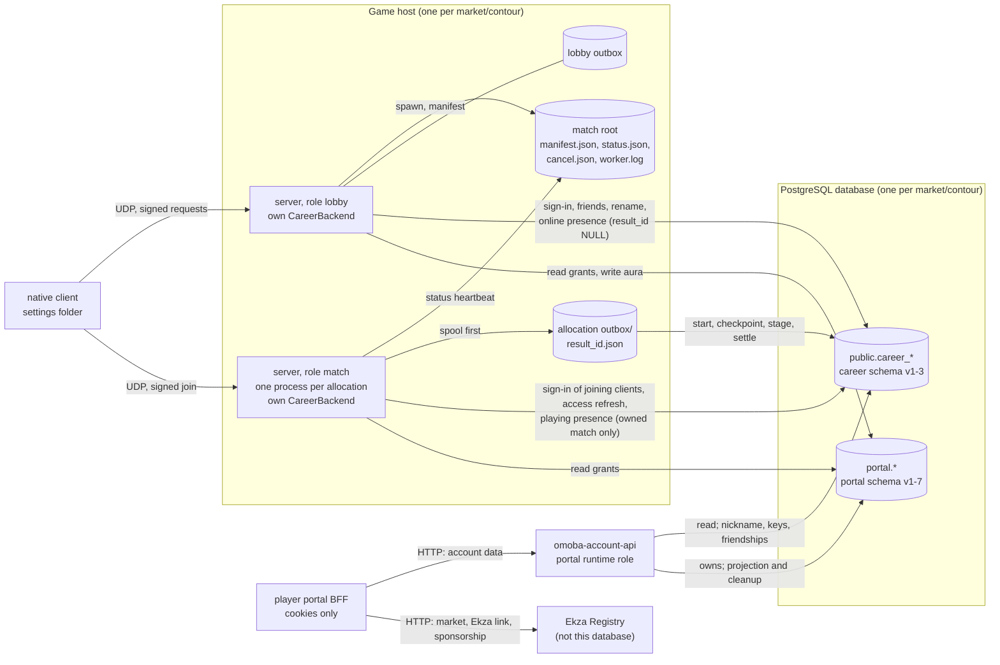
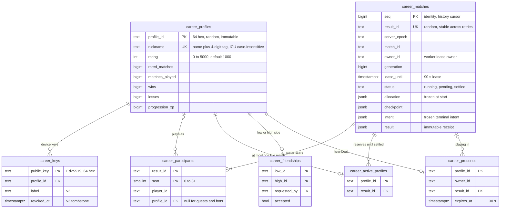
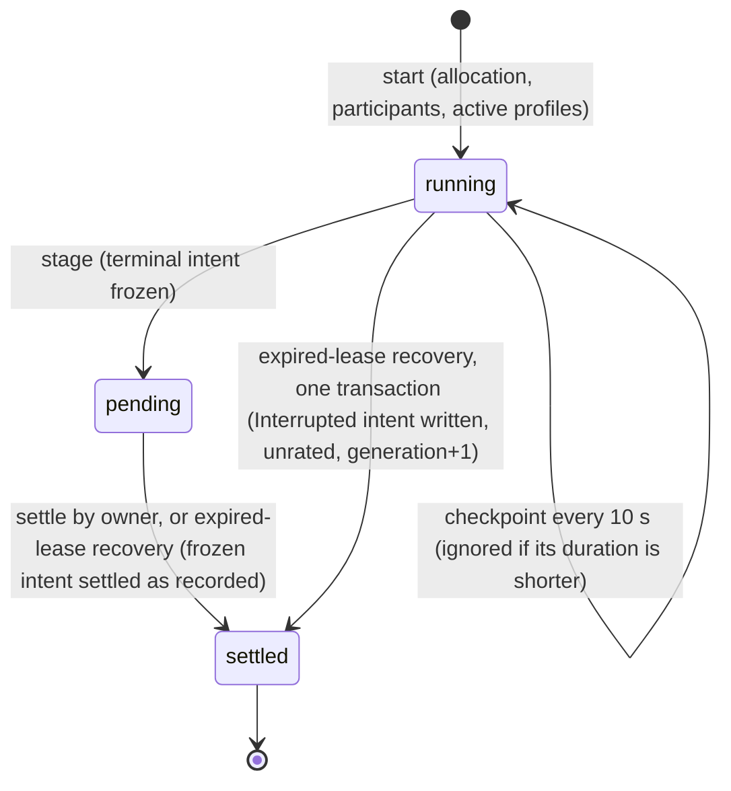

# Data and persistence

This page maps every place OMOBA keeps state that outlives a process:

- the shared PostgreSQL database (career core plus the portal schema)
- the game host's match root and settlement outboxes
- the native client's settings folder
- the player portal's browser state

For each store it says who owns the schema, who may write which table, how long data lives, and how to back it up and restore it. Field-level rules stay in the linked READMEs and migrations. This page is the map and the reasons behind it.

Snapshot: game dev 6d34f98, portal dev 604bc34, 2026-10-24. See [README](README.md).

## Stores at a glance

| Store | Technology | Schema owner | Writers | Durability | Detail |
| --- | --- | --- | --- | --- | --- |
| Career core (`public.career_*`) | PostgreSQL, versions 1–3 | `career-store` crate (migrations embedded with `include_str!`) | Every game server process (lobby and match workers) through `CareerStore`. The Account API may rename (`nickname`), add or revoke device keys, and change friendships. | Permanent. Match receipts are append-only. | [career-store README](../../career-store/migrations/postgres/README.md) |
| Portal (`portal.*`) | PostgreSQL, same database, versions 1–7 | `account-api` crate | Account API. The game writes one table (`supporter_preferences`). | Mixed. TTL cleanup, see [Retention](#retention-and-cleanup). | [account-api README](../../account-api/README.md) |
| Match root (`OMOBA_MATCH_ROOT`) | Files: JSON manifests and status | `server/src/match_allocation.rs`, `match_pool.rs` | Lobby (allocates) and match workers (report status) | Kept on disk. Finished allocations move to `archive/`. | [§ Match root](#match-root-allocation-manifests) |
| Career outbox (`OMOBA_CAREER_OUTBOX`, per worker `outbox/`) | Files: one JSON per `result_id` | `server/src/career_backend.rs` | The career worker thread of each server process | Until the database acknowledges the record. Exceptions are listed under [Retention](#retention-and-cleanup). | [§ Outbox](#settlement-and-the-durable-outbox) |
| Client settings folder | Files: JSON, one folder per market and contour | `client/src/platform.rs`, `persistence.rs`, `career_identity.rs`, `connection_profile.rs` | Native client | Player's device | [§ Client](#client-side-local-state) |
| Player portal browser state | HttpOnly cookies, a language cookie and `localStorage` | Portal repo (`src/lib/security.mjs`, `ekza-link.mjs`, `sponsor.mjs`, `locale.mjs`) | Next.js BFF and the browser | Cookie max-age, or until the browser clears it | [§ Portal browser state](#player-portal-browser-state) |

The portal (Next.js 16) has **no database of its own**: its `package.json` lists no database driver. Account data goes through the Account API (`src/lib/server-api.ts`). The market, Ekza library link and sponsorship routes call the Ekza Registry directly from the BFF and keep only cookies:

- `src/lib/market-server.mjs` (`registryRequest`, `readLibrary`)
- `src/lib/ekza-link.mjs` with `src/app/api/ekza/[...path]/route.ts`
- `src/lib/sponsor-server.mjs` with `src/app/api/sponsor/[...path]/route.ts`

So `/market` also works with `OMOBA_ACCOUNT_MODE=disabled` (portal `docs/market.md`). Ekza Studio and Ekza Registry data, including the Ekza library (`studio.grants`), lives in Ekza's own Supabase, not in this database. See the umbrella `ARCHITECTURE.md`.

## PostgreSQL layout

- **One database per market host, plus one for the dev contour.** Each one holds both schemas:
  - The production host (global market, contour prod) uses `omoba` ([ops/vps/README.md](../../ops/vps/README.md)).
  - The RU host uses `omoba_ru` ([ops/vps/ru/README.md](../../ops/vps/ru/README.md)).
  - The dev contour uses `omoba_dev` ([ops/vps/dev/README.md](../../ops/vps/dev/README.md)). Dev builds of every market connect to the dev lobby ([markets.md](../markets.md)), so they all use this database.

  Market builds never share accounts or device keys ([markets.md](../markets.md)): each market and contour has its own [settings folder](#client-side-local-state), and therefore its own device key, even where dev builds share `omoba_dev`.
- **Portal per market.**
  - **Global, contour prod.** There is no Account API: [markets.md](../markets.md) lists "none in production", and [ops/vps/README.md](../../ops/vps/README.md) keeps `omoba_portal` as a reserved NOLOGIN role, so `portal.*` there holds only what `migrate` created. The portal runs in guest mode on Vercel: project `omoba-app` at `https://app.omoba.io`, with `OMOBA_ACCOUNT_MODE=disabled`. Account routes answer `503 account_service_disabled`, while `/market` and the class workshop (browser drafts only) keep working (omoba-web `docs/vercel.md`).
  - **RU** is the first market with an account-enabled portal. `account.omoba.ru` and `omoba.ru` are planned and "answer once the RU servers are deployed" ([markets.md](../markets.md)).
  - **Dev contour.** It has its own Account API setup over `omoba_dev` ([ops/vps/dev/README.md](../../ops/vps/dev/README.md)). The dev portal `omoba-app-dev` was last recorded in guest mode. Whether it has since been switched to accounts is an open question in [system.md](system.md#open-questions).
- **Career tables live in `public`.** Portal migrations reference `public.career_profiles` and `public.career_matches` by schema name (`account-api/migrations/001_portal.sql`). The Account API pins `search_path TO public` on every connection (`App::connect` in `account-api/src/lib.rs`).
- **Two independent version tables.**
  - `career_schema_version` (expected `[1,2,3,4]`, `SCHEMA_VERSIONS` in `career-store/src/career_store.rs`). `CareerStore::from_pool` creates it (`CREATE TABLE IF NOT EXISTS`), not `001_career.sql`.
  - `portal.schema_version` (expected `[1..7]`, `PORTAL_SCHEMA` in `account-api/src/lib.rs`).

  A portal migration never touches `career_schema_version` (comment in `001_portal.sql`).
- **PostgreSQL versions.**
  - CI (`.github/workflows/ci.yml`, job `postgres`, image `postgres:16`) and the production host (PostgreSQL 16, [ops/vps/README.md](../../ops/vps/README.md)) use v16.
  - The RU runbook does not state a version.
  - Dev runs in the dev Supabase Postgres container, whose version is not stated.

  Career v2 needs ICU and the `"und-x-icu"` collation. No extensions are needed ([career-store README](../../career-store/migrations/postgres/README.md)).

### Migrations and versions

Migrations run only on the explicit admin path. Runtime processes check versions and never run DDL.

| Command | Applies | Lock | Pool | Source |
| --- | --- | --- | --- | --- |
| `cargo run -p server --bin migrate-career` (or the packaged `migrate-career`) | Career v1–4 | `pg_advisory_xact_lock(721946001)`, one transaction | `CareerStore::open_pool`: 4 connections unless `OMOBA_SERVER_ROLE=match`, same session settings as the game | `server/src/bin/migrate-career.rs` → `CareerStore::connect` → `from_pool` |
| `omoba-account-api migrate` | Career v1–4 first (`CareerStore::connect`), then portal v1–7 in a second transaction | `721946001` for career, `721946101` for portal | Career step as above. Portal step uses a separate 1-connection pool. | `account-api/src/lib.rs` `migrate` |

| Career version | File | Change |
| --- | --- | --- |
| 1 | `career-store/migrations/postgres/001_career.sql` | Profiles, keys, matches, participants, active profiles, friendships, presence. Adds two guard functions. `career_guard_match` (trigger `career_match_guard`) makes matches append-only, settled rows immutable, the allocation identity immutable and `intent` immutable once set. `career_guard_participant` (trigger `career_participant_guard`) allows inserts only while the match is running. The adapter inserts version 1. |
| 2 | `002_player_handles.sql` | `nickname#1234` handles. Locks `career_profiles` with ACCESS EXCLUSIVE, adds the function `career_assign_handle` (trigger `career_handle_assignment`) and the unique ICU index `career_player_handle`, and backfills existing rows. See [player-handles.md](../player-handles.md). |
| 3 | `003_device_keys.sql` | `career_keys.revoked_at` (tombstone) and `label`, plus the partial index `career_active_keys` |
| 4 | `004_admission_limits.sql` | Admission limits (LR-16). `career_admission_salt` (one random salt) and `career_profile_admissions` (one row per profile created for a new key: salted SHA-256 of the source IP, time; rows deleted after 48 h). The SECURITY DEFINER function `career_prune_unplayed_profiles(min_age_days, max_profiles)` deletes profiles whose only key is older than `min_age_days` (≥ 7), that never played and that no other row references; its `search_path` is pinned to the migration's schemas plus `pg_temp`, and PUBLIC cannot execute it. |

- **Version sets.** `from_pool` upgrades from `[]`, `[1]`, `[1,2]` or `[1,2,3]` and rejects any other version set. `runtime_from_pool` accepts only `[1,2,3,4]` (`career-store/src/career_store.rs`).
- **Statement timeout.** `from_pool` sets `statement_timeout='120s'` with `SET LOCAL` only when v2 is pending. Because it is transaction-local and v3 and v4 run in the same transaction, it also covers them in that run. Otherwise the pool's 10 s timeout applies.

| Portal version | File | Adds |
| --- | --- | --- |
| 1 | `account-api/migrations/001_portal.sql` | Schema `portal`. Browser pairing and sessions (`web_pairings`, `web_sessions`), `profile_settings`, `operation_receipts` (idempotency), `rate_limits`, `audit_events`, and the projection tables `projected_results` and `player_match_facts` |
| 2 | `002_devices.sql` | `authorization_version` on sessions and pairings. **Revokes every existing session and cancels every pairing once.** Adds `device_enrollments` and `recovery_codes`. |
| 3 | `003_supporter.sql` | `supporter_accounts` (Apple account token), `supporter_events`, `supporter_grants`, `supporter_preferences` (aura), `supporter_orders` (Solana), `supporter_nonces` |
| 4 | `004_class_builds.sql` | `class_builds`: private `omoba.class-build.v1` documents, 8 KiB cap |
| 5 | `005_ekza_library.sql` | `ekza_library_links`: one sealed Ekza library connection per profile |
| 6 | `006_supporter_recognition.sql` | `supporter_preferences.recognition_visible` (default false, private) |
| 7 | `007_social_sign_in.sql` | VK ID: `social_identities` (HMAC of the VK user id only), `social_tickets` (30 min), `social_links` |

**What happens on a version mismatch.**

- **Game server.** It keeps running against a wrong or missing career version. Its `omoba-career` thread calls `CareerStore::connect_runtime`, discards the error with `.ok()` and retries every 2 s (`server/src/career_backend.rs`). Meanwhile records stay in the outbox; a sign-in or account action waits up to 10 s for the store and then replies "Profile storage is unavailable. Retry shortly."
- **Account API.** It refuses to start unless career is exactly `[1,2,3,4]` (`runtime_from_pool`, called inside `App::connect`) and portal is exactly `[1..7]` (`validate_portal_schema`). The portal process therefore depends on the career version too.
- **Migrate commands.** They fail on unknown version sets.

**Rollout order** (inferred, not stated as a rule in the repo):

1. Run the owner migrations.
2. Re-apply `grants.sql` (see below).
3. Start the binaries that expect the new versions.

### Roles and grants

`account-api/ops/grants.sql` takes `-v portal_role=… -v game_role=…`. The roles must already exist. The file creates no passwords and no roles. The README shows `migrate` followed by `grants.sql` ([account-api README](../../account-api/README.md)). Re-apply `grants.sql` after each migration, because:

- `grants.sql` names each table explicitly, so a new table needs its line.
- `GRANT … ON ALL SEQUENCES` only affects sequences that exist when it runs.

This rule is inferred from `account-api/ops/grants.sql` and PostgreSQL semantics. The README does not state it.

| Role | Can do | Cannot do |
| --- | --- | --- |
| Migration owner (e.g. `omoba_owner`) | Owns `public` career objects and schema `portal`. Runs `migrate` and `grants.sql`. | Its login is disabled after migrating ([ops/vps/README.md](../../ops/vps/README.md), RU and dev runbooks) |
| Game runtime (`game_role`, e.g. `omoba_game`) | See [the list below](#game-runtime-grants). | UPDATE or DELETE on `career_keys` (revoked keys stay revoked), any other portal table, DDL. Triggers still block deleting or rewriting a match. |
| Portal runtime (`portal_role`, e.g. `omoba_portal`) | See [the list below](#portal-runtime-grants). | Creating profiles, changing XP, rating, outcomes or allocation identities, schema CREATE, `public` sequences |

#### Game runtime grants

- SELECT on `career_schema_version`.
- Full DML on `career_profiles`, `career_matches`, `career_participants`, `career_active_profiles`, `career_friendships` and `career_presence`.
- SELECT, plus `INSERT(public_key, profile_id)`, on `career_keys`.
- SELECT on `career_admission_salt`; SELECT, INSERT and DELETE on `career_profile_admissions` (the new-profile counter, LR-16).
- EXECUTE on `career_prune_unplayed_profiles(integer, integer)`: the only way the game role deletes a profile with its key (retention of never-played, unlinked profiles).
- USAGE on all sequences in `public`.
- SELECT on `portal.supporter_grants`.
- SELECT, INSERT and UPDATE on `portal.supporter_preferences`.

#### Portal runtime grants

- SELECT on all career tables, including `career_schema_version`.
- `UPDATE(nickname)` on `career_profiles`.
- `INSERT(public_key, profile_id, label)` and `UPDATE(revoked_at)` on `career_keys`.
- INSERT, UPDATE and DELETE on `career_friendships`.
- `portal.schema_version`: SELECT only.
- USAGE on all sequences in `portal`.
- Full DML on the other portal tables, with these exceptions:
  - `supporter_events`: SELECT and INSERT only.
  - `supporter_accounts`, `supporter_grants`, `supporter_preferences` and `supporter_orders`: no DELETE.

Runtime roles must not inherit owner or superuser membership. On databases older than PostgreSQL 15, revoke `CREATE` on `public` from `PUBLIC` (`grants.sql` footer).

### Connection budgets

| Process | Pool | Acquire timeout | Session settings | Source |
| --- | --- | --- | --- | --- |
| Match worker (`OMOBA_SERVER_ROLE=match`) | 1 | 5 s | `statement_timeout 10s`, `lock_timeout 5s`, `synchronous_commit on` | `CareerStore::open_pool`, `pool_connections` |
| Lobby or standalone server | 4 | 5 s | same | same |
| Account API | 8 | 3 s | `search_path public`, `timezone UTC`, `statement_timeout 8s`, `lock_timeout 3s` | `App::connect` |
| Migration commands (admin only) | `migrate-career`: `open_pool` (4, or 1 if the role is `match`). `omoba-account-api migrate`: the same for the career step, then 1 connection for the portal step. | 5 s for the career step | Career step: game settings. Portal step: defaults. | `career_store.rs`, `account-api/src/lib.rs` `migrate` |

Size `max_connections` as lobby 4 + (`OMOBA_MATCH_CAPACITY` × 1) + 8 per API replica + admin headroom. The shipped units set capacity 2 for production and RU and 1 for dev (`ops/vps/omoba-lobby.service`, `ops/vps/ru/omoba-lobby-ru.service`, `ops/vps/omoba-lobby-dev.service`). The pool's default capacity and allowed range are in [protocols.md §5](protocols.md#5-lobby--worker-allocation-handoff).

## Career core schema

Key invariants. Full rules are in the [career-store README](../../career-store/migrations/postgres/README.md).

- **Identity.** A public key maps to a separately generated random `profile_id`. `authenticate` serializes this per key with `pg_advisory_xact_lock(hashtextextended(key, 721946002))`. Signing in again never renames the profile. A revoked key fails sign-in and can never create a new profile.
- **New profiles (LR-16).** A game sign-in (`authenticate_from`) creates a profile for an unknown key only while its source IP created fewer than `OMOBA_LIMIT_NEW_PROFILES_PER_IP` profiles in the last 24 hours and everyone fewer than `OMOBA_LIMIT_NEW_PROFILES_TOTAL`. The check and the insert run under `pg_advisory_xact_lock(721946004)` in the sign-in transaction, counted in `career_profile_admissions`, which keeps a salted hash of the source, never the address.
- **Device keys.** At most 16 active keys per profile. `devices::complete` refuses with `device_limit` (`account-api/src/devices.rs`).
- **Match JSON.** `allocation`, `checkpoint`, `intent` and `result` hold `shared::career::MatchResult`, capped at 1 MiB (`MAX_JSON`). Match-time names and loadouts are frozen and never follow later renames.
- **Friendships.** One row per unordered pair (`low_id < high_id`). At most 64 friends plus pending requests per account. Both profile rows are locked in sorted order. Remove, reject and cancel DELETE the row (`apply_friend_action`).
- **Presence.**
  - Refreshed every 10 s by every server process for its own signed-in clients (`career_backend.rs`, up to 512 rows per statement). It expires after 30 s.
  - A row with a `result_id` (playing) is accepted only from the process that owns that live match: `touch_presences` checks `m.owner_id` against this process's owner token. The lobby therefore writes online presence (`result_id` NULL), and the owning worker writes playing presence.
  - Rows are never deleted. An expired row reads as Offline.

### Match lifecycle in `career_matches.status`

Settlement (`CareerStore::finish_inner`):

- Locks the match row first, then the affected profiles in sorted id order. It commits the profile counters and the immutable `result` together.
- A retry with identical content returns the stored receipt.
- Expired-lease recovery of a running match writes the `Interrupted` intent with `status='pending'` and settles it in the same transaction, so `pending` is never visible alone on that path.

Other rules:

- **Rating and XP.** Elo K=32. XP is 150/100 for a rated win/loss and 50/25 for public casual. Eligibility is checked by `validate_rated` and `validate_public_casual` (see also the README).
- **Checkpoints.** Cadence is `CHECKPOINT_INTERVAL` (10 s, `server/src/career_runtime.rs`). The store ignores only a strictly shorter duration, so an equal duration overwrites.
- **History.** Pages use `seq` descending with an exclusive cursor, 10 per page (`HISTORY_PAGE_SIZE`).

## Portal schema

All tables below live in schema `portal`. `career_profiles` and `career_matches` are the `public` career tables.

```mermaid
erDiagram
    career_profiles ||--o| profile_settings : "privacy, locale"
    career_profiles ||--o{ web_sessions : "browser sessions"
    web_sessions ||--o{ operation_receipts : "idempotency"
    career_profiles |o--o{ web_pairings : "approved for"
    career_profiles |o--o{ audit_events : "events"
    career_matches ||--o| projected_results : "projection marker"
    career_matches ||--o{ player_match_facts : "one row per human"
    career_profiles |o--o{ device_enrollments : "approved into"
    career_profiles ||--o{ recovery_codes : "keyed hashes"
    device_enrollments |o--o{ recovery_codes : "consumed by"
    career_profiles ||--o| supporter_accounts : "Apple token"
    career_profiles ||--o{ supporter_events : "provider events"
    career_profiles ||--o{ supporter_grants : "paid periods"
    career_profiles ||--o| supporter_preferences : "aura, recognition"
    career_profiles ||--o{ supporter_orders : "Solana orders"
    career_profiles ||--o{ class_builds : "max 50"
    career_profiles ||--o| ekza_library_links : "sealed link"
    career_profiles |o--o| social_identities : "one VK per profile"
    social_identities ||--o{ social_tickets : "30 min"
    social_identities ||--o{ social_links : "offered link"
    device_enrollments ||--o| social_links : "pending game link"
```

Tables with no foreign key are left out of the diagram:

- `schema_version`
- `rate_limits` (HMAC identity × 1-minute bucket)
- `supporter_nonces` (native replay protection)

| Area | Tables | Notes | Source |
| --- | --- | --- | --- |
| Browser sign-in | `web_pairings`, `web_sessions`, `operation_receipts`, `rate_limits`, `audit_events` | Codes and tokens are stored only as HMAC-SHA256 under `OMOBA_PORTAL_SECRET`. The one-time session hand-off is sealed with ChaCha20-Poly1305. Sessions last 7 days absolute and 1 day idle, with at most 20 active per account. | `auth.rs`, `crypto.rs`, account-api README |
| Privacy | `profile_settings` | All flags default off. A row is created lazily (`INSERT … ON CONFLICT DO NOTHING`). | `accounts.rs` |
| Analytics | `projected_results`, `player_match_facts` | Derived from settled `career_matches.result`. The raw JSON stays the source of truth. See [Projection](#projection). | `read.rs` `project` |
| Devices | `device_enrollments`, `recovery_codes` | See [Devices and recovery](#devices-and-recovery). | `devices.rs`, [supporter.md](../supporter.md) |
| Supporter | `supporter_*` | Grants come only from verified provider events. `supporter_events` is insert-only for the portal role. The first active grant creates `supporter_preferences` with aura `solar`. Without a stored row, the game's `supporter_status` also defaults the equipped aura to solar. Free markets (ru, cn) serve no Supporter routes, and their Account API refuses to start with billing configured (`billing_configured_without_supporter`). | `supporter.rs`, `supporter/solana.rs`, `lib.rs`, `career_store.rs` `supporter_status`, [supporter.md](../supporter.md) |
| Workshop | `class_builds` | Private preferences. Saving one never admits a class to a match. | `class_builds.rs` |
| Ekza library | `ekza_library_links` | The device code (while pending) or the access token (when connected) is sealed under the portal secret. The associated data is `ekza-library:{profile}:{registry origin}:{phase}`. The Ekza Registry origin is derived from `OMOBA_PORTAL_ORIGIN` (`EkzaConfig::for_portal`) or the local fixture origin. | `ekza_library.rs` |
| VK ID | `social_identities`, `social_tickets`, `social_links` | Identity = `HMAC(OMOBA_SOCIAL_SECRET, vk user id)`. No name, e-mail or token is stored. The display name lives only in a ticket or link and expires with it. | `social.rs`, `007_social_sign_in.sql` |

### Devices and recovery

The flows, their signatures and their rate limits are in [identity-and-accounts.md](identity-and-accounts.md#one-account-on-many-devices). This list covers what they do to stored data, all in `account-api/src/devices.rs`:

- **Enrollment.** The client signs `expires_at`. The API validates it against `shared::device_account::ENROLLMENT_SECONDS` (300 s, `shared/src/device_account.rs`). Completing an enrollment adds the key to `career_keys`.
- **Revocation.** Sets `revoked_at` and revokes every browser session of the profile. It also deletes approved enrollments that no recovery code refers to.
- **Last device.** Revoking the last active key is refused with `recovery_required_before_last_device`, unless an unused recovery code exists.
- **Recovery codes.** Each set has 8 single-use 256-bit codes, stored as keyed hashes. Rotating a set marks all unused old codes consumed. Rotation is rate-limited per profile ([rate-limit buckets](identity-and-accounts.md#revocation-expiry-and-limits)).
- **Recovery.** Approving a recovery also revokes every browser session of the profile.

## Who writes what

| Table | Game server (via `CareerStore`) | Account API |
| --- | --- | --- |
| `career_profiles` | INSERT on first sign-in. UPDATE on rename and on settlement counters. | `UPDATE(nickname)` only (`accounts.rs`) |
| `career_keys` | INSERT of the first key | INSERT of an enrolled key with its label (16-key cap). UPDATE `revoked_at`. |
| `career_matches`, `career_participants`, `career_active_profiles` | All writes: start, checkpoint, stage, settle, adopt, recover. Done by the owning worker, or by the recovering process. | Read: history, detail, projection |
| `career_friendships` | Friend actions (INSERT, UPDATE, DELETE) | Friend actions via `CareerStore::apply_friend_action`, in the same transaction as the idempotency receipt |
| `career_presence` | `touch_presences` from every process. Settlement clears `result_id`. | Read only |
| `portal.supporter_grants` | Read (`supporter_status`, at sign-in and on access refresh) | Write (provider events, Apple reconciliation) |
| `portal.supporter_preferences` | INSERT/UPDATE the aura, gated in SQL on an active grant (`equip_supporter_aura`) | Write (aura, recognition, default `solar` on first grant) |
| Other `portal.*` | None | Owner |

**Inside the game server.**

- Every server process (the lobby and each match worker) runs its own `CareerBackend`.
- Each process signs its clients in with the signed challenge (`Job::Login`), refreshes access every 10 s (`Job::RefreshAccess`: key still active, `supporter_status`) and sends presence every 10 s (`Job::Presence`).
- A match worker admits a joining client only if that client signed in on the worker and its profile and session are in the manifest (`allocated_team` in `match_allocation.rs`). The full admission rules are in [protocols.md §5](protocols.md#5-lobby--worker-allocation-handoff).
- The lobby refreshes online presence. The owning worker refreshes playing presence and owns the match rows.
- Every SQL call runs on the dedicated `omoba-career` worker thread, never on the simulation tick (`career_backend.rs`).
- Without `OMOBA_DATABASE_URL` the server runs guests only and refuses records. Public roles exit at startup without it ("Public roles require OMOBA_DATABASE_URL", `server/src/runtime/mod.rs`).

## Settlement and the durable outbox

Every server process with a database has a local spool directory: `OMOBA_CAREER_OUTBOX`, default `.omoba/career-outbox` relative to the working directory (`CareerBackend::new`).

- **Match workers.** The lobby gives each worker its own `<allocation>/outbox` (`worker_command` in `match_pool.rs`).
- **The lobby** uses the configured lobby outbox. Two layouts ship:
  - `launch-lobby.sh` (`write_lobby_launcher` in `scripts/package_native.py`) exports `OMOBA_CAREER_OUTBOX="$OMOBA_MATCH_ROOT/lobby-outbox"` (inside the match root) and `cd`s into `$OMOBA_MATCH_ROOT`.
  - The systemd units (`ops/vps/omoba-lobby.service`, `ops/vps/ru/omoba-lobby-ru.service`, `ops/vps/omoba-lobby-dev.service`) use a sibling directory: `<state>/matches` and `<state>/lobby-outbox` under `/var/lib/omoba`, `/var/lib/omoba-ru` or `/var/lib/omoba-dev`, with `WorkingDirectory=<state>`.
- **Defaults.** The code defaults (`.omoba/matches`, `.omoba/career-outbox`) are relative to the working directory. A deployment must set the paths or the working directory deliberately.

How the outbox works:

- **Format.** `<result_id>.json` holds a `PendingRecord { kind: Start | Checkpoint | Settle | Rejected, result: MatchResult, recovery_allocation, recovered_live }`. A `result_id` may contain only ASCII alphanumerics and `-`, up to 128 characters (`spool_path`).
- **Write-ahead.** Before *every* database attempt, `write_record`:
  1. writes the record to a temp file and fsyncs it,
  2. renames it into place,
  3. fsyncs the directory.

  The file is deleted only after the database call succeeds and the reply reaches the game thread.
- **Coalescing.** One pending record per result. A Settle wins over everything else, and an older checkpoint is dropped. The original Start metadata is kept as `recovery_allocation`, so `ensure_allocation` can re-create a missing allocation.
- **Rejection tombstones.** A Start refused for an active-assignment conflict or a changed queue rating is first rewritten as a durable `Rejected` record. An undeleted Start can then never allocate a cancelled roster after a restart. While the process runs, the tombstone file is deleted once the rejection reaches the game thread.
- **Restart (`recover_outbox`).**
  - Start and Checkpoint records become unrated `Interrupted` settles (`unrated_reason: "server_interrupted"`, `recovered_live`).
  - Rejected tombstones are only loaded as refused ids, at most 512 in memory. Their files stay on disk.
  - Unreadable files are kept on disk and logged for manual recovery.
- **Leases.**
  - Each process has a random owner token. Its heartbeat renews its own live leases every 10 s for 90 s.
  - Before any sweep, a worker adopts expired allocations for its own pending ids. It sweeps only when its outbox is empty.
  - The lobby never sweeps (`RecoveryScope::Disabled`).
  - A match worker sweeps only its own `server_epoch`, and a recovery child reads it from `status.json`.
  - Standalone servers use the global sweep (at most 32 rows per call).
- **Database unavailable.** If the store is not connected, the thread retries `connect_runtime` every 2 s and records stay in the outbox (see [Migrations and versions](#migrations-and-versions)).
- **Bounds.**
  - At most 32 pending result ids in the game thread and a 256-job channel (`MAX_JOBS`).
  - Outbox retries every 2 s.
  - Inside the store, `retry` makes up to 3 attempts (2 retries, 25/50 ms backoff), only on SQLSTATE `40001` and `40P01`.

Why this design:

- The simulation never waits on PostgreSQL.
- A crash or a database outage loses no terminal result.
- An immutable receipt can be replayed safely.

The outbox, in its write order, is part of the recovery contract (career-store README, "Ownership, recovery and pagination").

## Match root (allocation manifests)

`OMOBA_MATCH_ROOT` (default `.omoba/matches`) belongs to exactly one lobby, which holds an exclusive `flock` on `.coordinator.lock` (`lock_root`). Workers outlive a lobby restart, and the next lobby rediscovers their allocations from the root. The file shapes, the worker environment, the readiness, port, recovery and archive timers are defined once, in [protocols.md §5](protocols.md#5-lobby--worker-allocation-handoff); the lobby's startup bounds are in [system.md › Lobby scheduling bounds](system.md#lobby-scheduling-bounds). This section covers only layout, ownership and retention.

Layout (`server/src/match_pool.rs`, `match_allocation.rs`):

| Path | Content | Writer |
| --- | --- | --- |
| `.coordinator.lock` | Lock file: one lobby per root | Lobby |
| `<allocation_id>/` (mode 0700) | One directory per allocated match | Lobby |
| `<allocation_id>/manifest.json` | The allocation: endpoint, preference, roster and join deadline. Immutable. | Lobby (`allocate`) |
| `<allocation_id>/status.json` | Worker heartbeat: phase and `result_id` | Worker. The lobby writes `failed` when a worker cannot start or exits without a status. |
| `<allocation_id>/cancel.json` | Cancel marker, written only before the match starts running | Lobby, or the worker when an allocated member leaves before the start |
| `<allocation_id>/worker.log` | Worker stdout and stderr, appended on every launch | Worker process |
| `<allocation_id>/outbox/` | That worker's career outbox ([§ Outbox](#settlement-and-the-durable-outbox)) | Worker |
| `archive/<allocation_id>/` | Terminal allocations, moved whole by `archive()` | Lobby |
| `lobby-outbox/` | Only with the packaged `launch-lobby.sh`. The systemd units keep it beside the root. | Lobby |

All JSON is written with `atomic_json` (temp file, fsync, rename, directory fsync).

Retention:

- An allocation directory stays in the root while its match is live or recovering. After a terminal phase (`finished` or `failed`), the lobby moves the whole directory, `worker.log` and `outbox/` included, to `archive/` (`Pool::poll`, and `Pool::from_env` at startup).
- Nothing prunes `archive/`, and `worker.log` is never rotated (see [Open questions](#open-questions)).
- Never delete live allocation directories by hand: their `outbox/` may hold results the database has not acknowledged (see [What to back up](#what-to-back-up)).

## Retention and cleanup

The Account API runs `read::project(128)` and `App::cleanup` every 5 s, and `reconcile_apple` every 300 s (`account-api/src/main.rs`). Cleanup deletes in bounded batches of 256 or 1000 rows, except the sealed-pairing delivery clear (`UPDATE web_pairings SET delivery=NULL`), which has no batch limit. `App::cleanup` also runs `social::cleanup`.

| Data | Lifetime | Mechanism |
| --- | --- | --- |
| `career_matches`, `career_participants` | Permanent. The trigger forbids DELETE and settled rows are immutable. | `001_career.sql` triggers |
| `career_profiles`, `career_keys` | Permanent, except never-played, unlinked profiles: the lobby deletes them, with their only key, once that key is older than `OMOBA_PROFILE_RETENTION_DAYS` (default 30; hourly, 200 per run). Kept are profiles with a match, XP, a friend, another or a revoked key, a live presence, or any portal row (sign-in link, session, Supporter grant, settings). Revoked keys stay as tombstones. | `career_prune_unplayed_profiles` (schema 4), called by the lobby's career worker (LR-16) |
| `career_profile_admissions` | 48 hours (the new-profile limits count 24 hours) | `CareerStore::prune_unplayed_profiles` (LR-16) |
| `career_active_profiles` | Until settlement | `finish_inner` |
| `career_friendships` | Until removed, rejected or cancelled (row DELETEd) | `apply_friend_action` |
| `career_presence` | Row kept. Reads as offline 30 s after the last refresh. Deleted with a pruned profile. | `touch_presences` |
| `web_pairings` | Code 5 min. Sealed delivery cleared after 60 s (unbounded UPDATE). Row deleted 60 s after expiry. | `cleanup`, `auth.rs` |
| `web_sessions` | 7 days absolute, 1 day idle. Deleted 1 day after expiry once no receipt refers to the session. | `cleanup` |
| `operation_receipts` | 8 days | `cleanup` |
| `rate_limits` | 1-minute buckets, deleted 2 buckets later | `cleanup` |
| `audit_events` | 30 days | `cleanup` |
| `device_enrollments` | Expire after 300 s (`ENROLLMENT_SECONDS` in `shared/src/device_account.rs`, [supporter.md](../supporter.md)). Deleted 1 day after expiry unless a recovery code refers to them. Approved ones without a recovery-code reference are deleted on key revocation. | `cleanup`, `devices.rs` |
| `recovery_codes` | Marked consumed when used or replaced. Rows are never deleted. | `devices.rs` |
| `supporter_nonces` | Deleted 60 s after expiry | `cleanup` |
| `supporter_events`, `supporter_grants`, `supporter_orders`, `supporter_accounts`, `supporter_preferences` | Permanent (billing audit) | none |
| `social_tickets` | 30 min (`TICKET_SECONDS`). Also deleted when the identity is linked. | `social::cleanup`, `social.rs` |
| `social_identities` (unlinked) | Deleted after 30 days without sign-in, unless any `social_links` row refers to them | `social::cleanup` (`UNLINKED_RETENTION_SECONDS`) |
| `social_identities` (linked) | Until the owner unlinks VK ID (row deleted) | `social.rs` unlink |
| `social_links` | Cascade with their enrollment or identity | `ON DELETE CASCADE` |
| `class_builds`, `ekza_library_links` | Until the owner deletes or disconnects. An Ekza link is also removed on terminal failures. | `class_builds.rs`, `ekza_library.rs` |
| `projected_results`, `player_match_facts` | Permanent. Derived data, can be rebuilt from `career_matches`. | `read::project` |
| Outbox files: Start, Checkpoint, Settle | Until the database acknowledges and the reply reaches the game thread | `career_backend.rs` |
| Outbox files: Rejected | Deleted once the rejection reaches the game thread. A tombstone found at restart is only loaded as a refused id, and its file stays on disk. | `recover_outbox` |
| Outbox files: unreadable | Kept for manual recovery | `recover_outbox` |
| Match root allocation directories | Until the lobby archives them after a terminal phase (timers in [protocols.md §5](protocols.md#5-lobby--worker-allocation-handoff)) | `Pool::poll`, `Pool::from_env` |
| Match root `archive/`, with each `worker.log` | Never pruned by code. `worker.log` is opened for append on every launch and never rotated. | `match_pool.rs` |

### Projection

- **Election.** One writer is elected across replicas with `pg_try_advisory_xact_lock(721946103)`.
- **Selection.** It selects settled results that have no marker row, in `seq` order, so a result that settles late is never skipped. The batch size is clamped to 1–256.
- **Rows.** Bots and guests are skipped. A non-finite `damage_to_heroes` fails the whole batch.
- **Commit.** Facts and the marker (version 1, SHA-256 of the result JSON) commit together.
- **New versions.** A new projection version needs an explicit backfill. Never delete game data to rebuild it ([account-api README](../../account-api/README.md)).

### Apple reconciliation

`reconcile_apple` holds `pg_advisory_xact_lock(721946109)`. It reserves at most 16 subscriptions per pass and updates `last_reconciled_at` before any outbound call, so several API replicas do not spin on the same subscriptions (`account-api/src/supporter.rs`).

### Advisory lock keys

New lock users should pick unused numbers.

| Key | Holder | Purpose |
| --- | --- | --- |
| `721946001` | `CareerStore::from_pool` | Career migrations |
| `hashtextextended(public_key, 721946002)` | `authenticate`, Account API device enrollment | Serialize per device key |
| `hashtextextended(result_id, 721946003)` | `allocation_inner` | Serialize allocation retries before the row exists |
| `(721946105, hash & 1023)` (two-int form) | `career_assign_handle` function (trigger `career_handle_assignment`) | Handle assignment |
| `721946101` | Account API `migrate` | Portal migrations |
| `hashtextextended(session:key, 721946102)` | `accounts.rs`, `class_builds.rs` | Idempotent mutations |
| `721946103` (try) | `read::project` | Projector election |
| `hashtextextended(…, 721946104)` | `read.rs` analytics (per profile, try), `supporter.rs` (per provider subscription) | One analytics request per account; subscription claim |
| `hashtextextended(profile_id, 721946105)` (bigint form) | `ekza_library.rs` | Per-account Ekza link |
| `721946109` | `supporter.rs` reconciliation | One Apple reconciler |

## Secrets that are part of the data

Neither secret is in the dump, but stored rows are meaningless without them.

| Secret | What it keys | Effect of rotation |
| --- | --- | --- |
| `OMOBA_PORTAL_SECRET` (32 bytes hex) | HMACs of pairing codes and poll secrets, session tokens, device codes, recovery codes, social tickets and rate-limit identities. Seals the pairing delivery, the device-code delivery and the Ekza library secrets. | The README says rotation invalidates outstanding pairings and browser tokens. The code (`devices.rs`, `social.rs`, `ekza_library.rs`) shows that it also makes stored recovery codes, pending enrollments, social tickets and sealed Ekza links unusable. Sealed Ekza links also become unreadable when the Ekza Registry origin changes, because the origin is part of the associated data. That origin follows `OMOBA_PORTAL_ORIGIN`. |
| `OMOBA_SOCIAL_SECRET` (32 bytes hex) | `social_identities.subject_hash` | Never rotate. Every linked VK identity becomes unmatchable ([account-api README](../../account-api/README.md), [ops/vps/ru/README.md](../../ops/vps/ru/README.md)). |

Other runtime secrets and configuration key no stored rows, but belong in the same secret-backup set:

- `OMOBA_APPLE_VERIFIER_SECRET` (`BillingConfig::from_env` in `supporter.rs`)
- the `OMOBA_SOLANA_*` provider settings (`supporter/solana.rs`). Each `supporter_orders` row stores its own network, mint and recipient.
- the portal ingress key (`OMOBA_ACCOUNT_INGRESS_KEY`), shared by the portal server and the Account API ingress ([ops/vps/dev/README.md](../../ops/vps/dev/README.md)). Hosted dev only: the RU portal calls the Account API on loopback and has no key ([ops/vps/ru/README.md › Topology](../../ops/vps/ru/README.md#topology)).

## Client-side local state

**Folder name.** The settings folder name is built from parts (`config_directory_name` in `client/src/platform.rs`):

1. `omoba-bevy`
2. plus `-<market>` for RU and CN (`Market::storage_suffix`)
3. plus `-<contour>` for a dev-contour build (`OMOBA_DEFAULT_CONFIG_DIR_SUFFIX`, checked at compile time)

Examples: `omoba-bevy`, `omoba-bevy-dev`, `omoba-bevy-ru`, `omoba-bevy-ru-dev`. A market or contour build therefore never reads another's device key or caches.

**Location** (`preferences_directory`). A non-empty `OMOBA_CLIENT_CONFIG_DIR` always wins.

| Platform | Location |
| --- | --- |
| Windows | `%APPDATA%/<name>` |
| Android | app internal data path `/<name>` |
| iOS | `$HOME/Library/Application Support/<name>` |
| Linux, macOS | `$HOME/.config/<name>` |

| File (in the settings folder) | Content | Source |
| --- | --- | --- |
| `client_preferences.json` | Schema 8: graphics, lighting, audio, render, HUD, camera zoom, reduce motion, language, character, avatar and handheld choice, `client_session_id` (stable install id used for reconnect reclaim). `game_server_addr` is still written for older builds but never read. | `persistence.rs` |
| `career_identity.json` | `{version: 1, seed, public_key}`: the Ed25519 device key **and the account credential**. Created with an exclusive hard link. Rejected on Unix if any group or other permission bit is set (mask `0o077`). | `career_identity.rs` |
| `career_nickname.json` | Nickname to request on first sign-in | `career_identity.rs` |
| `device-enrollment/career_identity.json` | Candidate key during enrollment or recovery. Becomes active at the next launch. | `stage_enrolled_identity` |
| `saved-devices/<old_public>.json` | Hard-linked backup of a replaced key. Profiles are never merged. | same, [supporter.md](../supporter.md) |
| `profile_card.json` | Local presentation card. Server-owned facts stay in the profile. | `frontend/card.rs` |
| `connection_profile.json` | Dev-contour builds only: the chosen connection profile, applied at the next start | `connection_profile.rs` |
| `match-resume.json` | Resume hint, deleted when it names a different lobby | `net/recovery.rs` |
| `ekza-store/` | Only when the market has Ekza: `account/session.json` (Ekza account link), `store.json` and `avatars/` (avatar catalogue), `.ekza-cache/`, `map-props/` (sponsorship), weapon store data | `client/src/passport.rs`, `passport/src/store.rs` |
| `profiles/<dev\|local\|custom-…>/` | Dev-contour builds keep `ekza-store/` and `match-resume.json` per connection profile. Prod-contour builds keep them in the folder root. | [connection-profiles.md](../connection-profiles.md) |

Graphics, audio, language and the device key are shared across connection profiles. Dev tooling only: Combat Test presets go to `OMOBA_SANDBOX_PRESET_DIR` or `target/combat-presets` (`client/src/sandbox/presets.rs`).

### Player portal browser state

The BFF keeps account, VK ID, Ekza link and sponsorship state only in HttpOnly cookies, whose names, contents and lifetimes are listed once, in [protocols.md §7](protocols.md#7-portal-bff-omoba-web). The browser also keeps:

- the language preference in a script-set cookie (not HttpOnly, one year): `omoba_locale`, shared across `.omoba.io` on production hosts, or the host-only `omoba_locale_dev` in the dev contour (`src/lib/locale.mjs`, `src/components/locale-provider.tsx`)
- unsent workshop drafts in the `localStorage` keys `omoba.workshop.recovery.v1` and `omoba.workshop.saved.v1` (`src/components/workshop.tsx`)

## Backup, restore and rollback

### What to back up

- The full database (career and portal together), with `pg_dump -Fc`.
- The game host's state directory. It holds receipts the database has not acknowledged yet:
  - the match root, including `archive/`
  - the lobby outbox: inside the match root for `launch-lobby.sh`, beside it (`<state>/lobby-outbox`) for the systemd units
  - every `<allocation>/outbox`
- Configuration and the secrets listed in [Secrets that are part of the data](#secrets-that-are-part-of-the-data), stored securely and separately from the dump.

Sources: [account-api README](../../account-api/README.md) "Backup, restore, rollback", [ops/vps/README.md](../../ops/vps/README.md).

### When

Back up before every schema change. Never delete live match directories or drop the database (production and RU runbooks).

### RU host

`ops/vps/ru/ru_backup.py` (LR-03) automates the list above on the RU host:

- **Sets.** Every night and before every migration (`ru_host.py ship`), one set holds `pg_dump -Fc` of `omoba_ru`, the match root with `archive/` and every allocation `outbox/`, the lobby outbox and a manifest (rows and an order-independent digest per table, both version tables, checksums). It is encrypted to the backup key with GnuPG and signed with it, then copied off-host to storage in Russia, which keeps 14 daily and 8 weekly sets.
- **Restore drill.** Every month the newest off-host set is restored into the scratch database `omoba_ru_restore_drill`. Its tables, row counts, row digests and schema versions are compared with the manifest, and the scratch database is dropped. A set the backup key did not sign is never restored.
- **Secrets.** The secrets above (the env files with `OMOBA_PORTAL_SECRET` and `OMOBA_SOCIAL_SECRET`) and the backup keys are escrowed offline, encrypted to the escrow holder's key.
- **Alerts.** A failed backup or drill alerts at once; an hourly check alerts when no backup has succeeded for 26 h.

Runbook: [ops/vps/ru/README.md](../../ops/vps/ru/README.md#backups-escrow-and-restore-drill).

### Restore

1. Restore into a **new isolated database**.
2. Apply `grants.sql` for the existing runtime roles.
3. Verify both version tables, row counts and checksums of the immutable receipts.
4. Start the services against the restored database.

Never test a restore over the running production database.

**Point-in-time effect.** Outbox files are deleted once the database acknowledges them (`career_backend.rs`). Matches settled after the dump therefore cannot be replayed from the outbox after a restore.

### Rollback

- Rollback needs no destructive SQL.
- There is no automatic downgrade. Pre-v3 binaries fail the schema check. The game server keeps retrying, and the Account API refuses to start.
- Keep the portal schema and the immutable game data. Never lower migration versions.
- To retire portal access, rotate or revoke its sessions deliberately.

### Dev contour

`omoba_dev` lives in the dev Supabase stack's Docker volume. Recreating that volume loses it, and the next `lobby_dev.py ship --apply` recreates an empty schema ([ops/vps/dev/README.md](../../ops/vps/dev/README.md)).

### Players

The device key (`career_identity.json`) is the account. Losing it without a recovery code or another enrolled device loses access to the profile. Recovery codes are shown once and stored only as keyed hashes ([supporter.md](../supporter.md)).

## Testing the data layer

Data-layer tests run only against real PostgreSQL. No SQLite or mock adapter substitutes for them ([career-store README](../../career-store/migrations/postgres/README.md)). `make test-postgres` runs `scripts/postgres_tests.py`, which is also the CI `postgres` job. It migrates a disposable database (`OMOBA_TEST_DATABASE_URL`, never production) with `omoba-account-api migrate`, creates restricted test roles, applies `grants.sql` to them, and runs the ignored database tests of `omoba-career-store`, `omoba-account-api` and `server` serially. Every run therefore also exercises the migrations and the runtime grants described on this page.

- Environment variables, test isolation and when to run it: [methodology.md](methodology.md#testing-layers).
- The CI job: [build-and-release.md](build-and-release.md#ci-workflows).
- For the isolated local workshop demo cluster, see `account-api/ops/workshop_fixture.py`.

## Open questions

Drift in older documents is listed once, in [README](README.md#known-drift-in-older-docs).

- **Game server on a career version mismatch.** The career-store README says game startup "rejects missing/unknown versions". The game server does not exit: it keeps running and retries `connect_runtime` every 2 s (`server/src/career_backend.rs`, see [Migrations and versions](#migrations-and-versions)). Only the Account API and the migrate commands refuse. Should the server fail at startup, or should the README describe the retry? LR-17 in the [launch-readiness plan](../plans/launch-readiness.md) asks at least for a logged failure reason and a `db_connected` status.
- **No pruning of `<match_root>/archive/`.** Is there an operator procedure or retention period? The lobby's startup bounds ([system.md › Lobby scheduling bounds](system.md#lobby-scheduling-bounds)) count only entries directly in the root, where `archive/` is a single entry, so the archive grows without bound. `worker.log` is never capped either. LR-17 in the [launch-readiness plan](../plans/launch-readiness.md) asks for retention by age or size.
- **Rejected tombstones found at restart are never deleted.** Is manual cleanup of these outbox files expected, or should a later run remove them?
- **No account or profile erasure path.** `career_matches` is append-only by trigger. Nothing deletes `career_profiles`, `career_keys`, supporter rows or `recovery_codes`. How should a data-erasure request be handled? LR-42 in the [launch-readiness plan](../plans/launch-readiness.md) proposes a deletion flow.
- **Production backups.** For the global production host the repository ships no backup timer, WAL archiving or off-host copy. Its runbook only says to back up (with `pg_dump -Fc`) before schema changes, and the career-store README leaves backup schedule, replication and disaster recovery as "deployment work". Whether that host has backups outside the repository is not documented. The RU host has nightly, pre-migration and off-host backups with a monthly restore drill ([RU host](#ru-host), LR-03), but no WAL archiving: up to a day of data can be lost. The dev runbook only mentions a Registry backup that contains `omoba_dev.dump`.
- **Dedicated schema for career.** The career-store README says to "use a dedicated database/schema". But the portal foreign keys and the Account API's `search_path` require career tables in `public`, so in practice only a dedicated *database* seems to work. Please confirm.
- **Three Ekza credential stores.** The market page and sponsorship placements keep Ekza Registry tokens in portal cookies ([protocols.md §7](protocols.md#7-portal-bff-omoba-web)). The class workshop keeps a sealed link in `portal.ekza_library_links`. Is this split intended long-term?
- **Concurrent cleanup.** `App::cleanup` runs on every Account API replica without election, unlike the projection and Apple reconciliation. It looks idempotent and mostly bounded, but the delivery clear is unbounded and contention with several replicas has not been measured.
