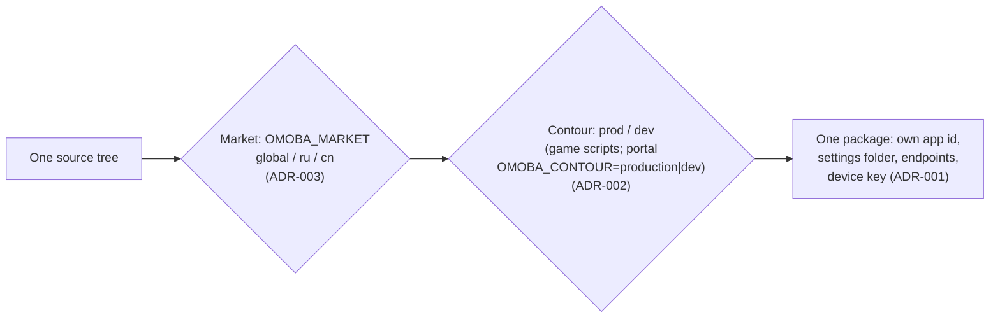
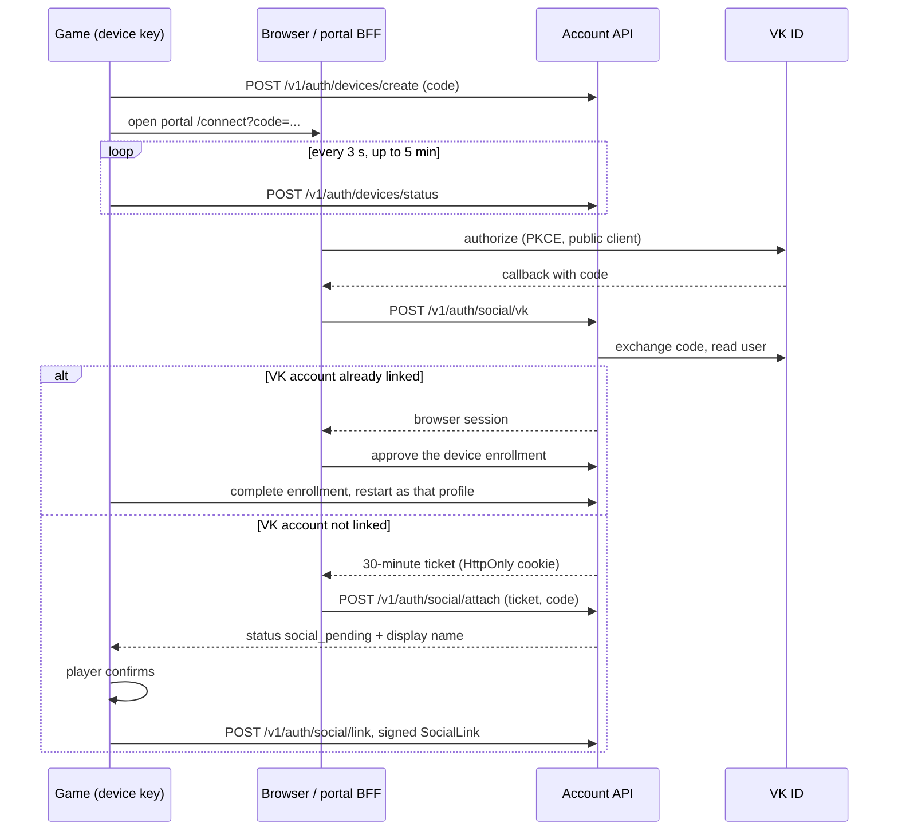

# Architecture decisions (ADR log)

This page is the single decision log for OMOBA: the game workspace in this repository and the player portal that runs beside it (`omoba-web`, repository name; its package is `omoba-player-portal`). Each record says what was decided, why, what it costs and where the details live. Most records were reconstructed from code, progress notes and plans after the fact. They are marked **Recorded retrospectively** and carry the date the decision landed. Detailed behaviour stays in the linked documents; this page is the map and the reasoning. To add a decision, append the next number, using the fields described in [methodology.md](methodology.md#recording-an-architecture-decision). Do not renumber, and do not delete a superseded record: change its status and link the record that replaces it.

Snapshot: game dev 6d34f98, portal dev 604bc34, 2026-10-24. See [README](README.md).

Status values: **Accepted** (in force and implemented), **Accepted, partly implemented**, **Accepted, amended** (in force with a later change recorded in the record), **Superseded by ADR-NNN**, **Proposed** (written down, not decided or built).

## Index

| ADR | Decision | Date | Status |
| --- | --- | --- | --- |
| [001](#adr-001-the-installation-device-key-is-the-account) | The installation device key is the account | 2026-09-14 to 09-16 | Accepted |
| [002](#adr-002-separate-production-and-omoba-dev-apps-contour-pinned-endpoints-no-server-picker-in-production) | Separate production and OMOBA Dev apps; no server picker in production | 2026-10-13 | Accepted |
| [003](#adr-003-markets-are-a-compile-time-build-axis) | Markets are a compile-time build axis | 2026-10-23 | Accepted |
| [004](#adr-004-sign-in-with-vk-id-goes-through-the-account-api-and-reaches-the-device-key-account) | VK ID sign-in through the Account API | 2026-10-23 to 10-24 | Accepted, partly implemented |
| [005](#adr-005-free-markets-gate-whole-plugins-and-close-endpoints-the-ekza-sdk-stays-a-dependency) | Free markets gate plugins and close endpoints; the Ekza SDK stays a dependency | 2026-10-23 to 10-24 | Accepted |
| [006](#adr-006-one-wire-protocol-in-shared-pinned-by-golden-tests) | One wire protocol in `shared`, pinned by golden tests | 2026-09-24 | Accepted |
| [007](#adr-007-the-server-is-authoritative-runs-one-paced-tick-and-has-no-bevy) | Authoritative server, one paced tick, no Bevy | 2026-05-28 to 09-25 | Accepted |
| [008](#adr-008-ekza-is-an-optional-web2-first-layer-on-top-of-the-game) | Ekza is an optional web2-first layer | 2026-09-19 | Accepted |
| [009](#adr-009-shared-is-engine-free-io-free-and-sdk-free) | `shared` has no engine, no I/O and no SDK | 2026-09-24 to 09-25 | Accepted, with one run-time exception |
| [010](#adr-010-authoritative-combat-lives-in-agpl-common-shared-by-the-server-and-offline-practice) | Combat engine in AGPL `common`, shared with offline practice | 2026-09-29 | Accepted |
| [011](#adr-011-server-io-behind-ports-match-policy-in-one-matchrules-value) | Server I/O behind ports; match policy in one `MatchRules` | 2026-09-24 | Accepted |
| [012](#adr-012-hero-item-and-skill-catalogs-are-embedded-validated-json) | Hero, item and skill catalogs are embedded, validated JSON | 2026-09-24 / 09-29 | Accepted |
| [013](#adr-013-a-compatibility-preflight-before-every-session-deploy-the-server-first) | Compatibility preflight before every session; deploy the server first (amended by LR-14: clients ship first, forced update) | 2026-10-05 | Accepted |
| [014](#adr-014-trusted-career-persistence-only-the-game-server-settles-the-runtime-runs-no-ddl) | Only the game server settles results; runtime runs no DDL | 2026-09-14 to 09-15 | Accepted |
| [015](#adr-015-public-service-one-lobby-and-one-process-per-match-rating-only-for-bot-free-pvp) | One lobby plus per-match worker processes; rating only for PvP | 2026-09-22 | Accepted |
| [016](#adr-016-the-player-portal-is-a-separate-bff-over-the-account-api-and-the-ekza-registry) | The player portal is a separate BFF over the Account API and the Ekza Registry | 2026-09-15 | Accepted |
| [017](#adr-017-hero-supporter-is-cosmetic-server-authorized-and-fail-closed) | Hero Supporter is cosmetic, server-authorized and fail-closed | 2026-09-16 | Accepted, provider rollout pending |
| [018](#adr-018-split-licensing-agpl-for-the-authority-mpl-for-client-and-shared-code) | AGPL for the authority, MPL for client and shared code | 2026-09-12 | Accepted |
| [019](#adr-019-localization-is-compile-time-dictionaries-wire-and-catalogs-stay-english) | Localization uses compile-time dictionaries | 2026-09-27 | Accepted |
| [020](#adr-020-skins-supply-geometry-the-engine-supplies-motion) | Skins supply geometry; the engine supplies motion | 2026-09-22 | Accepted |
| [021](#adr-021-bot-difficulty-is-behavioural-rated-play-stays-bot-free) | Bot difficulty is behavioural; rated play stays bot-free | 2026-10-13 to 10-14 | Accepted, partly implemented |
| [022](#adr-022-the-creator-asset-loop-comes-before-the-class-workshop) | Creator asset loop before class workshop | 2026-10-05; amended 2026-10-10 | Accepted, amended |
| [023](#adr-023-delivery-process-green-gate-dated-progress-notes-english-focused-ui-checks) | Delivery process: green gate, progress notes, focused UI checks | 2026-09-25 / 09-29 | Accepted |

Build axes referred to below:

---

## ADR-001: The installation device key is the account

- **Date:** 2026-09-14 (device key), 2026-09-15 (web pairing), 2026-09-16 (enrollment of more devices and recovery). Recorded retrospectively.
- **Status:** Accepted.

**Context.** Careers have to persist without a wallet, an e-mail address or an Ekza account. One player must reach the same profile from a phone and a PC. The website must never hold a game secret.

**Decision.**
- Each installation creates and keeps its own Ed25519 signing key, the device key (`career_identity.json` in the settings folder, `client/src/career_identity.rs`). PostgreSQL maps each public key to a separately generated, immutable 64-character random `profile_id` (`career-store/migrations/postgres/README.md`, "Accounts, profiles and friends"; enforced by `CHECK (profile_id ~ '^[0-9a-f]{64}$')` in `career-store/migrations/postgres/001_career.sql`).
- A new native device does not import a key. It creates an enrollment with an eight-character code that expires in five minutes. An authorized browser session approves the enrollment after comparing key fingerprints. The new device then confirms and restarts. Profiles are never merged, and the device keeps the previous local key in a private backup (`docs/supporter.md`, "One account on phone and PC").
- The website pairs by code. The game signs its approval of the displayed origin and scopes, and the private key never enters the browser (`docs/progress/2026-09-15-player-portal.md`).
- Signatures are domain-separated: one versioned domain string per purpose (for example `omoba.career.auth.v1`), defined in `shared` beside the type it signs, so a message signed for one purpose never verifies for another. The domains, their signed fields and their replay checks are listed in [identity-and-accounts.md](identity-and-accounts.md#signature-domains).
- Recovery uses eight single-use 256-bit codes. The database stores only keyed hashes of them (`docs/supporter.md`).

**Consequences.**
- No account is needed to play (`docs/public-mvp.md`). Nicknames (`Nickname#1234`), wallet addresses and VK accounts are addresses or sign-in routes. None of them is a credential (`docs/player-handles.md`, `docs/supporter.md`).
- Revocation keeps a tombstone, so a revoked key is never reassigned. The last native key can be revoked only with an unused recovery code. Online keys are rechecked every 10 s and fail closed after 30 s without a successful check; the game never falls back silently to a guest account.
- The device key is shared by every connection profile inside one settings folder. Only the Ekza link, the store caches and the match-resume hint are per profile (`docs/connection-profiles.md`, "Per-profile state"; ADR-002).
- Each market and contour combination has its own settings folder (`omoba-bevy`, `omoba-bevy-dev`, `omoba-bevy-ru`, `omoba-bevy-ru-dev`; `config_directory_name` in `client/src/platform.rs`, `shared::market::Market::storage_suffix`). Each therefore has its own device key and account service (ADR-003).
- A player who loses every device and has no recovery code loses the account.

**Links:** [identity-and-accounts.md](identity-and-accounts.md), [../supporter.md](../supporter.md), [../player-handles.md](../player-handles.md), [../progress/2026-09-16-supporter.md](../progress/2026-09-16-supporter.md), [../../account-api/README.md](../../account-api/README.md), [../../career-store/migrations/postgres/README.md](../../career-store/migrations/postgres/README.md).

## ADR-002: Separate production and OMOBA Dev apps, contour-pinned endpoints, no server picker in production

- **Date:** 2026-10-13 (`feat(client): connection profiles; production builds have no server selection`). Recorded retrospectively.
- **Status:** Accepted. Supersedes the editable server address and Beta/Localhost presets added in 0.34.0 (`docs/progress/2026-10-02-vps-beta.md`).

**Context.** Testers must use dev servers without the risk of production players or data reaching them. Production players should not be able to point the game at an arbitrary server.

**Decision.**
- There are two contours, `prod` and `dev` (`CONTOURS = ("prod", "dev")` in `scripts/contours.py`; the `contour` input of `.github/workflows/release.yml` offers `[prod, dev]`). They produce two apps that install side by side, production and **OMOBA Dev**. The apps differ in bundle or package id, icon, settings folder (`omoba-bevy` vs `omoba-bevy-dev`) and markings. The identities live in `scripts/contours.py` and are shared by `scripts/release.py`, `mobile/android/build.py` and the Xcode build phase.
- A production build has exactly one connection profile (`client/src/connection_profile.rs`) and no server or connection UI on any platform. Desktop developers and self-hosters can override endpoints with environment variables. Phones read none.
- The dev app offers the profiles Dev (default), Local and Custom, and never offers production. A custom lobby or Ekza Registry address that names production is refused by `endpoint_allowed_for` (`client/src/session_config.rs`), the same rule that guards `GAME_SERVER_ADDR` and match allocations.
- A profile switch applies at the next start, because the Ekza stores, the account link and the `ekza://` source open once per process. Each profile keeps its own Ekza link, store caches and match-resume hint under `profiles/<key>/`. The device key, graphics, audio, language and profile card stay shared in the settings folder. Production keeps everything in the settings folder itself (`docs/connection-profiles.md`).
- The portal has the same axis under other names: `OMOBA_CONTOUR` is `production` (the default) or `dev`, and a cross-contour origin fails closed (`omoba-web` `src/lib/contour.mjs`, `docs/vercel.md#contours`).

**Consequences.**
- Production ignores a `game_server_addr` saved by an older build and deletes a match-resume hint saved for another lobby.
- The production lobby address is compiled in, so moving the lobby needs a new client release. The game-directory concept is meant to remove this (see "Proposals not yet decided").
- CI checks the client a second time with the dev contour's compiled values, and dev releases use `v<version>-dev.N` tags ([build-and-release.md](build-and-release.md#ci-workflows); the dev release path is in [methodology.md](methodology.md#branching-and-merging)).

**Links:** [../connection-profiles.md](../connection-profiles.md), [../../client/src/connection_profile.rs](../../client/src/connection_profile.rs), [../../scripts/contours.py](../../scripts/contours.py).

## ADR-003: Markets are a compile-time build axis

- **Date:** 2026-10-23 (`428ccac`, `feat(market): add build-time markets …`); reached `dev` through PR #107 on 2026-10-24. Recorded retrospectively.
- **Status:** Accepted. `global` and `ru` can be packaged. `cn` is blocked until its servers and sign-in providers exist. Amended by ADR-025: clients will bind a runtime region in one app per platform; server processes keep the compile-time market.

**Context.** The Russian and Chinese builds need a free game with no Ekza ecosystem and no payments, their own servers, and in Russia a local sign-in provider and data residency. The global build has to keep working unchanged. A run-time switch could let a regional build reach payments or Ekza hosts.

**Decision.**
- `shared/src/market.rs` defines `Market { Global, Ru, Cn }`. Each market is a preset of `Features { ekza, supporter, vk_sign_in }`.
- `MARKET` and `FEATURES` are `const` values read at compile time from `OMOBA_MARKET` and `OMOBA_FEATURE_EKZA|SUPPORTER|VK_SIGN_IN=on|off`. An unknown value is a `const` panic, so a typo fails the build.
- Each market builds once, with its own servers, settings folder (`omoba-bevy-ru`), package names (`Omoba-<v>-ru-*`), Android identity (`space.ekza.omoba.ru`), first-launch locale and platform list.
- The RU market ships macOS, Windows, Linux and Android. It does not ship iOS, which needs its own App Store Connect record. Its planned servers are `lobby.omoba.ru:4000`, `https://account.omoba.ru` and `https://omoba.ru` (`scripts/markets.py`; `docs/markets.md`).
- The market never goes into serde (`fix(market): keep the market out of serde …`).
- `scripts/markets.py` mirrors the presets and adds the release data (servers, zones, platforms, `blocked`). `scripts/test_release.py` keeps the two files in step. `scripts/release.py` sets `OMOBA_MARKET` and the feature variables for each build from these presets (`markets.market_env`).
- The market is independent of the contour: `--market ru --contour dev` is the dev tester app with RU features.
- The portal reads the same variables with the same semantics. Its presets live in `omoba-web` `src/lib/market-profile.mjs`, and it checks the market at three points: `next.config.ts` (`assertMarket`) fails the build, `src/instrumentation.ts` refuses to serve on a mismatch with the built market (every request answers 500), and the root layout (`src/app/layout.tsx`) re-validates the market value on each request and renders no page on a bad value (`omoba-web` `docs/markets.md`).

**Consequences.**
- A wrong market cannot be fixed by configuration. It needs a rebuild. `release.py` refuses another market's servers, the global public lobby in a market build, and `--registry/--passport` without `ekza`.
- A new market follows a fixed recipe: add it to both files, add the locale folder and the portal presets, and lift `blocked` only after `release.py preflight` passes.
- No CI job builds or tests the free markets (ru, cn); see Open question 2.

**Links:** [../markets.md](../markets.md), [../../shared/src/market.rs](../../shared/src/market.rs), [../../scripts/markets.py](../../scripts/markets.py), [../progress/2026-10-24-market-profiles.md](../progress/2026-10-24-market-profiles.md), `omoba-web` `docs/markets.md`.

## ADR-004: Sign in with VK ID goes through the Account API and reaches the device-key account

- **Date:** 2026-10-23 (Account API, `428ccac`) to 2026-10-24 (in-game flow `6bd67dd` and its signature test `7198913`; merged to `dev` in PR #107). Recorded retrospectively.
- **Status:** Accepted, partly implemented. The code and tests (with a loopback VK stand-in) are done. The real VK ID app, RU hosting and DNS are owner steps that have not been done yet. The RU portal reaches the Account API on loopback ([ops/vps/ru/README.md › Topology](../../ops/vps/ru/README.md#topology)). Amended by ADR-025: equal first-party sign-in options next to the website, in-app unlink, and Sign in with Apple for the international region only.

**Context.** The RU market needs a familiar sign-in for the website and for new devices. ADR-001 already defines the account. Personal data of Russian players must be stored in Russia.

**Decision.**
- VK, OK and Mail.ru are one VK ID app, used as a public PKCE client with no secret. The portal never exchanges the authorization code. It posts the callback to the Account API (`POST /v1/auth/social/vk`), which exchanges and verifies the code itself (`account-api/src/social.rs`).
- The only lasting record of a VK user is an HMAC of its user id, keyed with `OMOBA_SOCIAL_SECRET`. No token, e-mail or avatar is kept. A short display name exists only in expiring tickets and links (`account-api/migrations/007_social_sign_in.sql`).
- **A website sign-in never creates or moves a game profile.** An unknown VK account gets a browser ticket that lasts 30 minutes and an instruction to finish in the game.
- Only the game links. Profile → "Sign in with VK ID" creates a device enrollment, opens `<portal>/connect?code=…` and polls the request every three seconds for five minutes (`SOCIAL_POLL` in `client/src/career_devices.rs`).
  - **Unlinked VK account:** after VK sign-in the BFF offers the ticket to the pending enrollment (`POST /v1/auth/social/attach`), and the enrollment status reads `social_pending` with a short display name. The game asks the player to confirm, then signs `omoba.social.link.v1` over `shared::device_account::SocialLink` with its active device key (`CareerIdentity::sign_social_link`, `POST /v1/auth/social/link`).
  - **Already-linked VK account:** the browser is signed in as that account and approves the device enrollment instead. The device switches after a restart without merging profiles.
- One VK account belongs to one profile (a unique index). Codes are single-use and expire in five minutes. Unlinking needs a fresh sign-in (`DELETE /v1/me/social/vk`). Expired tickets and unlinked identities left idle for 30 days are cleaned up (`account-api/README.md`, "Sign in with VK ID").
- `vk`, `ticket` and `attach` are BFF routes, called by the portal on loopback on RU and refused by the public ingress. Only `social/link` is on the public native ingress (ADR-016; [protocols.md](protocols.md#routes-by-exposure)).

**Consequences.**
- `OMOBA_SOCIAL_SECRET` keys every stored identity and is documented as never rotated.
- The feature exists only where `vk_sign_in` is on. The Account API refuses to start when VK settings are present in a build without it ("VK ID is configured, but this build has no vk_sign_in feature", `account-api/src/social.rs`). With neither `OMOBA_VKID_CLIENT_ID` nor `OMOBA_SOCIAL_SECRET` set, the routes answer 404.
- The portal hides its VK buttons and `/api/auth/vk/*` answers 404 when `OMOBA_VKID_CLIENT_ID` is unset (`omoba-web` `docs/markets.md`).

**Links:** [../markets.md](../markets.md) ("Sign in with VK ID", "RU release runbook"), [../../account-api/README.md](../../account-api/README.md) ("Sign in with VK ID"), [../../account-api/docs/openapi.json](../../account-api/docs/openapi.json), [identity-and-accounts.md](identity-and-accounts.md#sign-in-with-vk-id-ru-market), `account-api/tests/social_postgres.rs`, `omoba-web` `docs/markets.md`.

## ADR-005: Free markets gate whole plugins and close endpoints; the Ekza SDK stays a dependency

- **Date:** 2026-10-23 (merged into `feat/market-profiles` and into `dev` through PR #107 on 2026-10-24). Recorded retrospectively.
- **Status:** Accepted. Amended by ADR-025: the unified client registers the union of plugins and gates region-specific systems with run conditions; Ekza clients are never constructed in the RU region.

**Context.** A build for a free market (ru, cn) must contact no Ekza host, show no Ekza, Studio, wallet or market UI and sell nothing. It must keep the shipped heroes, avatars, weapons and gameplay. Scattering checks through the code would be hard to audit.

**Decision.** Each feature is checked at a few choke points, and each check is a pure function tested for both markets:
- Client plugin groups take `shared::market::FEATURES` and disable whole plugins: `SponsorshipPlugin` (`ekza`), `SupporterPlugin` and `SupporterStoreKitPlugin` (`supporter`; since LR-67 the StoreKit bridge also needs Apple among the market's payment providers, so the RU client has the panel without it) (`client/src/plugins.rs`). `QaPlugins` disables the two Supporter QA harnesses, `SupporterQaPlugin` and `SupporterWorldQaPlugin`, when `supporter` is off (`client/src/qa/mod.rs`).
- `initialize_store` in the client's own `passport` module (`client/src/passport.rs`, not the `omoba-passport` crate) returns `None` without `ekza`, so there is no store, account link, weapon library, placements or `ekza://` source.
- `connection_profile::for_market` swaps in closed loopback Ekza Registry and passport endpoints (`CLOSED_REGISTRY`, `http://127.0.0.1:9`; `CLOSED_PASSPORT`) and blanks the market and Studio URLs. While `install` pins the profile, `endpoint_override` ignores `OMOBA_REGISTRY_URL` and `OMOBA_PASSPORT_URL` when `ekza` is off (`client/src/connection_profile.rs`).
- On the server, `PassportAdmissions::for_market(false)` denies protected avatars and `ekza-` weapons without making a request (`server/src/passport_admission.rs`).
- The Account API serves no Supporter or Ekza library route and refuses billing settings (`account-api/src/lib.rs`). The portal answers 404 and narrows its BFF allowlist.
- The `ekza-bevy-sdk` dependency stays in the client, server and passport manifests of every market. The iOS StoreKit bridge is still compiled and is never called when Supporter is off.

**Consequences.**
- All markets share one dependency graph and one lockfile. Free-market builds still contain Ekza code paths. The guarantee "no Ekza host is contacted" comes from the gates and the closed endpoints, not from the code being absent.
- A saved Ekza weapon from another build falls back to the class default (`restorable_handheld` in `client/src/persistence.rs`).
- The RU checks (clippy, 1418 client tests and 343 server tests) were run locally (`docs/progress/2026-10-23-market-gating.md`). No CI job builds or tests a free market (Open question 2).

**Links:** [../progress/2026-10-23-market-gating.md](../progress/2026-10-23-market-gating.md), [../markets.md](../markets.md) ("What each feature switches").

## ADR-006: One wire protocol in `shared`, pinned by golden tests

- **Date:** 2026-09-24 (roadmap step 2). Recorded retrospectively.
- **Status:** Accepted.

**Context.** The UDP/JSON gameplay protocol had been copied by hand into the server, the client and the harness, and the copies had drifted. Field order, phantom fields and missing variants differed, and decode failures were dropped silently.

**Decision.**
- Wire types live only in `shared/src/protocol/wire.rs` (`shared::wire`) and are never copied into another crate. Client ECS components (`Team`, `StructureKind`) wrap shared types and convert with `From` at the network boundary.
- Golden tests pin the exact JSON the server produced before the move (`golden_strings_match_the_server_before_the_move`), and round-trip tests cover the packet variants. When the move landed they covered all 18 `ClientPacket` and 3 `ServerPacket` variants (`docs/progress/2026-09-24-shared-wire-protocol.md`). The enums have since grown to 22 and 4. `every_client_packet_variant_round_trips` lists 19 tags (not `party`, `takeover_vote` or `interact`), and `every_server_packet_variant_round_trips` covers 3 (not `Party`). The party packets round-trip in `shared/src/party.rs` (see Open question 11).
- Evolution rules (`docs/ARCHITECTURE.md`, "Protocol rules"):
  - `PROTOCOL_VERSION` (currently 12, `shared/src/protocol.rs`; 12 added the LR-67 tier aura styles) is bumped only for incompatible changes, and peers with another version are rejected at `Hello`.
  - Additive fields carry `serde(default)`. A usually-absent optional field also carries `skip_serializing_if`, so existing bytes do not change.
  - Every wire enum is listed in `shared/src/protocol/wire_enums.rs` (test-only) with no `_` arm, so a new variant does not compile until someone decides whether it needs a version bump or a tolerant decoder. The list is pinned to `POLICY_PROTOCOL_VERSION`, and a source scan fails the tests until every new serde enum in `shared` is classified as wire or not wire.
  - Commands that must not replay (`BasicAttack`, `Utility`, `BuyItem`) carry `server_epoch`, `match_id` and a monotonic `request_id`. `Cast` carries none: a replayed cast is refused by the slot's cooldown, skill recovery and mana.
- Signature domain strings and signed-command envelopes (`shared/src/public_transport.rs`) are part of the same shared contract.

**Consequences.**
- A new field is one edit in `shared` plus a golden-test update. The harness decodes with the same types the server encodes.
- Snapshots are trimmed by dropping the oldest cosmetic events, never gameplay state. A player's private economy is sent only to that player.

**Links:** [../progress/2026-09-24-shared-wire-protocol.md](../progress/2026-09-24-shared-wire-protocol.md), [../ARCHITECTURE.md](../ARCHITECTURE.md#protocol-rules), [../../shared/src/protocol/wire.rs](../../shared/src/protocol/wire.rs).

## ADR-007: The server is authoritative, runs one paced tick and has no Bevy

- **Date:** 2026-05-28 (authority hardening); 2026-09-24 (one tick, roadmap step 6); 2026-09-25 (movement time budget, report fix O3 in 0.24.0). Recorded retrospectively.
- **Status:** Accepted. Supersedes the server-side Bevy `App` and its ECS mirror.

**Context.** Early builds trusted client transforms and endpoint identity. Later the server ran a Bevy `App` whose only job was to mirror players and minions into ECS. That created a second copy of the state, a second mana regeneration and a second projectile path.

**Decision.**
- **Authority.**
  - Transforms are requests. The 2026-05-28 hardening clamped each one against authoritative speed, elapsed time, a per-packet tolerance and map bounds (`docs/progress/2026-05-28-production-authority-hardening.md`). On 2026-09-25 the tolerance became a carry-over budget: each transform may cover speed × elapsed time plus at most one `MOVEMENT_POSITION_TOLERANCE` of unspent slack (`HeroTimers::movement_slack`), so sending transforms faster does not move a hero faster (`CHANGELOG.md` 0.24.0, "Report fixes", O3). `HeroTimers` now lives in `common/src/hero_timers.rs`, and the budget is applied in `common/src/hero_stats.rs`.
  - Casts are validated against live positions, range, cooldown and mana.
  - Commands that must not replay carry `server_epoch`, `match_id` and a monotonic `request_id` (ADR-006).
  - Vision is computed on the server, and every snapshot is filtered for its recipient (`docs/team-vision.md`).
  - Cosmetic choices are IDs that the server admits itself (ADR-008).
- **One tick.** `runtime::run` is a plain loop: `prepare_tick`, then `ServerRuntime::tick`, then sleep for the rest of `SIMULATION_STEP_SLEEP` (10 ms, `server/src/runtime/mod.rs`). `prepare_tick` (`server/src/runtime/tick.rs`) polls the career port, receives packets, ticks the match service, sends lobby snapshots on public roles, and returns `(now, dt)`. `dt` is the real elapsed time clamped to 0.1 s, not a fixed timestep, and the Combat Sandbox may substitute its own step (`sandbox.advance`). `GameWorld` is the only copy of the state.
- **No engine.** `server/Cargo.toml` has no `bevy` dependency, and the server is a binary crate.

**Consequences.**
- The server and its tools compile and test headless. The simulation is not lockstep-deterministic, because `dt` varies with load.
- The client predicts locally and reconciles to authoritative snapshots (`docs/ARCHITECTURE.md`, "Client frame").

**Links:** [../progress/2026-05-28-production-authority-hardening.md](../progress/2026-05-28-production-authority-hardening.md), [../progress/2026-09-24-server-one-tick.md](../progress/2026-09-24-server-one-tick.md), [../ARCHITECTURE.md](../ARCHITECTURE.md#server-tick), [../../CHANGELOG.md](../../CHANGELOG.md).

## ADR-008: Ekza is an optional web2-first layer on top of the game

- **Date:** 2026-09-19 (Ekza umbrella ADR 0001, accepted by the founder); OMOBA account link on 2026-09-20; cross-app account on 2026-09-22; typed asset lifecycle on 2026-10-01. Recorded retrospectively.
- **Status:** Accepted.

**Context.** Ekza's umbrella ADR 0001, "Web2-first and the asset lifecycle", is in the Ekza umbrella repository, not here. It made an Ekza account (Supabase Auth) and a Postgres ownership record the primary path, and Solana an optional layer hidden behind a flag. The Ekza Registry is the hub, and each game publishes its own rendition profile. Umbrella ADR 0002 (2026-09-21) later let each game keep its own approved revision when an author publishes a new one.

**Decision (OMOBA side).**
- The OMOBA game profile (ADR-001) does not depend on an Ekza account. Linking an Ekza account is an optional, cosmetic connection: a device code against the Ekza Registry, then the library, with the credentials persisted by the SDK (`docs/progress/2026-09-20-ekza-account-link.md`, `2026-09-22-cross-app-account.md`).
- Hosted avatars and weapons reach a match only through server admission against the server's own catalogue read (`server/src/passport_admission.rs`). Packets carry immutable IDs, never URLs or approval flags. The SDK checks exact size and SHA-256 (`docs/progress/2026-10-01-asset-lifecycle.md`).
- Ekza Registry routes: avatars use the legacy `/v2/avatars` route (`passport/src/store.rs`). Weapons use the typed `/v2/assets?kind=weapon&project=omoba&platform=desktop&profile=handheld-glb-v1` query.
- The game owns its rendition profiles (`humanoid-glb-v1`, `handheld-glb-v1`) and their builder (`scripts/ekza_build_rendition.py`). The Ekza Registry runs the builder as an external command (`docs/progress/2026-09-19-ekza-rendition-builder.md`).
- Solana is one payment method (website USDC for Hero Supporter, ADR-017), not an ownership requirement.
- The whole Ekza layer is one market feature, `ekza` (ADR-003, ADR-005).

**Consequences.**
- During a catalogue outage the game keeps the last known approvals. A healthy empty catalogue removes eligibility. Approvals are trusted for at most 5 minutes, and an unknown item may trigger another read after 10 s (`docs/progress/2026-10-01-asset-lifecycle.md`).
- The production profile still includes the wallet passport endpoint for legacy wallet pairing and protected avatars (`docs/connection-profiles.md`).
- A Python mirror of the Rust validator checks the rendition builder's output. A parity test is planned but not built.

**Links:** Ekza umbrella `adr/0001-web2-first-asset-lifecycle.md` and `adr/0002-approved-revision-continuity.md` (separate repository), [../ekza-production-avatars.md](../ekza-production-avatars.md), [../progress/2026-10-01-asset-lifecycle.md](../progress/2026-10-01-asset-lifecycle.md).

## ADR-009: `shared` is engine-free, I/O-free and SDK-free

- **Date:** 2026-09-24 (crate hygiene) to 2026-09-25 (roadmap step 13). Recorded retrospectively.
- **Status:** Accepted, with one run-time exception (below).

**Context.** Both sides depend on `shared`. It used to embed client manifests, read environment variables and hold the Ekza SDK, which pulled engine and network concerns into the server and its tools.

**Decision.**
- `shared` depends on `serde` and `serde_json` only (`shared/Cargo.toml`).
- It reads no file at run time. Its own data is embedded with `include_str!`. The only file reads are in test code (the `wire_enums` source scan).
- Data loaded at run time and process-global registries belong to the crate that owns the boundary (`omoba_passport::avatars`). The binaries read the environment once at startup (`RosterSource::from_env()` in the server's `runtime::run` and the client's `main`) and pass the result down.
- The career store moved into its own `career-store` crate, so the Account API no longer links the server package.
- **Build-time inputs:** `option_env!` for `OMOBA_MARKET` and `OMOBA_FEATURE_*` in `shared::market` (ADR-003), and `env!("CARGO_PKG_VERSION")` in `shared::compatibility::ReleaseContract::current` (the informational `release` field, ADR-013).
- **Exception (since PR #97, 2026-10-14):** `shared::bot_profile::BotDifficulty::from_env` (`shared/src/bot_profile.rs`) calls `std::env::var("OMOBA_BOT_DIFFICULTY")` at run time. Only the client's offline practice calls it (`client/src/net/offline.rs`). The server reads the variable itself and parses it with the pure `BotDifficulty::from_env_value` (`server/src/bots.rs` `boot_bot_difficulty`, called from `server/src/runtime/mod.rs`).

**Consequences.** The server, the harness and the Account API compile without an engine. Moving `from_env` out of `shared` (into the client) would restore the rule without exceptions (Open question 9).

**Links:** [../ARCHITECTURE.md](../ARCHITECTURE.md#crate-map), [../progress/2026-09-25-shared-no-io.md](../progress/2026-09-25-shared-no-io.md), [../progress/2026-09-24-crate-hygiene.md](../progress/2026-09-24-crate-hygiene.md).

## ADR-010: Authoritative combat lives in AGPL `common`, shared by the server and offline practice

- **Date:** 2026-09-29 (0.31.0, commit `c36dd0f`). Recorded retrospectively.
- **Status:** Accepted.

**Context.** Offline practice had its own simulation, which drifted from the server and could not offer the full roster.

**Decision.**
- The `common` crate owns the authoritative state, hero timers and stats, damage receipts, skill execution, entity simulation, bot controllers, match rules and practice controls (`common/src/lib.rs`). It depends only on `shared`, and it has no transport, authentication or persistence.
- The server keeps admission, dispatch order, career settlement and broadcast. Its modules re-export `common` (for example `server/src/game_world.rs`, `server/src/match_rules.rs`).
- The client's offline module only adapts `common::offline::PracticeSession` to Bevy and channels.

**Consequences.**
- Online/offline parity tests (`server/src/offline_parity_tests.rs`) guard the shared engine. A bot or balance change applies to both hosts at once.
- `common` keeps the server's AGPL-3.0-only license, so the client executable now combines MPL and AGPL code (ADR-018).

**Links:** [../progress/2026-09-29-common-offline.md](../progress/2026-09-29-common-offline.md), [../REFACTORING.md](../REFACTORING.md#post-programme-architecture-follow-ups--2026-10-04), [../ARCHITECTURE.md](../ARCHITECTURE.md#crate-map).

## ADR-011: Server I/O behind ports; match policy in one `MatchRules` value

- **Date:** 2026-09-24 (roadmap step 7); `MatchRules` moved into `common` with the 0.31.0 extraction (2026-09-29). Recorded retrospectively.
- **Status:** Accepted.

**Context.** Every runtime test bound a real socket, read the wall clock and spawned a PostgreSQL worker. Mode checks (`mode == …`) were scattered through the code.

**Decision.**
- `ServerRuntime` owns three ports: `Transport`, `Clock` and `CareerPort` (`server/src/runtime/ports.rs`, `server/src/career_port.rs`). Each has a process implementation (`UdpTransport`, `SystemClock`, `CareerBackend<WorkerLink>`) and an in-memory one (`MemoryTransport`, `ManualClock`, `MemoryCareer`). `ServerRuntime::with_ports` is the one constructor.
- `MemoryCareer` runs the same account state machine over a different link; it is not a second copy of the logic.
- `MatchRules::for_mode` (`common/src/match_rules.rs`, pinned by the test `rules_table_per_mode`) turns the mode into plain decisions once: team assignment, start, bot fill, debug commands, career credit and so on. `server/src/match_rules.rs` re-exports it and adds `from_env` (`OMOBA_MATCH_MODE`, `OMOBA_TEAM_SIZE`). The split between worker and standalone rounds stays at the call sites.

**Consequences.** Runtime tests can run without sockets and move time deterministically. The store's own TTLs keep using the real clock.

**Links:** [../progress/2026-09-24-server-ports.md](../progress/2026-09-24-server-ports.md), [../progress/2026-09-24-server-match-rules.md](../progress/2026-09-24-server-match-rules.md), [../../common/src/match_rules.rs](../../common/src/match_rules.rs).

## ADR-012: Hero, item and skill catalogs are embedded, validated JSON

- **Date:** 2026-09-24 (heroes and items, roadmap step 12); 2026-09-29 (skills, `579069d`). Recorded retrospectively.
- **Status:** Accepted.

**Decision.**
- Per-class, per-item and per-skill data lives in `shared/assets/catalog/heroes.json`, `items.json` and `skills.json`. They are embedded with `include_str!` (`shared/src/catalog.rs`, `shared/src/loadout.rs`) and validated once by `shared::catalog::ensure_loaded()` at server and client startup, which also calls `loadout::ensure_loaded()` for the skills. There is no run-time override, because client and server must agree.
- The format is JSON, not RON, because `serde_json` was already a dependency and the Python tools read JSON natively (`scripts/catalog.py`).
- Unknown fields are rejected, and file order must match the enum order (`HeroClass::ALL`, `ItemId::ALL`).
- Uniform rules stay in code (`shared::hero_balance`). Server-only simulation numbers stay in `server/src/balance.rs`.
- The same folder holds two files that are not embedded: `workshop.json` is a snapshot generated from the compiled Rust definitions for the website workshop (`scripts/export_workshop.py`, `docs/class-workshop-game.md`), and `asset-requirements.json` is authored input for the asset catalogue export (`scripts/export_asset_catalog.py`).

**Consequences.**
- Balance is tuned by editing data. A new class or item still needs code: its enum variant, art and bots.
- There are two version markers. A layout change to `heroes.json` or `items.json` bumps `catalog::SCHEMA_VERSION` (now 1). A gameplay-incompatible change to the standard kits bumps `loadout::CATALOG_REVISION` (now `"standard-kits-8"`). `CATALOG_REVISION` is the `catalog` field of the compatibility contract (ADR-013), and every `BuildRecipe` carries it.

**Links:** [../progress/2026-09-24-data-catalogs.md](../progress/2026-09-24-data-catalogs.md), [../ARCHITECTURE.md](../ARCHITECTURE.md#adding-content), [../class-workshop-game.md](../class-workshop-game.md).

## ADR-013: A compatibility preflight before every session; deploy the server first

- **Date:** 2026-10-05 (0.41.0). Recorded retrospectively.
- **Status:** Accepted.

**Context.** A protocol version alone does not catch mismatched catalogs, map geometry or simulation semantics between a client and a server.

**Decision.**
- Every new transport sends a small JSON preflight before `Hello` (offline practice has none). Lobby-to-worker redirects, retries and reconnects each run a fresh check.
- The contract is owned by `shared/src/compatibility.rs` (`ReleaseContract::current`) and has these fields: `handshake` (`HANDSHAKE_VERSION`, 1), `release` (`CARGO_PKG_VERSION`, informational), `protocol` (`PROTOCOL_VERSION`), `catalog` (`loadout::CATALOG_REVISION`), `geometry` (`map::GEOMETRY_ID`) and `gameplay` (`GAMEPLAY_REVISION`, now `"dawnweaver-2026-10-11-reference"`).
- Probes and reports are at most 2 KiB (`MAX_PROBE_BYTES`). Each attempt carries a 16-byte nonce. Replies are budgeted per second per process: 8 per source IP and 32 per network first, then 64 in all with 16 kept for new sources (LR-16; `docs/release-compatibility.md`, "Bounds and trust").
- A confirmed mismatch names its category and stops automatic reconnect. A four-second timeout reports verification as unavailable, not as a mismatch.
- The release builder writes `compatibility.json` next to the packages. Distribution waits until the live lobby and a staged worker verify that manifest.

**Consequences.**
- Rollouts went server first, then clients (0.41.0). Amended by LR-14 below. A rollback must be checked against every supported client.
- The preflight diagnoses an accidental mismatch. It does not authenticate or encrypt the server.

**Amendment (2026-10-25, LR-14, launch default O-12).** Client and server ship together and a contract change is a forced update. A contract-changing release stages and verifies the server, publishes the clients and the release catalog, notifies players, and only then switches the production servers. A report may carry an additive `update` notice (`min_release`, `url`). The client reads a mismatch as **Update required** (download button to the portal's download page) or **Servers updating** (a game newer than the server keeps retrying), and reads the market's release catalog (`GET /v1/releases`) for the **Update available** banner. Notice links count only on the client's own portal. Catalog entries carry `channel` (`direct`), `min_release` and `update_url`; the client reads only its own channel's entries and chooses the button target per (channel, platform), so the format survives LR-68.

**Links:** [../release-compatibility.md](../release-compatibility.md), [../RELEASING.md](../RELEASING.md#compatibility-gate), [../RELEASING.md](../RELEASING.md#updates-and-contract-changes-lr-14).

## ADR-014: Trusted career persistence: only the game server settles; the runtime runs no DDL

- **Date:** 2026-09-14 (careers), 2026-09-15 (Account API and portal schema). Recorded retrospectively.
- **Status:** Accepted.

**Decision.**
- PostgreSQL owns history, win/loss totals, progression and rating. Only the game server submits results. It does so through `CareerPort` and a bounded worker thread off the tick, with a local outbox and idempotent settlement (`docs/progress/2026-09-14-career-and-friends.md`).
- The Account API links `omoba-career-store`, but no HTTP endpoint can settle a match or change rewards (`account-api/README.md`; [protocols.md](protocols.md#6-account-api-http-contract)).
- Runtime processes check the schema and never run DDL. Migrations run once as an owner role: `omoba-account-api migrate` applies the career and portal schemas (`account-api/src/main.rs`), and `cargo run -p server --bin migrate-career` initializes the career schema alone for a game-only deployment (`server/src/bin/migrate-career.rs`). Runtime roles are restricted by `account-api/ops/grants.sql`.
- The career (core) schema is version 3. The portal schema is versioned separately and is now versions 1–7 and 9 (`account-api/migrations/009_yookassa_supporter.sql`; 8 is reserved for LR-20).

**Consequences.**
- Every deployment has an explicit migration step before the runtime starts.
- PostgreSQL tests run against a disposable database (`make test-postgres`, the CI `postgres` job).

**Links:** [data.md](data.md), [../match-progression.md](../match-progression.md), [../../account-api/README.md](../../account-api/README.md), [../supporter.md](../supporter.md#database-upgrade-and-runtime-permissions).

## ADR-015: Public service: one lobby and one process per match; rating only for bot-free PvP

- **Date:** 2026-09-22 (0.22.0-rc.1). Recorded retrospectively.
- **Status:** Accepted.

**Decision.**
- `OMOBA_SERVER_ROLE` selects the process role (`server/src/match_service.rs`):
  - `standalone` (default): LAN, dev and practice.
  - `lobby`: the queue coordinator. It spawns a bounded pool of workers (`server/src/match_pool.rs`). A coordinator lock prevents two lobbies sharing one match root.
  - `match`: one worker per match, which reads a frozen allocation manifest.
- Workers freeze their roster. Fresh players cannot join a running match, and a disconnected participant can reclaim their seat.
- Public roles admit only signed commands (`omoba.gameplay.command.v1`).
- Reward policy `public-casual-v1`: approved bot-filled games give 50 XP for a win and 25 XP for a loss and do not change rating. Rating comes only from eligible bot-free PvP, which gives 150/100 XP. Newcomers (fewer than 20 rated matches) are matched separately, and the compatible rating spread is bounded at 300 points.
- Since LR-08 the player chooses the queue, and the queue decides rating, not the head count: only **Ranked** (ten humans of one rated cohort, never bot-filled) can be rated. **Casual PvP** (every cohort together, bots after 30 s, possibly ten humans) and **vs Bots** settle as `public-casual-v1` with reasons `casual_queue` and `allocated_bots`. The lobby and the store share one cohort policy (`career-store/src/matchmaking.rs`), so the lobby never forms a rated roster the store rejects.
- Public admission limits per process: at most 512 endpoint records (8 per source IP), 64 probes per second with per-IP and per-network budgets checked first and a reserve for new sources, 120 packets per second per endpoint; datagrams capped at 12 KiB and signed command payloads at 8 KiB (`docs/public-mvp.md`). Since LR-16 new profiles, arenas held by one IP and abandoned vs Bots allocations are limited per source too ([ops/vps/ru/README.md › Admission limits](../../ops/vps/ru/README.md#admission-limits-lr-16)). These bound application work; they are not a measured DDoS capacity.

**Consequences.**
- There is one region and one coordinator, with no distributed lobby scheduling. Ranked can wait when the compatible count is too small; after 5 minutes it offers to also search Casual PvP (owner default O-1, [match-progression.md](../match-progression.md#low-population-ranked-policy)).
- Parties live in one server process's memory (`docs/party.md`).
- Signed commands authenticate the client but do not encrypt the traffic or authenticate the server.

**Links:** [../public-mvp.md](../public-mvp.md), [../progress/2026-09-22-public-mvp.md](../progress/2026-09-22-public-mvp.md), [../party.md](../party.md), [system.md](system.md#server-roles-and-the-lobbyworker-model).

## ADR-016: The player portal is a separate BFF over the Account API and the Ekza Registry

- **Date:** 2026-09-15 (portal 0.1.0). Recorded retrospectively.
- **Status:** Accepted.

**Decision.**
- `omoba-web` (repository; package `omoba-player-portal` 0.1.0 on Next 16.3.8) is a standalone Next.js app that acts as a backend-for-frontend.
- The browser holds only HttpOnly cookies, `__Host-` prefixed on HTTPS ([protocols.md](protocols.md#7-portal-bff-omoba-web) lists them). Pairing secrets, API bearer values and the Ekza library link token never reach browser storage, public environment variables or rendered JSON.
- **Over the Account API:** `OMOBA_ACCOUNT_API_URL` is server-side only. Upstream paths pass an allowlist (`allowedPath` in `src/lib/security.mjs`, which also admits the workshop's `me/class-builds` routes), and mutations need same-origin CSRF proof.
- **Over the Ekza Registry:** the market page and the `/api/ekza/*` and `/api/sponsor/*` routes read the Ekza Registry directly through `registryRequest` (`src/lib/market-server.mjs`: fixed origin, 5 s budget including the body, size cap, `redirect: "error"`). The Ekza Registry link token is held in an HttpOnly cookie (`src/lib/ekza-link.mjs`).
- **Exposure:** the database is never public, and the Account API binds to loopback only (a non-loopback `OMOBA_ACCOUNT_BIND` fails, `account-api/src/main.rs`). The TLS ingress exposes only the native signed routes. Every other `/v1/*` route is internal to the portal BFF: it needs the portal ingress key at the ingress (hosted dev) or is refused there and called by the portal on loopback (RU); that includes pairing creation and the VK `vk`, `ticket` and `attach` routes. The full route set must never be exposed as a browser backend (`account-api/README.md`, "Runtime"). The route-by-route exposure is in [protocols.md](protocols.md#routes-by-exposure).
- Contour and market are fixed at build time. A runtime contour or market that differs from the build stops the server at startup, and the root layout re-validates both on each request (the contour also against the request host). Any misconfiguration fails closed (ADR-002, ADR-003).

**Consequences.** A new Account-API-backed portal feature needs an Account API route, an allowlist entry and feature gating (ADR-005). An Ekza-Registry-backed feature needs no Account API route, but it must sit behind the `ekza` gate: without `ekza`, `/api/ekza/*` and `/api/sponsor/*` answer 404 before reading a cookie or contacting the Ekza Registry (`omoba-web` `docs/markets.md`).

**Links:** `omoba-web` `README.md`, `docs/markets.md`, `docs/vercel.md#contours`; [../../account-api/README.md](../../account-api/README.md); [protocols.md](protocols.md#7-portal-bff-omoba-web).

## ADR-017: Hero Supporter is cosmetic, server-authorized and fail-closed

- **Date:** 2026-09-16 (0.20.0-rc.5); monthly Hero naming and recognition on 2026-10-15. Recorded retrospectively.
- **Status:** Accepted. Real provider rollout (Apple sandbox and production, a real Solana payment) is still pending. Amended by ADR-025: seven non-renewing Apple tier products replace the monthly subscription, which was never sold.

**Decision.**
- No purchase changes damage, health, XP, rating, matchmaking, visibility or hitboxes.
- Server-owned expiring grants authorize the aura: they refresh every 10 s, the cache is valid for at most 30 s, and a verified expiry cuts the aura immediately.
- Provider events go to an append-only ledger keyed by provider and payment period, attached to the immutable profile. Duplicates never extend a period, and refunds revoke it.
- The providers are StoreKit 2 (monthly) and website Solana USDC (30 days prepaid). Each is disabled unless fully configured. Apple verification runs only through a separate loopback verifier, and a mock verifier must never be enabled.

**Consequences.** The feature is the `supporter` market flag, off in the free markets (ru, cn). `months_supported` is counted from the ledger, not computed from elapsed days.

**Links:** [../supporter.md](../supporter.md), `billing/apple-verifier/`.

## ADR-018: Split licensing: AGPL for the authority, MPL for client and shared code

- **Date:** 2026-09-12 (0.19.0-rc.3). Recorded retrospectively.
- **Status:** Accepted.

**Decision.**
- AGPL-3.0-only covers `server/`, `common/`, `career-store/` and `account-api/`. The server is not dual-licensed.
- MPL-2.0 covers `client/`, `shared/`, `passport/`, `harness/`, `arena-sync/` and scripts.
- CC-BY-4.0 covers original standalone documentation and the identified original Verdant art and handheld props. Imported assets keep their own terms.
- Avatar rights stay with their creators. Owning a token does not establish copyright.

**Consequences.**
- Since 0.31.0 the client links AGPL `common` (ADR-010), so the client executable is distributed under combined-work terms.
- The 2026-09-12 note recorded that the SDK revision pinned then had no license grant. The revision pinned now (`Cargo.toml` workspace dependency) declares `MIT OR Apache-2.0` in its own manifest.

**Links:** [../../LICENSING.md](../../LICENSING.md), [../progress/2026-09-12-open-source-licensing.md](../progress/2026-09-12-open-source-licensing.md).

## ADR-019: Localization is compile-time dictionaries; wire and catalogs stay English

- **Date:** 2026-09-27 (0.26.0). Recorded retrospectively.
- **Status:** Accepted.

**Decision.**
- Dictionaries are JSON files in one folder per locale (`client/i18n/<locale>/`). `client/build.rs` embeds them, so nothing is loaded at run time.
- Shared catalogs and wire enums keep their English text. The client maps their IDs to localized keys.
- Mixed status lines store either a key or the external text.
- The first-launch language comes from the market (ADR-003). A saved choice or `OMOBA_LANGUAGE` overrides it.

**Consequences.** A new language needs a dictionary folder and no code. Text the server writes cannot be translated until it carries codes.

**Links:** [../i18n.md](../i18n.md), [../progress/2026-09-27-i18n.md](../progress/2026-09-27-i18n.md), [methodology.md](methodology.md#localization-rules).

## ADR-020: Skins supply geometry; the engine supplies motion

- **Date:** 2026-09-22 (0.21.0-rc.5). Recorded retrospectively.
- **Status:** Accepted.

**Decision.**
- A skin (VRM or GLB) supplies geometry, skinning, humanoid bones and a rest pose. The engine supplies one shared CC0 motion library.
- Derived clips play in place (hip X and Z stay at zero), so only the server moves the hero.
- Which clip a skill plays is data in `client/assets/config/skills.skillfx`. Nothing in gameplay waits for a clip.

**Consequences.**
- Any validated humanoid skin animates without its own clips.
- The library has no kick, bow draw or shield clips, so stand-ins must be labelled as such.

**Links:** [../humanoid-motion.md](../humanoid-motion.md).

## ADR-021: Bot difficulty is behavioural; rated play stays bot-free

- **Date:** 2026-10-13 (owner decisions, D1 to D4 closed the same day); behaviour levels merged to `dev` in PR #97 on 2026-10-14 (`89ed2c7`). Recorded retrospectively.
- **Status:** Accepted, partly implemented. S1 to S3 are merged: the behaviour profiles, the lower-level behaviours and the difficulty simulator (`BotDifficulty` in `shared::bot_profile`, `common/src/bots.rs`). The practice level picker (S4) and personas are not built.

**Decision.**
- There are four levels, Recruit, Regular, Veteran and Elite, with one name in code, on the wire and in the UI (D4). Elite is the bots as they were before the levels existed.
- Lower levels are more cautious: they retreat earlier, never dive towers and focus less. Reaction time and aim are never slowed.
- The practice level applies to both teams (D2). The picker's first-run default will be Regular (D3). Until the picker exists every host defaults to Elite, and `OMOBA_BOT_DIFFICULTY` is a tester override, read only by desktop offline practice and by a standalone server that fills with bots (`boot_bot_difficulty` in `server/src/bots.rs`).
- Online play stays Elite: Casual PvP fill (Quick match before LR-08), the lobby's Server bot match (D1), the party "Play vs bots" and takeover of a disconnected human. Lobby and match workers never read `OMOBA_BOT_DIFFICULTY`, and the lobby removes it from the worker environment (`server/src/match_pool.rs`, `env_remove`).
- Personas, when built, always carry a visible AI label.
- Competitive rating stays PvP-only and bot-free.

**Consequences.** Any level change applies to the server and to offline practice together (ADR-010). Decisions D5 to D11 are still open in the plan (Open question 8).

**Links:** [../plans/bot-personas.md](../plans/bot-personas.md).

## ADR-022: The creator asset loop comes before the class workshop

- **Date:** 2026-10-05 (owner priority); amended 2026-10-10 (class workshop prototype). Recorded retrospectively.
- **Status:** Accepted, amended. The creator loop stays the P0 milestone, but a website class workshop prototype and local game import shipped first, on the owner's explicit request.

**Decision (2026-10-05).**
- The next product milestone is a repeatable route for one fresh avatar and one fresh cosmetic weapon: artist, then Studio, then game approval, then SDK, then an OMOBA player observed by another player.
- It reuses the existing Ekza Registry and Studio pipeline instead of building a second publishing system.
- The local class workshop (built on `BuildRecipe` and `EquippedSkills`) was to come after it, and online custom classes after that.

**Amendment (2026-10-10).** The owner asked for a class workshop prototype at once. The progress note says it replaces the planned delay of web class authoring (`docs/progress/2026-10-10-class-workshop.md`). What exists now:
- `shared::workshop::ClassBuildDocument`: a strict, bounded import and persistence document, validated by the shared recipe resolver. The game launcher accepts `--class-build` for local import (`docs/class-workshop-game.md`).
- Owner-private saved builds in the Account API (`account-api/migrations/004_class_builds.sql`) behind the portal's `me/class-builds` BFF routes, and the `/workshop` page in `omoba-web`.
- A saved build is a named recipe. It is not a new `HeroClass` or executable script, and it gives no entry to public or ranked matches.

**Creator loop status.**
- Done: Wildspark set skins and My Ekza library weapons (PR #86, 2026-10-13); an opt-in creator-loop capture harness (`client/src/qa/creator_loop_qa.rs`, 2026-10-11), extended to attack in a live public match (PR #91, 2026-10-13).
- Open: acceptance items A1 to A7 in the plan are unchecked. The release checklist for them is owned by the Ekza Registry.

**Links:** [../plans/creator-loop-and-class-builder.md](../plans/creator-loop-and-class-builder.md), [../progress/2026-10-10-class-workshop.md](../progress/2026-10-10-class-workshop.md), [../class-workshop-game.md](../class-workshop-game.md), [../REFACTORING.md](../REFACTORING.md#product-priority--creator-loop-before-class-workshop-2026-10-05).

## ADR-023: Delivery process: green gate, dated progress notes, English, focused UI checks

- **Date:** 2026-09-25 (merge rule, maintainer decision); 2026-09-29 (UI verification budget, `5809652`). Recorded retrospectively.
- **Status:** Accepted.

**Decision.**
- A change merges only after its pull request's CI checks are green. Before a PR is opened, the full local gate (`make check`) passes, plus the checks its change type requires (`docs/REFACTORING.md`, "Process rules"; `CONTRIBUTING.md`). The current list per change type is in [methodology.md](methodology.md#definition-of-done-by-change-type).
- A moved `ekza-bevy-sdk` pin must already be on an SDK branch (`make sdk-pin-check`).
- Each substantial session leaves a dated note in `docs/progress/` with its goal, changes, checks and remaining risks. Release-relevant changes update `CHANGELOG.md`, and the version follows SemVer from `[workspace.package].version` (`docs/RELEASING.md`).
- Routine UI verification covers one language, one device or viewport and only the affected screens. A full matrix is opt-in for an explicitly requested release run (`.claude/rules/ui-verification-budget.md`, tracked in the repository; [methodology.md](methodology.md#ui-verification-budget)).
- Three maintainer conventions have no tracked rule file of their own; they live in local contributor rules, and [methodology.md](methodology.md) is their tracked summary: repository text is English ([methodology.md](methodology.md#release-documentation-and-versioning)); all checkouts and worktrees share one build cache outside the worktree, and heavy platform checks go to CI first ([methodology.md](methodology.md#build-cache-and-disk-policy)). Whether to promote them into tracked rules is open ([methodology.md](methodology.md#open-questions)).

**Consequences.** Evidence for a claim lives in its progress note or task folder. A device or language that was not tested is never reported as verified.

**Links:** [methodology.md](methodology.md), [../REFACTORING.md](../REFACTORING.md#process-rules-agreed-with-the-maintainer), [../../CONTRIBUTING.md](../../CONTRIBUTING.md), [../RELEASING.md](../RELEASING.md).

---

## ADR-024: RU monetization: YooKassa donations buy monthly tiered auras

- **Date:** 2026-10-24 (owner decision). Implementation: LR-67 in [../plans/launch-readiness.md](../plans/launch-readiness.md).
- **Status:** Accepted; partly implemented. The tier engine is built (LR-67a: provider lists per market, protocol 12 tier styles, portal schema 9, tier points, the shared entitlement rule, YooKassa settlement, client palettes and the website link); the YooKassa checkout, webhook and reconciliation (LR-67b) and the RU portal pages (LR-67c) are not. Amends ADR-003 (the RU preset had `supporter` off) and ADR-005 (RU stays without Ekza but is no longer free of payments). Amended by ADR-025: providers are chosen per region × channel, and the tier counts provider-neutral points.

**Context.** The owner wants the Russian launch to earn money from players who support the project, through the Hero Supporter auras players already see on each other, and to grow from that revenue. Russian players cannot use Apple or Solana checkout here; the owner already runs YooKassa for another product.

**Decision.**
- The RU market turns `supporter` on with YooKassa as its only payment provider; the provider list is a market property, so global stays Apple + Solana.
- A donation is a one-time YooKassa payment on the RU portal (100–10 000 ₽ tiers or a custom amount). It grants a 30-day cosmetic aura; the tier is the sum of donations inside the current 30-day window, so the aura reflects what a player gives per month, not their lifetime total.
- Higher tiers look better (pink, green, blue, red, then three rainbow shimmer levels). Auras never change combat, matchmaking or rating.
- Tier styles are new `AuraStyle` variants with a protocol bump; the server re-checks every equipped style against the tier.
- The vibe-piano payment rules apply: re-read every webhook object, persist the idempotence key before the POST, replay only within 23 h, settle exactly once, refunds reduce the grant, receipts through «Чеки от ЮKassa».

**Consequences.** RU clients render other players' auras (the plugin is on in RU). The RU release needs a YooKassa shop for an ИП or ООО, a public offer and a real fiscal-receipt test. Client and server ship together because of the protocol bump.

**Links:** [../supporter.md](../supporter.md), [../markets.md](../markets.md), [identity-and-accounts.md](identity-and-accounts.md), [protocols.md](protocols.md).

---

## ADR-025: One app per platform; the account's region chooses servers, sign-in and payments; tiers are provider-neutral points

- **Date:** 2026-10-24 (owner decisions). Implementation: LR-67 (amended), LR-68 and LR-69 in [../plans/launch-readiness.md](../plans/launch-readiness.md).
- **Status:** Accepted; implementation pending. Amends:
  - **ADR-003:** clients bind a runtime region, and servers keep the compile-time market.
  - **ADR-004:** adds Sign in with Apple (international), equal first-party sign-in options, and unlink.
  - **ADR-005:** the unified client registers the union of plugins and gates region-specific systems with run conditions.
  - **ADR-017:** Apple sells seven non-renewing tier products instead of a monthly subscription.
  - **ADR-024:** providers per region × channel, and the tier counts points across providers.

  ADR-002 is kept: the region card chooses a whole baked endpoint set per (region, contour) and is not a server picker.

**Context.**
- **One app.** The owner wants one production app per platform for Russia and the rest of the world. Today the market is a build axis (`shared/src/market.rs`): RU has its own Android package and no iOS (`scripts/markets.py`; `docs/markets.md:161`).
- **Russian sign-in law.** Under 149-FZ art. 8 part 10, owners who are RF citizens or Russian entities may authorize users located in Russia only by a Russian phone number, ЕСИА, ЕБС, or a system owned by an RF citizen without other citizenship or by a Russian entity. KoAP 13.55 fines apply from 2026-07-07; the amounts come from secondary sources (https://pravo.ru/news/264596/).
- **Russian data law.** 152-FZ art. 18 part 5, as worded from 2025-07-01, forbids recording, storing and similar operations on RF citizens' data in databases located outside Russia.
- **Apple.**
  - Web-acquired items may be used in the app only if they are also sold as IAP (3.1.3(b)). Outside the US, the app may not steer to other payment methods (3.1.1(a), 3.1.3).
  - Social login on the primary account requires an equivalent login (4.8).
  - In-app deletion and in-app revocation of social credentials are required (5.1.1(v)).
  - Since 2026-04-01, Russian users can pay only from an existing Apple balance (https://support.apple.com/126891).
- **Google Play.**
  - Play has exempted payments from users in Russia from its billing requirement since 2022-08-02 (https://support.google.com/googleplay/android-developer/answer/11950272).
  - Play requires in-app and web account deletion.
- **International contour.** No global production Account API exists yet (`docs/architecture/system.md:181`).

**Decision.**
- **The account decides the region.** A production client carries `global` and `ru`. Each process binds one region; the player confirms it on first launch, and a switch needs a cold start.
  - Each region has its own profile, folders, endpoints, database and legal documents.
  - Accounts are never merged or replicated.
  - Server processes stay single-region at compile time.
- **Channels are a build property** (`app_store | google_play | rustore | direct`) and decide the purchase surface:
  - iOS sells StoreKit tier products and never shows a web payment link;
  - Play links to the RU portal for RU accounts only;
  - direct builds link to the region portal.
- **Sign-in.**
  - RU signs in through omoba.ru (VK ID, OK, Mail.ru), with recovery code and pairing offered as equal first-party options.
  - International uses Sign in with Apple (no scopes, gated for Russian signals, R2b).
  - Every channel can unlink a social identity in the app.
  - Only HMAC(`sub`) is stored.
- **Tier points.**
  - A grant carries `tier_points`: YooKassa 1 ₽ = 1 point; Apple products 100 … 10000; Solana 0 unless O-27.
  - The tier is the sum over covering grants, computed by one shared function and re-checked by the server.
  - Any active grant unlocks the base styles.
- **Apple.**
  - Seven non-renewing 30-day products ($0.99 … $99.99).
  - The account's region verifies; event ids are built from facts only.
  - First purchases come from device delivery, restore from server-side history, refunds from a daily poll.
  - No production notification URL until R2b and counsel.
- **Deletion.** Every store channel has in-app deletion, and each portal has a `/delete` page.

**Consequences.**
- **Startup and network.**
  - Region-scoped startup moves behind `region::bind`, and lazy global accessors are removed.
  - Every HTTP client built in this repository goes through a host policy per (region, contour).
  - Ekza SDK clients are never constructed in RU, and a network-audit boot proves RU-only traffic.
- **One binary for both regions.** Ekza must be unreachable in RU at runtime, not compiled out. The RU-locked build remains for servers, CI and M0 until LR-68 R3.
- **Release trains.** Every protocol or gameplay bump is a two-region train, servers first. The compatibility reply carries an optional `region` without a protocol bump.
- **Apple traffic.** The RU host calls Apple's server API, and Apple history returns other regions' transactions for shared Apple IDs. Both regions drop these in memory, which is listed for counsel (O-30).
- **Revenue.**
  - Apple revenue from RUS storefronts will be close to zero.
  - RU-account iOS sales, if any, come from non-RUS storefronts, and their payout is open (O-24).
  - RU revenue stays mainly on YooKassa, through direct downloads and Play.
- **Legal exposure** of Sign in with Apple, of our own first-party sign-in, and of RF citizens' data on the global contour depends on O-22, O-23 and O-30.

**Links:** [../plans/launch-readiness.md](../plans/launch-readiness.md) (LR-67, LR-68, LR-69), [../markets.md](../markets.md), [../supporter.md](../supporter.md), [identity-and-accounts.md](identity-and-accounts.md), [system.md](system.md), [protocols.md](protocols.md), [../plans/game-directory.md](../plans/game-directory.md).

---

## Proposals not yet decided

- **Game directory and server routing** (concept, 2026-10-13, not scheduled). Clients would fetch one HTTPS directory document per contour instead of using a compiled lobby address, and pick a lobby whose compatibility contract matches their own (phases D0 to D4). The document is proposed to be Ed25519-signed with a public key baked into the client. Where it is hosted (a portal route or a static signed file on the game host) is undecided. See [../plans/game-directory.md](../plans/game-directory.md). If adopted, it would amend ADR-002 and ADR-013. LR-68 (ADR-025) needs D0 for the global lobby (a DNS name instead of `77.246.105.57`, O-31) and serves the D1 document per region.
- **Architecture backlog R18 to R23**: separating actor identity, controller and transport presence; an unattended-match resource policy; brush geometry in map data; splitting skill execution; catalog order; UI reuse. See [../REFACTORING.md](../REFACTORING.md#todo--prioritized-separately-reviewable-slices).

## Open questions

1. **Why `const` gates instead of Cargo features or `cfg` (ADR-005)?** No document records why the market features are `const` checks with the SDK kept everywhere, rather than features that remove the code at compile time.
2. **Market CI coverage.** No CI job builds or tests a free market (ru, cn): no CI job sets `OMOBA_MARKET`, and `release.yml` builds the `global` market only ([build-and-release.md](build-and-release.md#ci-workflows)). The RU build has been checked only locally (`docs/progress/2026-10-23-market-gating.md`). Should CI add an RU job?
3. **Branch policy.** The gitflow model (feature PRs into `dev`, release branches into `main`) is described in [methodology.md](methodology.md#branching-and-merging). Still unresolved:
   - No `release/*` or `hotfix/*` branch has been exercised yet, so `main` does not contain the market work (`428ccac`, ADR-003 to ADR-005, is not an ancestor of `origin/main`).
   - The back-merge policy from release or hotfix branches into `dev` is not recorded.
   - `ci.yml` runs on pushes to `main` only, so `dev` gets no post-merge CI run.
   - [RELEASING.md](../RELEASING.md) ("Turnkey release") still commits the version bump to `main`, which does not fit release branches.
4. **Global production account service.** [system.md](system.md#production-host-global-market) records no production Account API for `global`: the production portal runs with accounts disabled, and the global production client reports website pairing, device enrollment and Supporter checkout as not configured. ADR-001's web pairing, device enrollment and recovery, and ADR-017's Supporter purchases, therefore have no production path in the global market. Whether a global production Account API is planned is not recorded, and the live deployment state cannot be confirmed from the repository.
5. **`OMOBA_SOCIAL_SECRET` rotation (ADR-004).** The secret is documented as never rotated. No policy for its compromise or for re-keying the stored identities is recorded.
6. **CN market.** Servers, sign-in providers and data rules are undecided, and the market is `blocked` in `scripts/markets.py`.
7. **Doc drift.** Drift in older documents is listed once, in [README.md](README.md#known-drift-in-older-docs). Two items found while recording these ADRs are not on that list yet:
   - `docs/markets.md` ("Adding a market", step 4) points to `omoba-web` `src/lib/market.mjs`. That file is the Ekza Registry catalogue parser; the presets are in `src/lib/market-profile.mjs` (ADR-003).
   - `docs/plans/creator-loop-and-class-builder.md` still places the class workshop after A1 to A7 acceptance (P1). It does not reflect the 2026-10-10 amendment (ADR-022).
8. **Bot personas D5 to D11** and the practice level picker S4 (ADR-021) are still open.
9. **`BotDifficulty::from_env` in `shared` (ADR-009).** It is the only run-time environment read in `shared`, and only the client calls it. Should it move to the client, or should ADR-009 be amended to allow it?
10. **`workshop.json` in the catalog folder (ADR-012).** `shared/assets/catalog/workshop.json` sits next to the embedded catalogs but is not embedded or validated at startup. It is a generated website snapshot. Should it live elsewhere to avoid confusion?
11. **Round-trip coverage of newer packets (ADR-006).** `ClientPacket::TakeoverVote` and `ClientPacket::Interact` are not in the wire round-trip fixture list (`CLIENT_PACKET_TAGS` in `shared/src/protocol/wire.rs`), and no other `shared` test round-trips them. Should the list cover every variant again?
