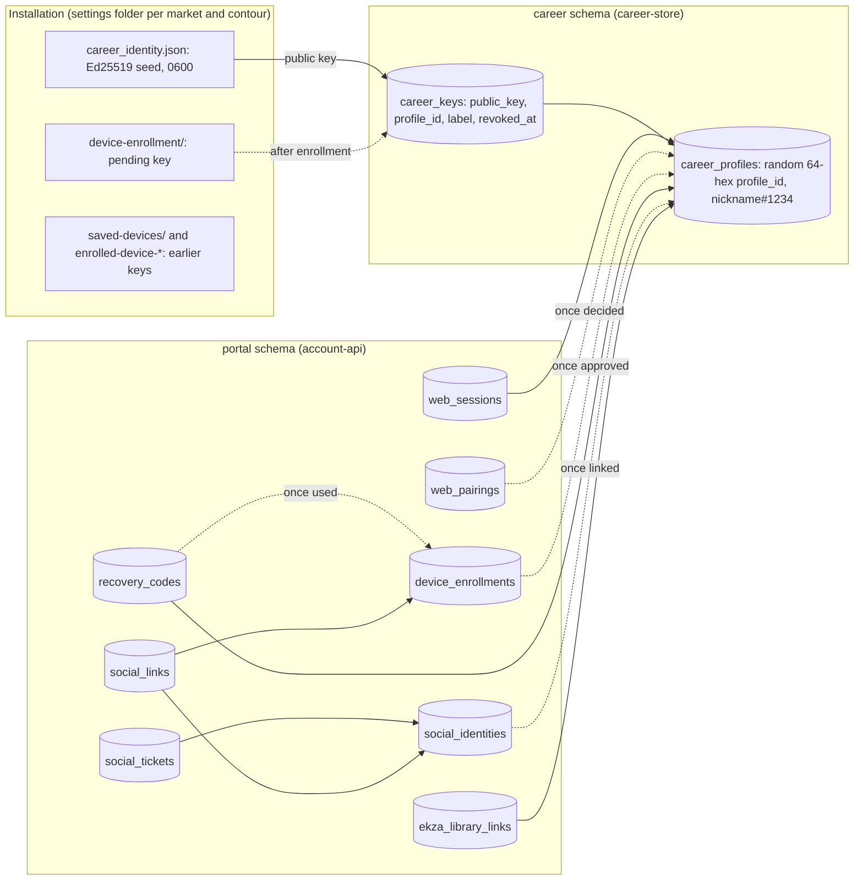
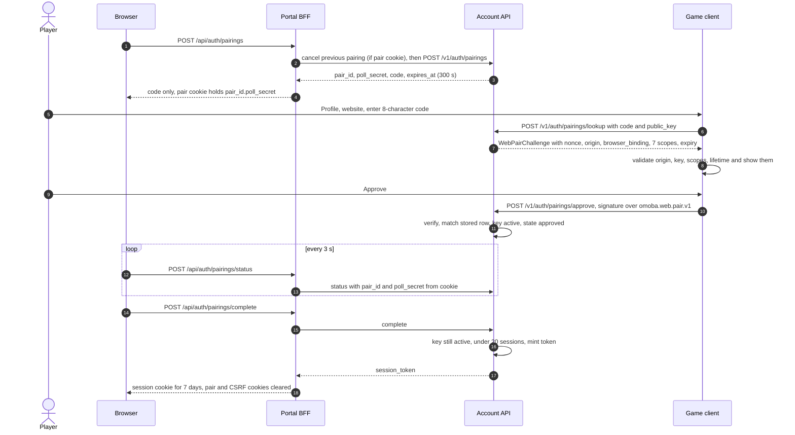
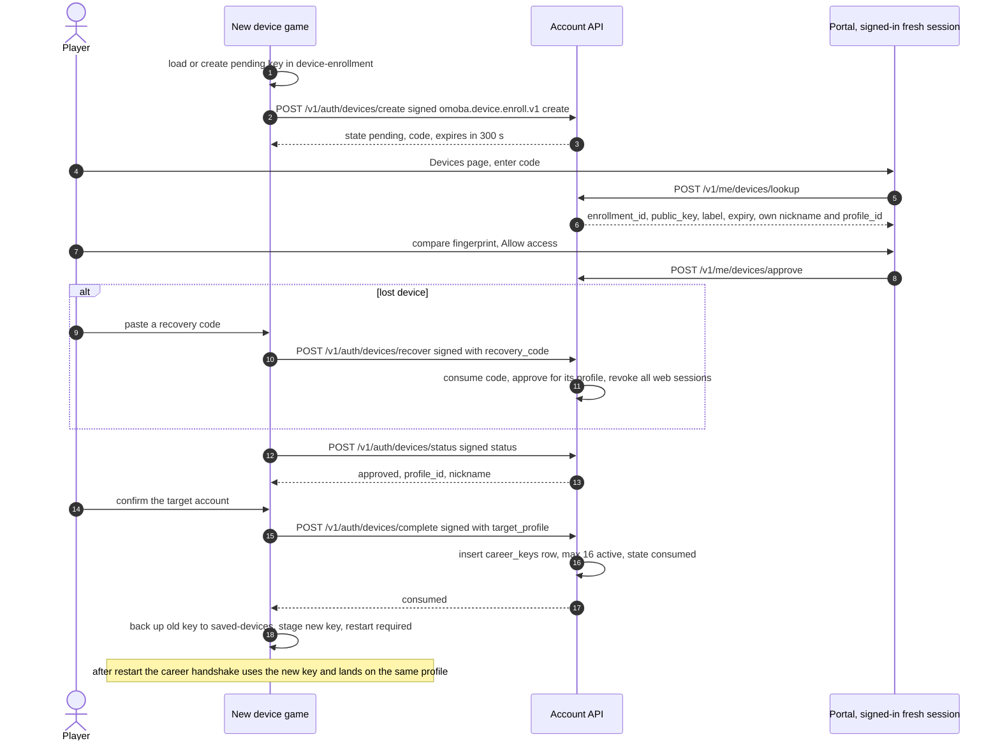
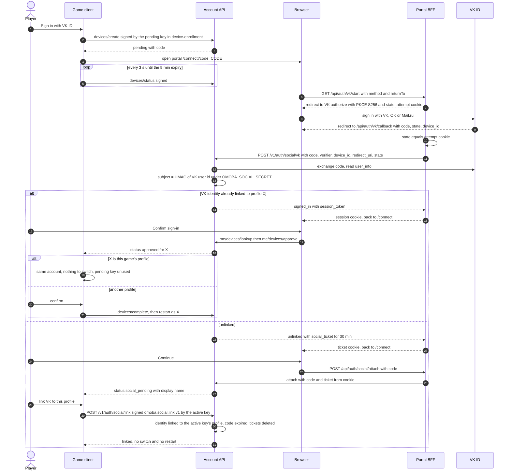

# Identity and accounts

This page maps how OMOBA knows who a player is. It starts with the private key an installation creates on first launch, then covers the career profile on the game server, the player portal session in a browser, extra devices, recovery, Sign in with VK ID (RU market) and the optional Ekza links (global market). It describes the code at the snapshot below, explains why it is built this way, and points to the detailed documents and source files. Change the code or the detailed documents first, then keep this map in sync.

Snapshot: game dev 6d34f98, portal dev 604bc34, 2026-10-24. See [README](README.md).

## Principles

- **The account is the device key.** Each installation holds its own Ed25519 key. There are no passwords. A career profile is created only when the game server sees proof of possession of an unknown key ([`career_store.rs` `authenticate`](../../career-store/src/career_store.rs)). No HTTP route can create a game profile ([`account-api/README.md`](../../account-api/README.md)).
- **Keys never move between profiles.** A key belongs to one profile for its whole life. A revoked key's row stays as a tombstone. Other devices join a profile as *new* keys, never by copying a key ([`devices.rs`](../../account-api/src/devices.rs), [`003_device_keys.sql`](../../career-store/migrations/postgres/003_device_keys.sql)). Neither database role may change a key's `profile_id` or delete a key ([`ops/grants.sql`](../../account-api/ops/grants.sql)).
- **Every signature has its own domain.** Each signed message is a JSON tuple that starts with a versioned domain string (`omoba.*.v1`), so a proof made for one purpose never verifies for another ([Signature domains](#signature-domains)).
- **The private key never leaves the game, and only typed tuples are signed.** Every signature covers a typed, domain-prefixed tuple built from `shared` types. The signing paths are:
  - `CareerIdentity` methods (`prepare_request`, `sign_web_pair`, `sign_social_link`, `sign_supporter_request`),
  - `identity_driver` for the career auth proof,
  - `career_devices::sign` for the pending enrollment key held in `Worker.key`,
  - the UDP thread's in-process `GameplaySigner`, which holds a clone of the key ([`career_identity.rs`](../../client/src/career_identity.rs), [`career_devices.rs`](../../client/src/career_devices.rs), [`net/public_transport.rs`](../../client/src/net/public_transport.rs)).

  No path signs bytes supplied by a caller. The browser, the portal and the HTTP services only ever see public keys and signatures.
- **Profiles are never combined.** Linking a device switches the installation to the existing profile after a restart. So does signing in on a new device with a VK account that is already linked. Linking a VK account that is not linked yet attaches it to the *current* profile, with no switch and no restart. The previous local key is always kept.
- **Website sign-in has two roots.** A browser session comes either from a game approval (pairing) or, in `vk_sign_in` builds, from a VK ID already linked to the profile. Both produce the same full session (`authorization_version = 2`), so whoever controls a linked VK account controls the profile's website account, including its devices ([VK trust property](#sign-in-with-vk-id-ru-market)).
- **Lookups use keyed hashes.** Codes, poll secrets, tickets, session tokens, recovery codes and VK user ids are looked up by HMAC under server secrets. When a value must be returned again, the server also keeps a ChaCha20-Poly1305 sealed copy. This covers the enrollment code replay, a lost pairing reply and the Ekza token ([Keyed hashes and sealed values](#keyed-hashes-and-sealed-values)).
- **The market decides which links exist.** `shared::market::FEATURES` (`ekza`, `supporter`, `vk_sign_in`) is a compile-time preset for each market. A build can flip any feature with `OMOBA_FEATURE_<NAME>=on|off` (`Features::resolve`, [`shared/src/market.rs`](../../shared/src/market.rs)). Routes and UI for a disabled feature do not exist in that build. The portal reads the same variables (`omoba-web` `src/lib/market-profile.mjs`) and refuses to serve a market or feature set other than the one it was built with (`assertBuiltMarket`). See [`../markets.md`](../markets.md).

## Moving parts

| Part | Role in identity | Source |
|---|---|---|
| Game client | Owns the device key and signs every proof type. Runs the career handshake per server, the website pairing modal and the devices/VK modal | [`client/src/career_identity.rs`](../../client/src/career_identity.rs), [`career_web.rs`](../../client/src/career_web.rs), [`career_devices.rs`](../../client/src/career_devices.rs), [`net/public_transport.rs`](../../client/src/net/public_transport.rs) |
| `shared` | Wire contracts and signing tuples | [`career.rs`](../../shared/src/career.rs), [`public_transport.rs`](../../shared/src/public_transport.rs), [`web_account.rs`](../../shared/src/web_account.rs), [`device_account.rs`](../../shared/src/device_account.rs), [`supporter.rs`](../../shared/src/supporter.rs), [`market.rs`](../../shared/src/market.rs) |
| `passport` crate | Native HTTPS transports to the Account API (pairing, devices, VK link, Supporter), plus the Ekza SDK account and wallet wrappers | [`passport/src/web_account.rs`](../../passport/src/web_account.rs), [`device_account.rs`](../../passport/src/device_account.rs), [`supporter_account.rs`](../../passport/src/supporter_account.rs), [`account.rs`](../../passport/src/account.rs) |
| Game server (lobby and match workers) | Issues career challenges, verifies account and gameplay signatures, rechecks keys | [`server/src/career_backend.rs`](../../server/src/career_backend.rs), [`server/src/public_transport.rs`](../../server/src/public_transport.rs), [`server/src/match_service.rs`](../../server/src/match_service.rs) |
| `career-store` | Profiles and keys in Postgres (`career_profiles`, `career_keys`) | [`career_store.rs`](../../career-store/src/career_store.rs), [`migrations/postgres/`](../../career-store/migrations/postgres/) |
| Account API | HTTP boundary for the portal and for native account calls: pairing, sessions, devices, recovery, VK ID, Supporter, Ekza library. Binds to loopback only | [`account-api/src/`](../../account-api/src/), [`openapi.json`](../../account-api/docs/openapi.json), [`README`](../../account-api/README.md) |
| Player portal (`omoba-web` repository, npm package `omoba-player-portal`; Next.js BFF) | Holds browser cookies and forwards an allowlisted set of routes to the Account API. Runs the VK ID redirect and the `/connect` page | `omoba-web`: `src/app/api/[...path]/route.ts`, `src/app/api/auth/vk/`, `src/lib/security.mjs`, `src/lib/vk-id.mjs`, `src/lib/vk-route.ts`, `src/components/connect.tsx`, `src/components/devices.tsx` |

The dotted edges are nullable foreign keys. Only `social_identities.profile_id` points at a profile. `social_tickets` hangs off an identity, and `social_links` hangs off both an identity and a device enrollment ([`007_social_sign_in.sql`](../../account-api/migrations/007_social_sign_in.sql)).

## Device key

- **Creation.** `load_or_create_key` generates a 32-byte seed with `getrandom` and writes `{version: 1, seed, public_key}` to a temporary file created with `create_new` and mode `0600`. The file is fsynced and published with an exclusive `hard_link`, so two clients starting at once both end up using the winning key. It never overwrites an existing or damaged identity ([`career_identity.rs`](../../client/src/career_identity.rs)).
- **Reading.** `read_key` refuses:
  - non-regular files, such as symlinks,
  - files over 1 KiB,
  - on Unix, any group or other permission bits,
  - a `public_key` that does not match the seed.
- **Location.** `career_identity.json` in the settings folder `omoba-bevy[-<market>][-<contour>]` (`client/src/platform.rs` `config_directory_name`), or in `OMOBA_CLIENT_CONFIG_DIR`. Each market and each contour therefore has its own device key and its own account service. Connection profiles inside one build share the career identity ([`../connection-profiles.md`](../connection-profiles.md)).
- **Nickname.** The chosen name is kept separately in `career_nickname.json`. It is sent at login but takes effect only when a profile is created. Renames are a separate signed action ([`../player-handles.md`](../player-handles.md)).
- **QA capture.** QA capture (`OMOBA_CAREER_QA_OUTPUT`, `qa` feature) never touches the identity or the profile service.

## Career profile: the lobby handshake

The client runs one handshake for each *scope* `(server address, server epoch, client session id)`. When any of the three changes, the client authenticates again (`identity_driver`, `AuthScope`). Examples are the move from the lobby to a match worker and a server restart. The session id is the persisted client session id (`client/src/persistence.rs`), used for reconnection. It is not a secret.

1. **Client → server:** `CareerRequest::Challenge { public_key, nickname, session_id }`.
2. **Server issues a challenge.** `CareerBackend::handle` validates the inputs. The nickname must pass `normalize_nickname`, otherwise the reply is *"Invalid nickname."*. The public key must be 64 hex characters, and `session_id` must be 1–64 characters from `[A-Za-z0-9._-]`. Other invalid requests are dropped silently. The server then issues `AuthChallenge { public_key, nonce (32 random bytes), server_epoch, session_id, nickname }`.
   - A matching request within 30 s (`CHALLENGE_TTL`) gets the same challenge.
   - A new challenge drops any earlier authorization and sequence on that UDP endpoint.
   - The exception: while the endpoint is authenticated and admitted to a match (`c.playing && c.auth.is_some()`), new `Challenge`s are ignored, so a re-handshake during a match cannot reset authorization.
3. **Client → server:** `Authenticate { challenge, signature }` over `omoba.career.auth.v1`, signed inline in `identity_driver`.
4. **Server logs the key in.** The server checks that the challenge is the one it issued and still fresh, verifies the signature with `verify_strict`, and queues `Job::Login`. `CareerStore::authenticate(public_key, nickname)` then takes a transaction advisory lock on the key:
   - **Known key:** returns the profile and keeps the saved nickname. A revoked key is refused with *"This device key was revoked…"*.
   - **Account ban (LR-15).** After the store answers, the worker reads the profile's active sanctions; an active `account_ban` refuses the sign-in with `error_code` `account_banned` and the ban in `CareerView.sanctions`, so the client shows until when. The client signs in again a minute later, so a lifted ban needs no restart. A ban applied while signed in ends the authorization at the next 10-second access refresh, as a revoked key does.
   - **Unknown key:** inserts a new `career_profiles` row and a matching `career_keys` row. The `profile_id` is two random UUIDs without dashes (64 hex characters) and is *not* derived from the key. The key row has no label, so it gets the column default `Original device`.
   - **New-profile limits (LR-16).** A game server signs in through `authenticate_from`: an unknown key gets a profile only while its source IP (IPv4 address, IPv6 /64) created fewer than 10 profiles in the last 24 hours and everyone fewer than 5000 (`OMOBA_LIMIT_NEW_PROFILES_*`). The refusal creates nothing; the view carries `error_code` `new_profile_limit` or `new_profiles_paused`, which the client shows localized and stops retrying on. Known keys always sign in. The count lives in PostgreSQL (`career_profile_admissions`, a salted hash of the source, 48 h).
5. **Client is authenticated.** The reply carries `auth_nonce = challenge.nonce` and the profile. The client treats itself as authenticated once both are present. It retries every 2 s and gives up after 25 s (`RETRY`, `AUTH_TIMEOUT`).

Server state is kept per UDP source address: at most 512 clients and 8 per source IP (an idle client of a full IP gives way after 30 s), one request per 100 ms, and removal after 120 s idle. A new client beyond 512 is told `server_full` and keeps trying (LR-09). A server without career storage serves unranked guest matches.

**Retention (LR-16).** The lobby deletes profiles that never played and that nothing else holds once their only key is older than 30 days (`OMOBA_PROFILE_RETENTION_DAYS`; `career_prune_unplayed_profiles`, [data.md › Retention](data.md#retention-and-cleanup)). The key goes with the profile, so that device signs in to a fresh profile. A profile with a match, XP, a friend, another or a revoked key, or any portal row (sign-in link, session, recovery, Supporter grant) is kept.

## Signed account requests and gameplay commands

**Account requests.** After login, every profile action is sent as `CareerRequest::Authorized { session_nonce, sequence, action, signature }` under `omoba.career.request.v1` (`CareerIdentity::prepare_request`). This covers match search, history, friends, rename, handle lookup, Supporter status and aura, and social chat. The server accepts a request only if all of these hold:

- the session nonce equals the auth nonce,
- the sequence is strictly greater than the last one accepted,
- the signature verifies,
- the key was rechecked within the last 30 s.

Actions that reach the database recheck `key_is_active` first. Career packets travel in a path-validated `TransportBootstrap` envelope and carry their own signatures. A signed gameplay command that wraps a career packet is dropped, so the two replay counters stay independent.

**Gameplay commands.** `CareerIdentity::gameplay_signer` gives the UDP thread an in-process `GameplaySigner`. It holds a clone of the key plus a `GameplayPrincipal { public_key, session_id, session_nonce = auth nonce }`, and is available only for a non-zero `match_id` in the authenticated scope. Each command is signed under `omoba.gameplay.command.v1`. `server/src/public_transport.rs` `PublicTransport::receive` takes the principal from `CareerBackend::gameplay_principal` and checks:

- the endpoint passed the return-path proof (`path_nonce`),
- epoch, match id, session id and nonce match,
- the sequence is above the last one for that nonce,
- the signature verifies,
- a `Join` names the principal's session.

Snapshots go only to endpoints that are verified and allowed to observe. This authenticates commands. It neither encrypts UDP nor authenticates the server (header of [`shared/src/public_transport.rs`](../../shared/src/public_transport.rs)).

The transport depends on the server role, not on the use case. The standalone role (`OMOBA_SERVER_ROLE` unset, empty or `standalone`) is the only non-public one, and it accepts plain JSON `ClientPacket`s. The lobby and worker roles require the public transport (`MatchService::is_public`, `MatchService::from_env` in [`match_service.rs`](../../server/src/match_service.rs); `server/src/runtime/dispatch.rs`).

## Website pairing

This is how a browser signs in to the portal: the game approves it with its device key. Sources:

- Contract: [`shared/src/web_account.rs`](../../shared/src/web_account.rs)
- Server: [`account-api/src/auth.rs`](../../account-api/src/auth.rs)
- Native transport: [`passport/src/web_account.rs`](../../passport/src/web_account.rs)
- Game UI: [`career_web.rs`](../../client/src/career_web.rs)

The flow:

- **The browser starts.** The BFF calls `POST /v1/auth/pairings` (internal). If the browser already holds a pair cookie, the BFF first cancels that pairing upstream. The API returns `pair_id`, `poll_secret`, an 8-character code and a 300 s expiry. The code uses an alphabet without `I O 0 1` and carries 40 bits. The BFF keeps `pair_id.poll_secret` only in the HttpOnly pair cookie and shows the code.
- **Browser binding.** The challenge's `browser_binding` is `HMAC(portal secret, "pair-poll", poll_secret)`. The game signs over it, so only the browser that holds the poll secret can complete the pairing.
- **The game looks up and signs.** The game sends `{code, public_key}` to `/v1/auth/pairings/lookup` and gets a `WebPairChallenge`. `WebAccountApi::lookup` and `::decide` check the challenge against the build's portal origin, the device key, the exact 7 scopes and a lifetime of at most 300 s. The modal shows the origin, account and expiry, and the player chooses Approve or Deny. Both decisions are signed (`omoba.web.pair.v1`).
- **The server decides.** `auth::decide` verifies the signature and locks the pairing row. Nonce, binding and expiry must equal the stored values, and the key must be an active `career_keys` row. A `pending` row is then set to `approved` or `denied` with `authorization_version = 2`. A retry of the same decision by the same key returns the stored status. Any other non-pending state gets 409 `state_changed`.
- **The browser completes.** `auth::complete` rechecks that the key is still active and enforces the session cap under a row lock on the profile. It mints a session token and seals a copy for 60 s (AAD `pair_id:poll_hash`), so a lost reply can be fetched again.
- **The seven scopes.** `WEB_SCOPES` holds `career:read`, `friends:write`, `nickname:write`, `settings:write`, `devices:write`, `recovery:write` and `supporter:write`.
  - They are a fixed consent set bound into the signature. A session stores no per-scope flags.
  - `authorization_version = 2` marks sessions created under this consent. Portal migration 002 revoked every older session ([`002_devices.sql`](../../account-api/migrations/002_devices.sql)).
  - Builds without `supporter` (by default the free markets, ru and cn) show consent text without Supporter (`challenge_key` in `career_web.rs`).
- **Native transport policy.**
  - **Connection.** HTTPS only. Loopback HTTP needs `OMOBA_ALLOW_INSECURE_LOCAL=1`. No redirects, 3 s connect and 10 s total timeouts, responses read up to 65536 bytes.
  - **Errors.** Non-2xx statuses map to fixed messages: 404 means expired, cancelled or unavailable; 409 means already used or changed; 429 means rate limited (`WebAccountApi::request`).
  - **Validation.** Every pairing, enrollment and link proof is validated again on the client before sending (`WebAccountApi::decide`, `DeviceAccountApi::send`, `DeviceAccountApi::link_social`).
  - **Endpoints.** They come from `OMOBA_ACCOUNT_API_URL` and `OMOBA_PORTAL_ORIGIN`, at runtime or compile time. A build without them shows *"not configured"*. Packaged dev-contour builds accept only their own Account API and portal pair (`validate_contour_endpoints`).

## Web sessions

- **Storage.** The token (32 random bytes) lives in the session cookie. The API stores `HMAC("session-token")`. `auth::session` checks it on every request and updates `last_seen`, so the 1-day idle window slides. A session is valid only while all of these hold:
  - `authorization_version = 2`,
  - not revoked,
  - within its 7-day absolute lifetime,
  - seen within the last day.

  While the profile has an active `account_ban` (LR-15), every session-authenticated request answers `403 account_banned` without revoking the session, so it works again once the ban ends or is lifted. Pairing approval and completion and VK sign-in refuse the same way, so no new session is created ([`moderation.rs`](../../account-api/src/moderation.rs) `refuse_banned`).
- **Labels.** Pairing sessions get the column default `Browser` ([`001_portal.sql`](../../account-api/migrations/001_portal.sql)). VK sessions take the method label (`VK ID`, `OK`, `Mail.ru`).
- **Limit.** At most 20 active sessions per profile, serialized by a row lock on the profile. Further sign-ins get `session_limit`. The same rule applies to VK ID sessions.
- **Fresh session.** A session created no more than 600 s ago is "fresh", whether it came from pairing completion or from a VK sign-in (`devices.rs` `fresh`, `auth::revoke`). These actions require a fresh session:
  - looking up or approving a device,
  - rotating recovery codes,
  - revoking a device,
  - unlinking VK,
  - revoking *another* session.
- **Portal side.** The browser holds the session token only in an HttpOnly cookie, and the BFF forwards an allowlisted set of routes with no actor, API URL or forwarding header chosen by the browser. Cookie names, lifetimes and attributes, the CSRF check, the allowlist and the pairing and logout clearing rules are in [protocols.md › 7. Portal BFF](./protocols.md#7-portal-bff-omoba-web). The VK ID callback's cookie effects are listed there too (`omoba-web` `src/lib/vk-id.mjs` `vkCallback`).

## Account API exposure

The Account API binds only to loopback (default `127.0.0.1:40550`; non-loopback binds fail, `account-api/src/main.rs`). TLS and route exposure belong to the ingress ([`account-api/README.md`](../../account-api/README.md), "Runtime"). In outline, the routes the game calls are signed native POSTs on an explicit ingress allowlist, and the other `/v1/*` routes are meant for the portal BFF: behind the portal ingress key (hosted dev) or reached by the portal on loopback only (RU, [ops/vps/ru/README.md › Topology](../../ops/vps/ru/README.md#topology)).

- Every route with its caller, exposure and authentication: [protocols.md › Routes by exposure](./protocols.md#routes-by-exposure).
- The native allowlist on each host (dev, RU): [system.md › Account API ingress allowlists](./system.md#account-api-ingress-allowlists).
- The signature each native route verifies: [Signature domains](#signature-domains). Its rate limits: [Rate-limit buckets](#rate-limit-buckets).

## One account on many devices

Sources:

- Detailed user flow: [`../supporter.md`](../supporter.md), section "One account on phone and PC"
- Contract: [`shared/src/device_account.rs`](../../shared/src/device_account.rs)
- Server: [`account-api/src/devices.rs`](../../account-api/src/devices.rs)
- Game: [`career_devices.rs`](../../client/src/career_devices.rs)

**Enrollment.** The new installation signs every enrollment call with a *separate pending key* under `omoba.device.enroll.v1`. The signed tuple binds:

- the origin,
- the enrollment id,
- the key,
- the label,
- the expiry (at most 300 s),
- the action (`create`, `status`, `recover` or `complete`),
- `target_profile` or `recovery_code`, where they apply.

- **The pending key.** It lives in `<settings folder>/device-enrollment/` and a later enrollment reuses it (`load_or_create_key`). Two cases rename the folder to `enrolled-device-<random>` and create a fresh key: restarting an enrollment in the same session, and finding the active key there. A completed enrollment whose reply was lost is therefore never discarded.
- **Labels.** Each platform has a fixed label: `Desktop`, `Android` or `iPhone / iPad`. The label is not localized and ends up in `career_keys.label`. The key that created a profile, and keys that predate career migration 003, carry the default `Original device`.
- **`create`.** Rate-limited per key.
  - A key that is already registered gets back `consumed` and its profile, so the client can recover after a crash.
  - A revoked key gets 404.
  - Otherwise the server stores the 8-character code as `HMAC("device-code")` plus a sealed copy (`code_delivery`, AAD = enrollment id) for the life of the row, which makes retries return the same code.
- **Portal approval.** The account owner's fresh session calls `me/devices/lookup`. It returns the enrollment id, the full public key, the label, the expiry, and the session's own nickname and profile id. The session then calls `me/devices/approve` with the enrollment id and public key. The game shows the first and last 8 hex characters of the pending key, and the portal computes the same fingerprint (`connect.tsx`, `devices.tsx`), so the player can compare them.
- **`complete`.** Takes the same advisory lock as `CareerStore::authenticate`, so a racing login cannot register the key as a new profile. It requires the enrollment to be approved for that exact target. It refuses a key that is registered elsewhere (`device_key_already_registered`) and a profile that already has 16 active keys (`device_limit`). It then inserts the `career_keys` row and marks the enrollment consumed.
- **Activation.** `stage_enrolled_identity` hard-links the current key into `saved-devices/<old public key>.json` and atomically replaces `career_identity.json` with the enrolled key (temporary file, then rename). The running game keeps its old identity until restart.

**Recovery codes.**

- **Issuing.** A fresh session calls `POST /v1/me/recovery-codes` (at most 2 per minute per profile) and receives 8 random 32-byte hex codes. They are shown once and stored as `HMAC("recovery-code")`. A new set consumes the unused codes of the old set.
- **Using a code.** `recover` is signed with the code. The server allows 5 attempts per minute per key. It consumes the code, binds it to the enrollment and approves the enrollment for the code's profile. It also revokes **all** web sessions of that profile. Repeating the call with the same code and enrollment returns the current state. The player then runs `complete` as above.

## Sign in with VK ID (RU market)

Sources:

- User-level description and guarantees: [`../markets.md`](../markets.md), section "Sign in with VK ID"
- Server: [`account-api/src/social.rs`](../../account-api/src/social.rs), [`007_social_sign_in.sql`](../../account-api/migrations/007_social_sign_in.sql)
- Portal: `omoba-web` `src/lib/vk-id.mjs`, `src/lib/vk-route.ts`, `src/app/api/auth/vk/`, `src/components/connect.tsx`

The pieces:

- **Gating.**
  - **Game.** Only `vk_sign_in` builds show the button (`vk_button_visible`). The career actions and their Account API polls (VK sign-in, device links, website pairing) run only after the player accepted the market's legal documents on the first-launch card (`legal::bound_and_accepted`, LR-06).
  - **Account API.** `SocialConfig::from_env` enables VK only when both `OMOBA_VKID_CLIENT_ID` (numeric) and `OMOBA_SOCIAL_SECRET` (64 lowercase hex) are set. With neither set, the routes answer 404 `not_found`. With exactly one set, startup fails (`invalid_social_configuration`, from `App::connect`). Startup also fails when they are set in a build without `vk_sign_in`.
  - **Portal.** `/api/auth/vk/start` and `/api/auth/vk/callback` need both the `vkSignIn` feature and `OMOBA_VKID_CLIENT_ID` (`vkContext` → `vkSignInClientId`). The BFF catch-all forwards `auth/social/*` and `me/social/*` based on the `vkSignIn` feature alone (`allowedPath`).
- **OAuth.** VK ID is a public client using OAuth 2.1 with PKCE S256 and scope `vkid.personal_info`.
  - **Portal side.** The portal keeps `state.verifier.method.returnTo` in the single-use VK attempt cookie. On the callback it compares `state` in constant time and forwards the code, verifier, `device_id`, `redirect_uri` and `state` to `POST /v1/auth/social/vk`.
  - **Exchange.** The **Account API** exchanges the code itself against `https://id.vk.ru` (`/oauth2/auth`, then `/oauth2/user_info`). It uses 3 s connect and 8 s total timeouts, follows no redirects and caps each response at 64 KiB. It accepts only the portal's own callback URL as `redirect_uri`.
  - **Test seam.** `OMOBA_VKID_LOCAL_FIXTURE_ORIGIN` points the exchange at a stand-in for tests. Only a loopback HTTP origin is accepted.
- **Keyed identity.** A VK user is stored as `HMAC(OMOBA_SOCIAL_SECRET, ["vk-subject", user_id])`. This secret is separate from the portal secret and must never be rotated. No token, name or e-mail is kept. A display name such as "Иван П." (at most 40 characters) exists only in tickets and pending links, and expires with them.
- **Linked identity.** `vk_sign_in` inserts a normal `authorization_version = 2` web session labelled `VK ID`, `OK` or `Mail.ru`, under the same 20-session cap and profile lock. No game confirmation is involved.
- **Unlinked identity.** The browser receives a 30-minute ticket, stored as `HMAC("social-ticket")`, in the social cookie. The BFF injects the ticket from the cookie, and a browser body can never name a ticket (`socialTicketBody`). `POST /v1/auth/social/ticket` (BFF only) describes the ticket: display name, expiry and a `linked` flag. A 404 there clears the cookie.
- **Starting from the game.** `Action::SocialStart` takes the same branch as `DevicesStart`. It loads or creates the pending key in `device-enrollment/` and calls `devices/create`. It then opens `{portal}/connect?code=…` (`sign_in_url`) and polls `status` every 3 s until the enrollment expires (`SOCIAL_POLL`, `social_tick`).
- **Attach.** On `/connect?code=…`, `POST /v1/auth/social/attach` offers the unlinked identity to the pending, unexpired enrollment with that code (otherwise 404).
  - If the identity was linked in the meantime, it returns 409 `already_linked`.
  - If the enrollment already carries a different identity, it returns 409 `state_changed`. The same identity again is a no-op.
  - Once attached, the game's status poll reports `social_pending` with the display name.
- **Link.** The game signs `omoba.social.link.v1` with its **active** key, not with the pending enrollment key. The tuple binds the origin, the enrollment id, the enrollment key, the active key and the expiry. `social::link` checks:
  - the active key is unrevoked and resolves to a profile,
  - the enrollment key and expiry match, and the enrollment is still pending and unexpired,
  - the identity is not linked yet,
  - the profile has no VK yet (`profile_already_linked`, with the unique index `social_identity_profile` resolving races).

  It then sets `social_identities.profile_id` to the active key's profile, expires the enrollment code immediately and deletes the identity's tickets. A repeated link to the same profile is idempotent. The installation does not switch profiles, nothing is staged and no restart happens (`career_devices.rs` `poll` → `finish_social`). The pending key stays unused in `device-enrollment/`, where a later enrollment reuses it. The next VK sign-in on the portal yields a normal session for that profile.
- **Linked VK from a new device.** The browser signs in as that account, and the player presses "Confirm sign-in" on `/connect`. This is an ordinary fresh-session device approval. If the approved profile is the game's current profile, the game reports "same account", changes nothing and leaves the pending key unused. Otherwise the player completes the enrollment and restarts into that profile.
- **Unlink.** `DELETE /v1/me/social/vk` needs a fresh session. It deletes only the identity row; its tickets and links go with it by cascade. Browser sessions already created through VK stay valid until they expire or are revoked. Unlinked identities that have been idle for 30 days and have no pending link are deleted.
- **Trust property.** A VK session is a full session and is fresh for its first 600 s. A VK login alone can therefore approve a new device, rotate recovery codes (consuming the old ones), revoke devices (which revokes all web sessions), unlink VK and revoke other sessions. Control of the linked VK account is enough to take over the profile: approve one's own device, then revoke the others. The last-key guard does not apply once a second key exists.

## Supporter native requests

- **In-game status and aura.** On every platform these go through the game server as signed career actions (`SupporterStatus`, `EquipSupporterAura` under `omoba.career.request.v1`). The server reads grants through `career-store` and authorizes the aura itself. Grants are refreshed every 10 s and the cache is valid for at most 30 s ([`../supporter.md`](../supporter.md)).
- **iOS StoreKit.** The bridge ([`client/src/supporter_storekit.rs`](../../client/src/supporter_storekit.rs)) calls the Account API directly. `CareerIdentity::sign_supporter_request` signs `NativeSupporterRequest` under `omoba.supporter.native.v1`. The signature binds the portal origin, the key, a 32-byte nonce, an expiry of at most 60 s and the typed action (`status`, `equip`, `apple_prepare`, `apple_verify`). `supporter::native` in [`account-api/src/supporter.rs`](../../account-api/src/supporter.rs) checks:
  - the signature,
  - the per-key (30/min) and per-IP (60/min) rate limits,
  - that the key is active (it resolves the profile from `career_keys`),
  - that the nonce is single-use (`portal.supporter_nonces`, `request_replayed`).

  The client never sends an entitlement assertion.
- **Free market (cn).** Its preset turns `supporter` off. With `supporter` off:
  - the Account API serves no `supporter*` or `me/supporter*` route (404), including `GET /v1/supporters`,
  - the Account API refuses billing configuration,
  - the client registers neither the panel nor StoreKit.
- **RU market (LR-67).** `supporter` is on with YooKassa as the only provider (`shared::market::payment_providers`). The Account API refuses Apple and Solana settings (`payment_provider_not_in_market`) and serves no Apple or Solana route; the client registers the panel and every player's aura but no StoreKit bridge, and its panel links to the portal's `/supporter` («Поддержать на сайте»). The in-game status and equip go through the game server as everywhere else.

## Ekza links (global market only)

All three links are gated by `FEATURES.ekza`, which the free-market presets (ru, cn) turn off by default. A build may flip it with `OMOBA_FEATURE_EKZA`. None of the links creates or authenticates a career profile. Ekza usernames are display labels only.

| Link | Who holds it | Mechanism | Grants | Source |
|---|---|---|---|---|
| Ekza account library (game) | Installation, per connection profile: `ekza-store/account/session.json`, 0600 | Ekza SDK device flow against the Ekza Registry: code shown in the game, approved in Ekza Studio | Shows the account's saved or created free assets. Server admission is independent. Refreshed every 15 s | [`client/src/ekza_account.rs`](../../client/src/ekza_account.rs), [`passport/src/account.rs`](../../passport/src/account.rs), [`../features.md`](../features.md) ("Persistent Ekza account library") |
| Ekza library connection (portal) | Account API, one row per career profile | Server-side device flow: `/v1/account/device`, then poll, then `/library`. Device code and token are sealed with the portal secret (AAD `ekza-library:<profile>:<registry>:<phase>`) for as long as the link exists. Only project `omoba`, scope `library` | Library display on the portal. *"A project-scoped library grant, not a second login identity or SSO mapping"* ([`005_ekza_library.sql`](../../account-api/migrations/005_ekza_library.sql)) | [`account-api/src/ekza_library.rs`](../../account-api/src/ekza_library.rs) |
| Ekza passport wallet (game) | Process memory | Opt-in wallet pairing from the menu or `OMOBA_PASSPORT_CONNECT=1` | Purchased avatars. The passport consumes a one-use ticket per (avatar, session) before the server admits the avatar | [`client/src/passport.rs`](../../client/src/passport.rs), [`../features.md`](../features.md) ("Purchased avatar passport" entry) |

## Revocation, expiry and limits

| Credential | Lifetime | Limits | Ended by |
|---|---|---|---|
| Device key (`career_keys`) | Until revoked; kept as a tombstone afterwards | 16 active keys per profile | `DELETE /v1/me/devices/{key}` with a fresh session (game-approved or VK). The last key needs an unused recovery code (`recovery_required_before_last_device`). Revocation also revokes **all** web sessions of the profile and deletes approved enrollments that were not reached through a recovery code |
| Game server authorization (per UDP endpoint) | Until the scope changes or a new challenge arrives. New challenges are ignored while the endpoint is admitted to a match | Key rechecked every 10 s. Fails closed 30 s after the last successful check (`COSMETIC_CACHE_TTL`) | A revoked key gets *"This device was revoked…"*, a failed check gets *"…could not be refreshed…"*, and an `Authorized` request without authorization gets *"Sign in before using your profile."*. In each case `observe_server_auth` drops the client's auth and restarts the handshake, and the store refuses a tombstoned key |
| Web session | 7 days absolute, 1 day idle (sliding) | 20 active per profile | Logout, revoking a session (revoking another one needs a fresh session), device revocation, account recovery. Unlinking VK does **not** end sessions created through VK. Deleted 1 day after expiry unless an operation receipt refers to it |
| Pairing code | 300 s; completion delivery 60 s | | Cancel, or a new pairing from the same browser. Deleted 60 s after expiry |
| Device enrollment code | 300 s, single use | | Consumed by `complete`, expired by `social/link`. Deleted 1 day after expiry unless a recovery code refers to it. Its `social_links` row goes with it |
| Recovery codes | Until used or replaced | 8 per set, each single use | Rotation consumes unused codes |
| VK ticket | 30 min | | Expiry, or a successful link of its identity |
| Unlinked VK identity | 30 days without a sign-in | | Deleted when idle and no pending link refers to it |
| Linked VK identity | Until unlinked | One VK account per profile | `DELETE /v1/me/social/vk` (fresh session) |
| Native Supporter request | Up to 60 s | One use per nonce | |
| Portal Ekza library link | Pending 10 min | One per profile | `DELETE /v1/me/ekza-library`. A 401/410 from the Ekza Registry removes it |

To avoid leaking which accounts or rows exist, failed ownership checks answer `404 not_found` (`forbidden()`). A secondary `audit_events` log is kept for 30 days. It records `pair_approved`, `session_created`, `device_linked`, `device_revoked`, `account_recovered`, `social_sign_in`, `social_linked`, `social_unlinked` and similar events.

### Rate-limit buckets

Rate limits are per-minute buckets keyed by `HMAC(portal secret, scope, identity)` and shared between replicas through Postgres (`App::rate`, [`account-api/src/lib.rs`](../../account-api/src/lib.rs)). A 429 response carries `rate_limited` and `Retry-After: 60`. A per-IP bucket uses the socket peer, or `X-Real-IP` only when `OMOBA_TRUST_LOOPBACK_PROXY=1` and the peer is loopback ([protocols.md › Envelope, limits, idempotency](./protocols.md#envelope-limits-idempotency)). On RU the portal forwards the player's address on its loopback calls. Behind the hosted dev ingress, that address can be the portal host instead of the player ([system.md › Open questions](./system.md#open-questions)).

| Bucket | Keyed by | Limit per minute |
|---|---|---|
| `pair-create` | IP | 5 |
| `pair-requests` (every pairing route except create) | IP | 120 |
| `pair-lookup` / `lookup-key` (on top of `pair-requests`) | IP / key | 20 / 20 |
| `pair-decision` | key | 10 |
| `device-enrollment` (status: 120) | IP | 10 |
| `device-create-key` | key | 5 |
| `recovery-attempt` | key | 5 |
| `recovery-rotate` | profile | 2 |
| `social-sign-in` (every `auth/social/*` route) | IP | 30 |
| `social-link-key` | key | 10 |
| `native-supporter-ip` / `native-supporter` | IP / key | 60 / 30 |
| `apple-notification-ip` | IP | 120 |
| `public-profile`, `public-supporters` | IP | 120 each |
| `read` / `write` (session routes) | profile | 120 / 20 |
| `search` / `stats` | profile | 30 / 10 |

## Signature domains

Every signed message is `serde_json` of a tuple whose first element is the domain. Keys and signatures are lowercase hex, and signatures are checked with Ed25519 `verify_strict`.

| Domain | Signing bytes | Signer (key) | Verifier | Fields after the domain, in order | Freshness / replay |
|---|---|---|---|---|---|
| `omoba.career.auth.v1` | `shared::career::AuthChallenge::signing_bytes` | Client `identity_driver`, inline (device key) | `server/src/career_backend.rs` `CareerBackend::handle` (`Authenticate`) | `public_key`, `nonce`, `server_epoch`, `session_id`, `nickname` | Server nonce. The challenge is kept 30 s and must equal the issued one |
| `omoba.career.request.v1` | `shared::career::authorized_signing_bytes` | `CareerIdentity::prepare_request` (device key) | `CareerBackend::handle` (`Authorized`) | `server_epoch`, `session_nonce`, `sequence`, `action` (`CareerAction` JSON) | Nonce equals the auth nonce, sequence strictly increasing, key checked within 30 s |
| `omoba.gameplay.command.v1` | `shared::public_transport::SignedCommand::signing_bytes` | Client UDP thread, `GameplaySigner` (clone of the device key) | `server/src/public_transport.rs` `PublicTransport::receive` | `server_epoch`, `match_id`, `session_id`, `session_nonce`, `path_nonce`, `sequence`, `payload` (exact inner JSON) | Path proof, per-endpoint sequence under the session nonce |
| `omoba.web.pair.v1` | `shared::web_account::WebPairChallenge::signing_bytes(decision)` | `CareerIdentity::sign_web_pair` (device key) | `account-api/src/auth.rs` `decide` | `origin`, `pair_id`, `nonce`, `public_key`, `browser_binding`, `decision` (`approve`/`deny`), `scopes` (7), `expires_at` (decimal string) | Lifetime of at most 300 s. Nonce, binding and expiry must match the stored row. The row must be `pending`, or already in the same state for the same key (an idempotent retry). Otherwise 409 |
| `omoba.device.enroll.v1` | `shared::device_account::DeviceEnrollment::signing_bytes(action, target, code)` | `career_devices.rs` `sign` (**pending** enrollment key in `Worker.key`) | `account-api/src/devices.rs` `proof` | `origin`, `enrollment_id`, `public_key`, `label`, `expires_at`, `action`, `target_profile`, `recovery_code` | Lifetime of at most 300 s. Key, origin, label and expiry must match the stored row (`matches`). `target_profile` only for `complete`, `recovery_code` only for `recover` |
| `omoba.social.link.v1` | `shared::device_account::SocialLink::signing_bytes` | `CareerIdentity::sign_social_link` (**active** device key) | `account-api/src/social.rs` `link` | `origin`, `enrollment_id`, `enrollment_key`, `public_key`, `expires_at` | The active key must differ from the enrollment key. Enrollment pending and unexpired. Repeated success is idempotent |
| `omoba.supporter.native.v1` | `shared::supporter::NativeSupporterRequest::signing_bytes` | `CareerIdentity::sign_supporter_request` (device key, iOS) | `account-api/src/supporter.rs` `native` | `origin`, `public_key`, `nonce`, `expires_at` (number), `action` | Lifetime of at most 60 s, single-use nonce |

The domain-separation tests are:

- in [`shared/src/career.rs`](../../shared/src/career.rs): `auth_message_is_domain_bound_and_injective_for_separators` (`omoba.career.auth.v1`) and `social_account_action_signs_the_complete_match_scoped_request`,
- in `server/src/career_backend.rs`: `signatures_bind_domain_nonce_epoch_sequence_and_action` (request tuple),
- in `web_account.rs`: the golden tuple test,
- in `device_account.rs`: the action and target tests (*"A link proof can never verify as an enrollment proof"*),
- in `shared/src/public_transport.rs`: the field-mutation test.

Strings such as `omoba.class-build.v1`, `omoba.workshop.v1`, `omoba.asset-catalog.v1` and `ekza.account.library.v1` are document schema discriminators, not signature domains. `omoba.persona.v1` appears only as a proposed profile-id hash in [`../plans/bot-personas.md`](../plans/bot-personas.md).

### Keyed hashes and sealed values

`crypto::mac(key, scope, value)` is `HMAC-SHA256(key, JSON([scope, value]))`. `crypto::seal` is ChaCha20-Poly1305 with a random 12-byte nonce ([`account-api/src/crypto.rs`](../../account-api/src/crypto.rs)).

| Use | Key | Scope or AAD |
|---|---|---|
| Pairing code / poll secret / browser binding | `OMOBA_PORTAL_SECRET` | `pair-code` / `pair-poll` |
| Web session token | `OMOBA_PORTAL_SECRET` | `session-token` |
| Device enrollment code / recovery code | `OMOBA_PORTAL_SECRET` | `device-code` / `recovery-code` |
| VK ticket | `OMOBA_PORTAL_SECRET` | `social-ticket` |
| VK identity | `OMOBA_SOCIAL_SECRET` (never rotated) | `vk-subject` |
| Rate-limit identity | `OMOBA_PORTAL_SECRET` | bucket name |
| Sealed: pairing token delivery (60 s) | `OMOBA_PORTAL_SECRET` | AAD `pair_id:poll_hash` |
| Sealed: enrollment code replay (`code_delivery`, life of the row) | `OMOBA_PORTAL_SECRET` | AAD `enrollment_id` |
| Sealed: Ekza device code / token (life of the link) | `OMOBA_PORTAL_SECRET` | AAD `ekza-library:<profile>:<registry>:<phase>` |

Rotating `OMOBA_PORTAL_SECRET` deliberately invalidates pairings, sessions, codes and tickets ([`account-api/README.md`](../../account-api/README.md)). Rotating `OMOBA_SOCIAL_SECRET` would orphan every stored VK identity.

## Markets, contours and database roles

Market presets; a build may flip any feature with `OMOBA_FEATURE_<NAME>=on|off`:

| | `global` | `ru` | `cn` |
|---|---|---|---|
| Device key and lobby career | yes | yes | not decided |
| Account API / portal | No Account API; portal in guest mode (no sign-in, devices or recovery) ([system.md › Production host](./system.md#production-host-global-market)) | RU Account API and portal (host planned, [system.md › RU host](./system.md#ru-host-planned)) | not decided |
| VK ID | off | on | off |
| Supporter (and native requests) | on (Apple, Solana) | on (YooKassa on the portal; LR-67) | off |
| Ekza links | on | off | off |

- **Contours.** Each contour (`prod`, `dev`; the portal spells them `production`, `dev`) has its own settings folder and therefore its own device key. The packaged dev contour pins its exact Account API and portal pair (client `validate_contour_endpoints`, portal `contourPortal`).
- **Database roles** ([`account-api/ops/grants.sql`](../../account-api/ops/grants.sql); full grant tables in [data.md › Roles and grants](./data.md#roles-and-grants)):
  - **Portal role.** INSERT(public_key, profile_id, label) and UPDATE(revoked_at) on `career_keys`, UPDATE(nickname) on `career_profiles`, writes to `career_friendships`, and read access to the core career tables.
  - **Game role.** SELECT and INSERT(public_key, profile_id) on `career_keys`, so it cannot revoke or un-revoke keys. It creates profiles and writes match data.
  - **Neither role** can change a key's `profile_id` or delete keys, and the portal role cannot create profiles or change XP, rating or match outcomes.
  - **Enforced in code, not by the database.** Key proof, enrollment approval and one-way revocation are checked by account-api code. The grants alone would let the portal role insert any key into any profile or clear `revoked_at`.
- **Schema versions.** The core career schema is v3 (revocable keys). The Account API requires portal schema versions 1 to 7 exactly (`PORTAL_SCHEMA`, `validate_portal_schema`). See [data.md › Migrations and versions](./data.md#migrations-and-versions).

## Related documents

- [`../supporter.md`](../supporter.md): device linking, recovery, revocation and the Supporter operations runbook.
- [`../markets.md`](../markets.md): market features, the VK ID user flow and the RU runbook.
- [`../player-handles.md`](../player-handles.md): `Nickname#1234` and the immutable `profile_id`.
- [`../connection-profiles.md`](../connection-profiles.md): which state is per profile and which is shared.
- [`../../account-api/README.md`](../../account-api/README.md) and [`../../account-api/docs/openapi.json`](../../account-api/docs/openapi.json): service configuration and wire contract.
- [`../../ops/vps/`](../../ops/vps/): reference ingress and service configurations (RU, dev).
- [protocols.md](./protocols.md): Account API routes, auth and exposure (§6) and the portal BFF with its cookies (§7).
- [system.md](./system.md): hosts, per-host ingress allowlists and deployment blockers.
- [data.md](./data.md): career and portal schemas, grants and retention.
- [decisions.md](./decisions.md): ADR-001 (the device key is the account), ADR-004 (Sign in with VK ID), ADR-016 (the portal BFF), ADR-017 (Hero Supporter).
- Tests:
  - `account-api/tests/devices_postgres.rs`, `social_postgres.rs`, `supporter_postgres.rs`
  - `server/src/career_runtime_tests.rs`, `career_backend_resilience_tests.rs`

## Open questions

- **Server identity in the career handshake.** `omoba.career.auth.v1` binds the server nonce, epoch and session id, but not a server identity or address. The transport explicitly does not authenticate the server, and the career identity is shared across connection profiles, including custom servers. No document says whether relaying a challenge through a hostile server is inside or outside the threat model.
- **Scope enforcement.** The 7 web scopes are signed consent, but sessions are all-or-nothing: no per-route scope check exists in `account-api/src/lib.rs` or `auth.rs`. It is unclear whether per-scope enforcement is planned.
- **Supporter scope in free markets (cn).** Builds without `supporter` still sign `supporter:write` in the fixed scope list and only change the displayed text (`challenge_key`). Confirm this is intended.
- **Strength of a VK sign-in.** A linked VK session is as strong as a game-approved one. It is fresh for 600 s and can add devices, rotate recovery codes and revoke devices, so control of the VK account means control of the profile. [`../markets.md`](../markets.md) presents VK as a way to reach the account from new devices, so this looks intended. No document states the takeover consequence, or whether device and recovery actions should need a game confirmation. [`../../account-api/README.md`](../../account-api/README.md) ("Runtime") describes the check for revoking other sessions as "a new game confirmation", yet a VK session passes it too (`auth::revoke` looks only at `created_at`). Unlinking VK also leaves VK-created sessions valid. Confirm both behaviours are intended; then fix either the code or that README sentence.
- **Returning to a previous profile.** Keys backed up in `saved-devices/` and in `enrolled-device-*` folders have no in-game restore path. How a player returns to an earlier local profile is not documented.
- **Global accounts.** Global production runs no Account API, and its portal is in guest mode ([system.md › Production host](./system.md#production-host-global-market)). Global players therefore have no website sign-in, device-linking or recovery path, and the device key file is their only credential. omoba-web `docs/vercel.md` calls this the initial guest prototype. No document says when global accounts will be enabled, or how players should back up the key until then.
- **Older docs.** Drift in older documents that touches this page is listed once in [README › Known drift in older docs](./README.md#known-drift-in-older-docs).
