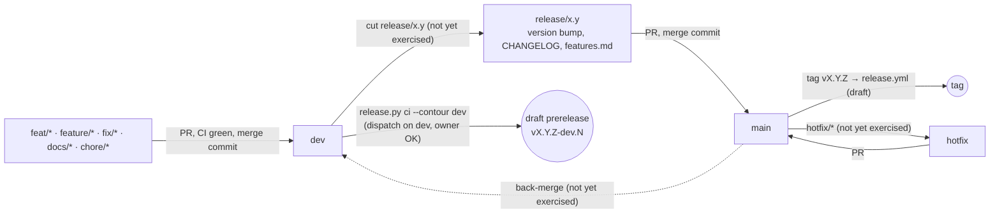
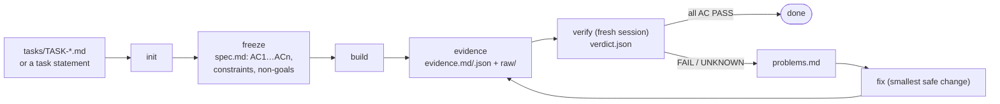

# Engineering methodology

This page describes how work gets done in the OMOBA game repository and its player portal. It covers branching and merging, the definition of done, what to run before a PR, the testing layers, the task proof loop, release documentation, localization, UI verification, the build-cache policy, working with coding agents, and how to record an architecture decision. It describes current practice and links to the detailed documents instead of repeating them. The CI workflows themselves (triggers, jobs, the release draft) are described in [build-and-release.md](build-and-release.md). Anything the repositories could not confirm is listed under [Open questions](#open-questions).

Snapshot: game dev 6d34f98, portal dev 604bc34, 2026-10-24. See [README](README.md).

## Where the rules live

| Source | Tracked | Covers |
| --- | --- | --- |
| [CONTRIBUTING.md](../../CONTRIBUTING.md) | yes | Review expectations, `make check`, SDK pin, harness and Postgres checks, wire-type ownership, licence boundaries, AI-assisted work, maintainers decide what enters the repository (line 38) |
| [Makefile](../../Makefile), [.github/workflows/](../../.github/workflows/) | yes | The gate itself (`check`, `verify-gameplay`, `test-postgres`, `sdk-pin-check`, release targets). CI jobs are described in [build-and-release.md § CI workflows](build-and-release.md#ci-workflows), the release targets in [§ Makefile release wrappers](build-and-release.md#makefile-release-wrappers), and the pre-PR targets under [What to run before a PR](#what-to-run-before-a-pr) |
| [RELEASING.md](../RELEASING.md), [release-compatibility.md](../release-compatibility.md) | yes | Versioning, packaging, compatibility gate, dev-contour builds |
| [dev-quickstart.md](../dev-quickstart.md) | yes | Dev vs prod app identity, the prod-contour iOS Archive guard, release-state tracking, owner-approval gates |
| [i18n.md](../i18n.md), [ui-kit.md](../ui-kit.md) | yes | Dictionaries, guard markers, fonts, UI assets |
| [REFACTORING.md](../REFACTORING.md) "Process rules" | yes | PR and CI rules of the 2026-09 refactoring programme. The branching model below supersedes their merge strategy and target branch. |
| [.claude/rules/ui-verification-budget.md](../../.claude/rules/ui-verification-budget.md), [.claude/skills/omoba-ui-verification/SKILL.md](../../.claude/skills/omoba-ui-verification/SKILL.md) | yes (the only tracked rule) | UI verification budget |
| Local contributor rules: task proof loop, build hygiene, release docs and versioning, project language, worktrees, and general working principles (no placeholder stubs, commit only when asked, roll back a regression) | **no** | The policies summarised on this page |
| The local proof-loop skill and its role prompts | **no** | The task proof loop tooling |

`.gitignore` ignores local agent configuration except the UI budget rule and two skills (`omoba-ui-verification`, `omoba-sprite-character`). It also ignores the `.agent` task folders and the root agent instruction files ([.gitignore](../../.gitignore) lines 26–45).

This page is the tracked summary of those local rules. It is also the tracked source for the English-text rule and the shared build-cache policy that [ADR-023](decisions.md#adr-023-delivery-process-green-gate-dated-progress-notes-english-focused-ui-checks) records. When a local rule and a tracked document disagree, the tracked document wins and the disagreement is a bug to fix. Known disagreements between documents and code:

- [CONTRIBUTING.md](../../CONTRIBUTING.md) (line 32) and the comment above `check` in the [Makefile](../../Makefile) (line 38) call `make check` the gate CI runs. It covers CI's `fmt, clippy, tests` job and most of `python tooling tests`. The other jobs need the commands in [What to run before a PR](#what-to-run-before-a-pr).
- ui-kit.md § Assets gives a 2.3 MiB UI asset budget. `scripts/sync_ui_assets.py` enforces 6.6 MiB (`PACKAGE_BUDGET`, lines 27–30).
- RELEASING.md § Turnkey release commits the version bump to `main`, which does not fit release branches ([Open questions](#open-questions) 1).

## Branching and merging

Since 2026-10-12 the game and portal repositories follow gitflow. The first pull request merged into `dev` was #86 (`c5a0777`, 2026-10-12 17:11 UTC). All 23 first-parent commits on `dev` since `main`'s tip `0c0585c` (2026-10-11) are pull-request merge commits. One branch was merged twice (#89 and #90, both `fix/scanner-safe-lobby-tests`), so PR numbers do not map one-to-one to branches. The portal's `dev` follows the same pattern: nine PR merge commits, #6–#15 (#10 is not on `dev`).



| Branch | Role | Source |
| --- | --- | --- |
| `main` | Released code. Default branch (`origin/HEAD → main`). | `git symbolic-ref refs/remotes/origin/HEAD` |
| `dev` | Integration branch. Feature PRs target it. Dev-contour tester builds come from it. They are started explicitly with `release.py ci --contour dev --ref v<version>-dev.N`, which dispatches `release.yml` on `dev` with `contour=dev`, or with `release.py draft --contour dev --tag v<version>-dev.N`, which uploads local packages. Both make a draft prerelease that targets `dev`. Pushing a `v*-dev*` tag by hand does not work: it builds prod-contour packages and then fails the draft step. | [release.yml](../../.github/workflows/release.yml) lines 10–16, [RELEASING.md § DEV-contour](../RELEASING.md), [ops/vps/dev/README.md](../../ops/vps/dev/README.md) line 201, `release_tag`/`ci_command` in [scripts/release.py](../../scripts/release.py) |
| `feat/*`, `feature/*`, `fix/*`, `docs/*`, `chore/*` | One topic per branch, cut from `dev`. All five prefixes appear on the remote. The local worktree rule suggests `feature/`, `fix/` and `refactor/`. | remote branches; local worktree rule |
| `release/x.y` | Freezes a release from `dev`, carries the version bump, and merges into `main`. Tags are `v<version>` (latest: `v0.44.0`). | gitflow convention; no `release/*` branch exists yet |
| `hotfix/*` | A fix cut from `main` and merged back into it | gitflow convention; not yet exercised |

Market releases are separate. `release.yml` builds only the `global` market, and `release.py ci` refuses any other market. Packages for the free markets (`ru`, `cn`) are built locally (`make release-ru`) into `dist/v<version>-<market>/` and drafted to a `v<version>-<market>` tag. Market releases use the prod contour only (`release_tag` and `ci_command` in [scripts/release.py](../../scripts/release.py)). `cn` is currently blocked in `scripts/markets.py`.

Rules:

- Every change reaches `dev` through a pull request, and the PR is merged with a merge commit. [REFACTORING.md](../REFACTORING.md) rule 2 prescribed squash merges into `main`, but in practice `main` received both kinds ([ARCHITECTURE_REPORT.md §3.1](../ARCHITECTURE_REPORT.md): 9 merge commits and 7 squash commits). `main`'s tip is itself a merge commit (#83).
- REFACTORING.md rule 2 also says never to merge a PR with a red or pending check. It records branch protection on `main` that requires four checks: `fmt, clippy, tests`, `headless gameplay harness`, `postgres-backed tests` and `python tooling tests`. No document says whether the same applies to PRs into `dev`.
- An `ekza-bevy-sdk` pull request whose commit this repository pins must be merged with a merge commit, or the pin must be moved to the merged commit. A squash or rebase merge leaves the pinned commit only on the SDK feature branch, and the pin breaks when that branch is deleted ([scripts/check_sdk_pin.py](../../scripts/check_sdk_pin.py) lines 14–16). Run `make sdk-pin-check` before opening the PR, and `make sdk-pin-check SDK_BRANCH=dev` (or `main`) before merging.
- Commit messages follow Conventional Commits ([CONTRIBUTING.md](../../CONTRIBUTING.md)), for example `feat(market): …` or `fix(avatars): …`.
- The authoritative record of a build's compatibility contract is `compatibility.json`, which `release.py` writes beside the packages ([RELEASING.md § Compatibility gate](../RELEASING.md), [release-compatibility.md](../release-compatibility.md)). The annotated `v0.44.0` tag message also lists the contract (protocol, catalog, geometry, gameplay). That is observed practice for one release, not a rule: the turnkey step in RELEASING.md tags with `-m "OMOBA <version>"` only.
- Distribution, uploads, Apple app records and credentials, DNS, VPS and firewall changes, and Vercel or other hosted-deployment settings need the maintainer's explicit OK ([dev-quickstart.md](../dev-quickstart.md) lines 99–109, 144–149 and 166–169; [ops/vps/dev/README.md](../../ops/vps/dev/README.md) § Owner inputs and line 201). The maintainers decide what enters the official repository ([CONTRIBUTING.md](../../CONTRIBUTING.md) line 38). No tracked document makes merges to `main` or changes to the default branch a separate approval step ([Open questions](#open-questions) 8).

## Definition of done by change type

| Change | Required beyond `make check` | Source |
| --- | --- | --- |
| Any Rust change | `make check` green locally before pushing | [CONTRIBUTING.md](../../CONTRIBUTING.md) |
| Server, gameplay, matchmaking, protocol | `make verify-gameplay` (the headless UDP harness against a freshly built server) | [CONTRIBUTING.md](../../CONTRIBUTING.md), [REFACTORING.md](../REFACTORING.md) rule 3 |
| Wire packet or field | Change only `shared/src/protocol/wire.rs`. Make additive fields `serde(default)` and extend its golden test. Classify new enums in `wire_enums.rs`. Bump the revision that [release-compatibility.md](../release-compatibility.md) requires (`PROTOCOL_VERSION` for incompatible packet meanings). | [CONTRIBUTING.md](../../CONTRIBUTING.md), [ARCHITECTURE.md § Protocol rules](../ARCHITECTURE.md) |
| Intended change to shared simulation or balance | Re-baseline the Elite bot trace as its module docs describe: take the glibc 2.39 block from CI's `elite-bot-trace` artifact, and re-record or delete the other blocks. Say in the commit message that it re-baselines the Elite trace, and why. Bump `GAMEPLAY_REVISION` (`shared/src/compatibility.rs`) when the change must ship together with matching clients. | [common/src/bots_trace_tests.rs](../../common/src/bots_trace_tests.rs) lines 30–50, [release-compatibility.md](../release-compatibility.md) |
| Career store, Account API, migrations | `make test-postgres` against a disposable database | [scripts/postgres_tests.py](../../scripts/postgres_tests.py) |
| Moving the SDK pin | `make sdk-pin-check` (with `SDK_BRANCH=dev` before merging) | [Makefile](../../Makefile) |
| Player-facing client text | Dictionaries for every shipped locale, `cargo test -p client i18n`, zh-Hans display subset coverage | [Localization](#localization-rules) |
| UI | One focused capture: one language, one viewport | [UI verification budget](#ui-verification-budget) |
| iOS-only code (`target_os = "ios"`, StoreKit FFI) | Dispatch [ios-check.yml](../../.github/workflows/ios-check.yml) on the branch | ios-check.yml header; local build-hygiene rule |
| Release tooling (`.github/workflows/release.yml`, `scripts/release.py`, `mobile/android/**`) | The PR triggers [release.yml](../../.github/workflows/release.yml), which builds the desktop (macOS, Windows, Linux) and Android packages without creating a release. iOS is local only. | release.yml `on.pull_request.paths` (lines 20–25); [build-and-release.md § CI workflows](build-and-release.md#ci-workflows) |
| Free-market code (`OMOBA_MARKET=ru` or `cn`) | Clippy and tests for that market, run locally. CI builds only `global` ([build-and-release.md § Guards and coverage](build-and-release.md#guards-and-coverage)). | example of a local RU run: [progress/2026-10-23-market-gating.md](../progress/2026-10-23-market-gating.md) § Checks |
| Toolchain | A separate change that updates `rust-toolchain.toml` **and** every `toolchain: 1.95.0` in `.github/workflows/*.yml` | [CONTRIBUTING.md](../../CONTRIBUTING.md), [rust-toolchain.toml](../../rust-toolchain.toml) |
| Release-relevant behaviour | `CHANGELOG.md`, `docs/features.md` and a `docs/progress/` note | [Release documentation](#release-documentation-and-versioning) |
| Documentation only | Link and content review; no game build | [CONTRIBUTING.md](../../CONTRIBUTING.md) |
| Code placement | Reusable shared logic goes in the MPL crates. Moving AGPL server code to another directory does not relicense it. No silent dependency or asset-licence changes. | [CONTRIBUTING.md](../../CONTRIBUTING.md) |

## What to run before a PR

Iterate with targeted commands, then run the full set once before pushing ([Build cache and disk policy](#build-cache-and-disk-policy)):

1. **`make check`, always.** It runs `fmt-check`, `lint`, `check-no-qa`, `test` and `test-scripts` ([Makefile](../../Makefile) line 41). On a machine without glibc 2.39 the Elite bot-trace comparison may skip with a notice. CI enforces it, and the determinism check runs everywhere.
2. **The extra checks for the change type** listed in the [definition of done](#definition-of-done-by-change-type), such as `make verify-gameplay` (not in `make check` because it launches servers), `make test-postgres` or `make sdk-pin-check`.
3. **What CI checks and `make check` does not**, when the change touches that area:
   - Android packaging (`mobile/android/`): `python3 -m unittest discover -s mobile/android -p 'test_*.py'`. CI's `python tooling tests` job runs these tests, but `make test-scripts` skips them.
   - Bot behaviour or difficulty: `cargo test --release --locked -p common --features test-support --test bot_difficulty_sim -- --ignored smoke_` (CI's `bot difficulty smoke`). The full matrix is [bot-sim.yml](../../.github/workflows/bot-sim.yml), run by dispatch.
   - Dev-contour code paths (`BUILD_CONTOUR = Some("dev")`): there is no make target. CI's `client in the dev contour` job lints and tests the client with the dev contour's settings. Rely on it, or copy its environment from [ci.yml](../../.github/workflows/ci.yml).
   - Android-specific Rust: `cargo check -p client --target aarch64-linux-android` needs the NDK. Prefer CI's `android compile check`.
   - iOS-only code and free-market code have no pull-request job. The [definition of done](#definition-of-done-by-change-type) says what to run instead.

CI runs on every pull request. [build-and-release.md § CI workflows](build-and-release.md#ci-workflows) lists the jobs and what each runs. The steps above name the CI job each local command stands in for.

The player portal has no CI workflow. Before a portal PR, run `npm test`, `npm run typecheck` and `npm run build` (portal `docs/TESTING.md`). Before publishing, portal `docs/vercel.md` adds the end-to-end smoke suites ([build-and-release.md § Player portal](build-and-release.md#player-portal-omoba-web)).

## Testing layers

| Layer | What it proves | Where | Run |
| --- | --- | --- | --- |
| Rust unit and integration | Rules, state machines, UI systems in a headless `App` | `src/**/tests*`, crate `tests/`. Counts on 2026-10-24: client 1418, server 343, shared 147, harness 31, passport 50, Account API lib 15 ([progress note](../progress/2026-10-23-market-gating.md) § Checks). | `make test` |
| Golden protocol | Exact JSON bytes of packets and of the per-recipient snapshot view | `GOLDEN_*` in [shared/src/protocol/wire.rs](../../shared/src/protocol/wire.rs), [server/src/tests/player_view.rs](../../server/src/tests/player_view.rs), enum policy in [wire_enums.rs](../../shared/src/protocol/wire_enums.rs) | `make test` |
| Catalog validation | Hero and item JSON shape, order and ranges | `cargo test -p shared` ([ARCHITECTURE.md § Adding content](../ARCHITECTURE.md)) | `make test` |
| Bot determinism trace | Elite bot behaviour is bit-stable for each `libm` fingerprint | [common/src/bots_trace_tests.rs](../../common/src/bots_trace_tests.rs) | `make test`; enforced in CI |
| Bot difficulty simulation | Fixed-seed rounds between difficulty levels, interval assertions | [common/tests/bot_difficulty_sim.rs](../../common/tests/bot_difficulty_sim.rs) (ignored tests) | smoke in CI, full matrix by dispatch |
| Harness (black-box UDP) | A real match end to end: the real `server` binary runs as a child on a unique loopback port and is killed on drop. On a panic it prints the server's last log lines. It warns when `target/debug/server` is older than the `server/` or `shared/` sources. | [harness/src/server.rs](../../harness/src/server.rs) lines 1–13, [harness/tests/](../../harness/tests/) | `make verify-gameplay` (serial: `--test-threads=1`) |
| Postgres-backed | Career store, Account API and server persistence against real PostgreSQL, with production migrations and restricted runtime roles | `#[ignore]` tests in `career-store`, `account-api/tests/*postgres*.rs`, `server` | `make test-postgres` |
| Python tooling | Release packaging, launcher, asset gate, iOS and Android packagers, contours and markets, the iOS release guard | `scripts/test_*.py`, `mobile/ios`, `mobile/android` | `make test-scripts`, plus the Android tests (see [What to run before a PR](#what-to-run-before-a-pr)) |
| i18n guards | Dictionary parity, placeholders, key existence, strict modules | [client/src/i18n/tests.rs](../../client/src/i18n/tests.rs) | `cargo test -p client i18n` |
| Compatibility probe | A build's contract checked read-only against a live lobby or worker | `shared` example `compatibility` | `make compatibility-check` ([release-compatibility.md](../release-compatibility.md)) |
| Portal unit | BFF rules, contours, markets, VK ID (`node:test`) | portal `tests/*.test.mjs` | `npm test` |
| Portal end to end | Browser suites (21 of the 23 `*.e2e.mjs` scripts) use Playwright against the real BFF, with a disposable PostgreSQL 18 cluster on loopback and synthetic identities only. Some scripts use loopback fakes instead: `vercel-cli.e2e.mjs` fakes the Vercel API, and `market-profiles.e2e.mjs` fakes the Account API. `contour.e2e.mjs` and `vercel-cli.e2e.mjs` do not use Playwright. | portal `tests/*.e2e.mjs`, `docs/TESTING.md` | `npm run test:<name>` or `node tests/<name>.e2e.mjs` |
| Visual | Rendered screens | `scripts/capture_ui_audit.py` (`make ui-audit`, the full sweep), `scripts/capture_showcase.py` | opt-in (see the UI budget) |
| Manual | Playtests, device behaviour | [playtest-script.md](../playtest-script.md), [bug-report-template.md](../bug-report-template.md). [manual-qa-matrix.md](../manual-qa-matrix.md), [release-gate-checklist.md](../release-gate-checklist.md) and [release-readiness-report.md](../release-readiness-report.md) record the April 2026 gameplay slice (TASK-12, last changed 2026-04-02). | by hand |

Postgres rules ([scripts/postgres_tests.py](../../scripts/postgres_tests.py); the data-layer view is in [data.md § Testing the data layer](data.md#testing-the-data-layer)):

- `OMOBA_TEST_DATABASE_URL` is required and must point at a disposable database, never production. `OMOBA_PORTAL_TEST_DATABASE_URL` defaults to the same database. `OMOBA_PORTAL_ROLE_TEST_URL` defaults to the same database, logged in as `omoba_portal_test`. `psql` must be on `PATH`.
- The script migrates the database with `omoba-account-api migrate`. It creates the roles `omoba_portal_test` (LOGIN) and `omoba_game_test` (NOLOGIN) and applies `account-api/ops/grants.sql`.
- It sets `OMOBA_REQUIRE_TEST_DATABASE=1`, so a test that would otherwise skip without a URL fails instead.
- It runs `omoba-career-store`, `omoba-account-api` and `server` serially: `-- --include-ignored --test-threads=1`.
- Isolation: the career-store fixture creates its own schema, `career_test_<pid>_<n>` ([career_store_tests.rs](../../career-store/src/career_store_tests.rs)). The handle-migration test in `account-api/tests/postgres.rs` uses a transaction-scoped `handles_fixture_<random>` schema and rolls it back. The other account-api suites, such as `devices_postgres.rs` and `class_builds_postgres.rs`, use the migrated disposable database directly. Their isolation comes from that database and the serial run. `class_builds_postgres.rs` accepts only loopback `5432/omoba_test` (CI) or `55581/workshop_test`. No in-memory substitute is used (`account-api/tests/postgres.rs` line 1).

Evidence limits are part of the result. A phone-sized preview is not a physical-device test ([CONTRIBUTING.md](../../CONTRIBUTING.md)). Browser screenshots prove rendering, not native input or key storage (portal `docs/TESTING.md`). Checks that were not run are reported as NOT_RUN or UNKNOWN, never as PASS.

## Task proof loop

The proof loop is used for non-trivial tasks: features, refactors, migrations and bug fixes. Release tasks have also used it (`RELEASE-041-20261005`, `RELEASE-COMPAT-20261004`). Its tooling belongs to a local skill and is not in this repository. That includes `task_loop.py`, the JSON schemas, and the role prompts (spec freezer, builder, verifier, fixer), which the skill installs into ignored local folders. Only the artifacts are in the repository.



| Artifact (`.agent/tasks/<TASK_ID>/`) | Content |
| --- | --- |
| `spec.md` | Original task, acceptance criteria `AC1…`, constraints and non-goals, frozen before any production edit (example: `MARKET-GATING/spec.md`) |
| `evidence.md`, `evidence.json` | A PASS, FAIL or UNKNOWN for each criterion. Each PASS cites a command, its exit code, file paths or a `raw/` log. |
| `raw/` | Command output (`clippy.log`, `rust-tests.log`, …) |
| `verdict.json` | The fresh verifier's verdict for each criterion and `overall_status` |
| `problems.md` | Written only when the verdict is not PASS. For each failing criterion: reproduction, expected vs actual, and the smallest safe fix. |

Rules from the local proof-loop rule:

- When a task file `tasks/TASK-*.md` is referenced, `TASK_ID` comes from its filename. Ad-hoc tasks choose their own ID in practice, for example `DEV-ACCOUNT-WIRING-20261016`.
- Reuse an existing task folder and continue from the next missing step. If none exists, run the skill's `init` first. The rule's `scripts/task_loop.py` path is relative to the skill, not to this repository.
- A task is not complete until every criterion in `verdict.json` is PASS.
- Non-trivial work gets its own worktree and branch. Check `git worktree list` first.
- Keep every artifact inside `.agent/tasks/<TASK_ID>/`.

Rules from the local proof-loop skill and its role prompts:

- Roles stay separate. The verifier is a fresh session or subagent. It judges the current tree and fresh reruns, not the builder's account, and it does not edit production code or backfill evidence.
- The fixer reads only `spec.md`, `verdict.json` and `problems.md`. It reconfirms each problem, makes the smallest safe change, regenerates the evidence, and does not sign off.

From the tracked UI budget rule: freeze acceptance criteria within the [UI verification budget](#ui-verification-budget) ([ui-verification-budget.md](../../.claude/rules/ui-verification-budget.md) line 7).

Current practice:

- `.agent` has been ignored since 2026-04-01 (`5f23238`), so task folders reach the index only by force-add. `ea5357d` (2026-09-19) untracked the task logs that were in the index at that time.
- Since then, six folders have been force-added as evidence in their PRs (2026-10-05 to 2026-10-23). Only `DEV-ACCOUNT-WIRING-20261016` has a committed `verdict.json`.
- [tasks/](../../tasks/) holds one `TASK-*.md` file and an MVP checklist.

## Release documentation and versioning

- **Version.** The only source is `[workspace.package].version` in [Cargo.toml](../../Cargo.toml) (0.44.0), following SemVer: patch for fixes, minor for compatible features, major for breaking changes. `0.x` releases are playtests and are marked pre-release on GitHub. `1.0.0` is reserved for public launch ([RELEASING.md](../RELEASING.md)). The Android `versionCode` derives from the version ([build-and-release.md § Versioning](build-and-release.md#versioning)).
- **Changelog.** [CHANGELOG.md](../../CHANGELOG.md) is newest first. Feature PRs add bullets at the top of `## [Unreleased]`. The release moves them into `## [x.y.z] - date`, and `make release-notes` reads that section.
- **Features.** Refresh [docs/features.md](../features.md) whenever the feature surface changes. Its newest area comes first.
- **Session notes.** Each substantial session gets a [docs/progress/](../progress/) note, `docs/progress/<YYYY-MM-DD>-<slug>.md`, with the goal, changes, checks and remaining risks. Machine output may sit beside it as `<date>-<slug>.json` or in a directory. Later follow-ups are added as dated sections instead of rewriting the note (for example "Combined dev integration (2026-10-15)" in `2026-10-11-dawnweaver-reference.md`).
- **Docs-only changes.** Documentation, workflow and rule changes may skip the version bump, but they are still logged in the changelog and a progress note (local release-docs rule).
- **Plans.** [docs/plans/](../plans/) holds forward-looking designs. Their status markers are not uniform:
  - `bot-personas.md`, `game-directory.md` and `rating-skill-slots.md` open with a `Status:` line (idea / concept / design / in progress), a date, and the origin of binding owner decisions.
  - `studio-skill-asset-catalog.md` has a `Status:` line after a "Status update" blockquote.
  - `client-10-15.md` and `steps-11-13.md` carry status for each step.
  - `creator-loop-and-class-builder.md` opens with a `Decision:` line, and `offline-practice-parity.md` with an `Owner feedback:` line.
  - `combat-visual-uplift.md` and `community-sculptures.md` have no status line.

  Opening a new plan with a `Status:` line is the recommended convention.
- **Packages.** `scripts/release.py` builds into one folder per market and contour, `dist/v<version>[-<market>][-dev]/` (for example `dist/v0.44.0/`, `dist/v<version>-ru/`, `dist/v<version>-dev/`), with `SHA256SUMS.txt` and `compatibility.json` (`dist_path` in [scripts/release.py](../../scripts/release.py); [Makefile](../../Makefile) `release-ru`, `release-dev`; [build-and-release.md § Artifact and dist naming](build-and-release.md#artifact-and-dist-naming)). GitHub releases are created as drafts, and nothing is published without an explicit step.
- **Compatibility gate.** Before distribution, probe the target lobby **and** a staged worker with the artifact's own `compatibility.json`. The exit codes are 0 (compatible), 2 (confirmed mismatch) and 3 (unavailable or invalid input), and any nonzero result blocks distribution ([release-compatibility.md](../release-compatibility.md) § Release commands).
- **Prod-contour iOS Archive guard.** The prod-contour Xcode Archive and `release.py build ios --contour prod` stop before Cargo unless all of these hold:
  - the build is on `main`, or on a detached HEAD at an exact stable tag that `origin/main` contains;
  - the tree is clean.

  Dev builds allow local changes. `prepare_testflight.py` refuses prebuilt prod-contour `.app`s. The guard is tested by `scripts/test_ios_release_guard.py` ([dev-quickstart.md](../dev-quickstart.md) lines 24–47).
- **Release states.** Track built → signed → uploaded → processed → assigned to testers → installed → tested as separate states. An archive or a successful upload alone does not prove that testers can install or play ([dev-quickstart.md](../dev-quickstart.md) lines 121–123).
- **Language.** Repository-facing text (code, commits, changelog, docs) is in English, unless a file already has an explicit reason to use another language (local project-language rule). A scan of the repository finds these Russian files: `ARCHITECTURE_CURRENT.md`, `ARCHITECTURE_REPORT.md`, `REFACTORING_SCALE.md`, `plans/combat-visual-uplift.md`, and the first section of `dev-quickstart.md` ("Как не перепутать DEV и PROD", lines 3–56).

## Localization rules

The details are in [i18n.md](../i18n.md). The working rules:

- **Dictionaries.** All player-facing client text comes from `client/i18n/<locale>/<namespace>.json`, plus a `_meta.json` that holds `code` and `native_name`. `en` is required and is the fallback; `ru` and `zh-Hans` also ship. `client/build.rs` embeds the dictionaries at compile time, so adding a language needs no Rust change.
- **Keys and placeholders.** Keys are `<namespace>.<area>.<item>`, lowercase, named by meaning. Placeholders are named (`{addr}`), and a translation uses exactly the English placeholders.
- **Calls.** Write keys as string literals in the first argument of `tr`, `trf`, `tr_in`, `trf_in`, `Localized::new` or `Localized::with_args`. The source-scan guards (`every_literal_key_in_client_src_exists_in_english`, `every_key_shaped_literal_in_client_src_exists_in_english`) then catch typos.
- **Parity guards.** These tests fail on locale drift: `every_locale_has_exactly_the_english_files_and_keys`, `every_translation_uses_the_english_placeholders`, `namespaces_prefix_their_keys_and_meta_files_are_valid` and `the_registry_is_exactly_the_locale_folders_on_disk` ([client/src/i18n/tests.rs](../../client/src/i18n/tests.rs)).
- **Strict modules.** A `// i18n-strict` line marks a fully migrated module (89 files today). `strict_modules_have_no_hardcoded_english` then rejects English UI literals in it. `// i18n-allow` excuses a single line. `report_hardcoded_english` (an ignored test) lists what remains.
- **Game data.** Never translate shared catalogs or wire enums. Show them through the `i18n::data` helpers, keyed by stable id. `Name` and `TestId` are identities and are never translated.
- **Tests in other languages.** Use `Locale::detached` in-process. A test that needs `tr` in another language re-runs itself alone in a child process with `i18n::testing::isolated`.
- **zh-Hans display font.** The display face is a subset, `NotoSerifSC-SemiBold-subset.ttf`, that holds only characters used in the dictionaries. `the_display_subset_covers_every_zh_hans_dictionary_character` ([client/src/ui/theme.rs](../../client/src/ui/theme.rs)) fails when new zh-Hans copy outside `kit.gallery.*` uses a missing character. Rebuild the subset with the UI handoff's font tool, then reinstall it with `python3 scripts/sync_ui_assets.py` ([ui-kit.md § Fonts and text roles](../ui-kit.md)). `--check` verifies files, byte counts and the 6.6 MiB package budget (ui-kit.md still says 2.3 MiB; see [Where the rules live](#where-the-rules-live)). Body CJK text uses the bundled Noto Sans CJK SC.
- **Startup language.** The first-launch language follows the build market (`shared::market::Market::default_locale`): English for global, Russian for `ru`, Simplified Chinese for `cn` ([markets.md](../markets.md)). The saved choice overrides it, and so does `OMOBA_LANGUAGE`, a QA and capture override that is not saved (`client/src/i18n/plugin.rs`).
- **Portal.** The portal localizes separately (en, ru, zh) by cookie, `Accept-Language` and country (portal `docs/LOCALIZATION.md`).

## UI verification budget

Source: [.claude/rules/ui-verification-budget.md](../../.claude/rules/ui-verification-budget.md) and the [omoba-ui-verification skill](../../.claude/skills/omoba-ui-verification/SKILL.md), the maintainer's standing instruction since 2026-09-29.

- **Default scope.** Routine work uses one language, one device or viewport, and only the affected screens and states. This holds for implementation, evidence and fresh verification alike.
- **Device.** Use the device the bug implicates or the task names. Otherwise reuse the cheapest available representative profile. If none is selected, use the iPhone 16 landscape viewport (852 × 393 logical points). A viewport check does not prove behaviour on physical iOS hardware.
- **Language.** English, unless the task concerns another language.
- **Full matrix.** A full device × language × screen sweep (for example `make ui-audit`) runs only when explicitly requested for that run. "Release-ready", "check everything" or a version bump does not enable it, and the opt-in does not carry over to later tasks. A request for specific extra devices or languages authorizes only that scope.
- **Older specs.** If an older task spec assumes a broad matrix without an explicit request, record a scope amendment before proceeding. Never mark untested criteria PASS.
- **Functional checks stay.** The budget limits visual sweeps, not functional checks.
- **Reporting.** Record the language, device or viewport, build identity and screens checked, and say what was not checked. A failed focused check is not a reason to expand into the full matrix.
- **Docs-only changes** need no game launch.

## Build cache and disk policy

A full workspace build writes 15–30 GB, according to the local build-hygiene rule.

- **One shared cache.** All checkouts and worktrees share one cargo target directory in the primary checkout: `export CARGO_TARGET_DIR="$(git rev-parse --path-format=absolute --git-common-dir)/../target"`. The tracked docs use this form ([dev-quickstart.md](../dev-quickstart.md), [release-compatibility.md](../release-compatibility.md)). A coordinator may assign a second cache, `target-b` (the local rule; also [release-compatibility.md](../release-compatibility.md) § Release commands). There are never more than two, and never a per-worktree `target/`. Cargo's lock serialises builds on the same cache.
- **No `cargo clean`**, and no deleting the shared cache, unless the maintainer asks. Iterate with targeted commands (`cargo check -p client`, `cargo test -p client --lib <filter>`) and run the full gate once before committing.
- **Heavy platform checks go to CI.** iOS: dispatch `ios-check.yml`. Android: the PR's `android compile check`. Build device packages (APK, `.xcarchive`, IPA) locally only when someone needs the artifact.
- **Clean up after the task.** Remove the worktree after merge, and delete the packages, archives and scratch builds the task created.
- **Check free space before heavy work.** Stop below about 20 GB free. `release.py build all` enforces the same floor through `OMOBA_MIN_FREE_GIB` (default 20); single-platform builds do not check it ([scripts/release.py](../../scripts/release.py) `command_build`, [RELEASING.md](../RELEASING.md)).

## Working with coding agents

Coding agents are welcome contributors under the same rules as people. CONTRIBUTING requires that AI-assisted work be reviewed, verified and explainable, with its provenance stated. The local contributor rules add:

- **Worktree per task.** Every non-trivial task gets its own `git worktree` and branch. Check `git worktree list` first. Never attach one branch to two worktrees. Keep the primary checkout clean, and remove worktrees with `git worktree remove`, not by deleting directories (local worktree rule; the proof-loop rule repeats the first three).
- **Workspace leases.** When several agents share a workspace, each takes an exclusive write lease on the paths it will change before its first write. Agents work on disjoint scopes or wait. They never break another agent's live lease, and they release their own when finished. The lease mechanism lives outside this repository.
- **Evidence before claims.** A result is reported only with its proof: the command, the exit code, the artifact path. "Verified" means re-run against the current tree. Checks that were not run are named as such. A regression is rolled back rather than argued away (local working principles).
- **No placeholders.** Do not write "in a real implementation…" stubs. Ship working code or leave the item explicitly open (local working principles).
- **Commit and push only when asked** (local working principles). Use Conventional Commits.
- **Role separation in the proof loop.** A spec freezer, a builder that also packs evidence, a fresh verifier and a fixer each act only on their own artifacts (the local proof-loop skill; see [Task proof loop](#task-proof-loop)).
- **Maintainer approval** is required for distribution and uploads, Apple records and credentials, deployment, DNS, VPS and firewall changes, and hosted-environment settings such as Vercel branch tracking ([dev-quickstart.md](../dev-quickstart.md), [ops/vps/dev/README.md](../../ops/vps/dev/README.md)). The UI skill also states that it authorizes no CI, deployment or production changes.
- **Portal agents.** Unlike the game repository, which ignores them, the portal tracks `AGENTS.md` and `CLAUDE.md` (`CLAUDE.md` only includes `AGENTS.md`). `AGENTS.md` tells agents to read the guide bundled under `node_modules/next/dist/docs/` before writing framework code, because Next.js 16 differs from older versions. `next dev` rewrites that block. Next.js is pinned at 16.3.8 (portal `package.json`).

## Recording an architecture decision

Record an ADR when a change sets or alters any of these:

- a contract: wire protocol policy, compatibility revisions, Account API or storage schema ownership, database roles
- a trust boundary: server authority, passport or account identity, market or contour isolation
- the build and release topology: markets, contours, platforms, signing
- a process rule: branching, required gates
- a licence boundary
- a pinned dependency whose choice has consequences

Tuning, bug fixes and copy changes do not need one.

**Where.** [decisions.md](decisions.md) is the single ADR log, and there are no separate ADR files. Append the next number as an `ADR-NNN` section after the last record (three digits; the latest is ADR-023), and add a row to the index table at the top of decisions.md. Never renumber or delete a record. Ideas that are not yet decisions can be listed under [Proposals not yet decided](decisions.md#proposals-not-yet-decided).

**Format.** Write in English, in the shape of the existing records:

```markdown
## ADR-NNN: <decision in a few words>

- **Date:** YYYY-MM-DD
- **Status:** Proposed | Accepted | Accepted, partly implemented | Accepted, amended | Superseded by ADR-NNN
- **Scope:** crates, repositories, contours or markets affected
- **Enforced by:** test name, CI job, script or "review only"

**Context.** What forces the decision; links to code, plans and progress notes.

**Decision.** What is now true, stated as rules.

**Consequences.** What becomes easier, harder, or must change together; migration and rollout order.

**Alternatives considered.** Options rejected and why.

**Links:** the detailed documents, as relative links.
```

The status values are defined at the top of [decisions.md](decisions.md). The retrospective records (ADR-001 to ADR-023) mark their date line "Recorded retrospectively" and omit Scope, Enforced by and Alternatives considered. New records fill in every field.

Process:

- Add the ADR in the same PR as the change it governs. If the decision comes before the work, add it as **Proposed** and change it to **Accepted** in the implementing PR.
- Link the ADR from the architecture page that describes the affected area.
- Never rewrite an accepted decision. Record a later change in one of two ways. Add a dated **Amendment** paragraph inside the record and set its status to **Accepted, amended**, as in ADR-022. Or write a new ADR that supersedes it, and change only the old record's Status line and index row to **Superseded by ADR-NNN**.
- Log the ADR like any docs change: a changelog bullet and the session's progress note.

Earlier decisions are recorded retrospectively in decisions.md (ADR-001 to ADR-023). Their sources stay where they are, and new ADRs cite them when they build on them:

- [docs/plans/](../plans/): status lines and binding owner decisions
- [REFACTORING.md](../REFACTORING.md) process rules
- [docs/progress/](../progress/) notes
- the Ekza umbrella workspace's own ADRs, for cross-product decisions (ADR-008 cites its ADR 0001)

## Open questions

1. **Gitflow is partly unexercised.** This page is the only tracked description of the branching model. No `release/*` or `hotfix/*` branch has been cut yet, and the latest tag, `v0.44.0`, predates `dev`. The back-merge policy (release or hotfix into `dev`) is unconfirmed. [RELEASING.md § Turnkey release](../RELEASING.md) still says to merge the release PR into `main` and then commit the version bump to `main`, which needs reconciling with release branches. The dev-contour release path has been used once: [dev-quickstart.md](../dev-quickstart.md) (lines 144–149, as observed on 2026-10-14) records a draft `v0.44.0-dev.1` targeting `1f4ad10`. That commit predates connection profiles, so the draft must not be used to accept newer features. Whether the draft still exists could not be checked offline.
2. **CI does not re-check `dev` after merges.** CI has no push trigger for `dev` ([build-and-release.md § CI workflows](build-and-release.md#ci-workflows)), and the nightly schedule and the weekly `ios-check.yml` run on the default branch (`main`). A merge of two green PRs into `dev` therefore gets no post-merge CI run. Required checks are documented only for `main` ([REFACTORING.md](../REFACTORING.md) rule 2). Whether `dev` has branch protection, and whether `main`'s four required checks are still configured, could not be confirmed offline.
3. **`make check` and CI differ.** `make test-scripts` skips the `mobile/android` tests, and the dev-contour client job has no make target. Should both be added to the Makefile?
4. **Proof-loop artifacts lack a commit policy.** `.agent` is ignored, yet six task folders are force-added, and only one has a `verdict.json`. Which artifacts must be committed is undecided. The proof-loop tooling and role prompts are not versioned with the repository.
5. **Cache count.** The local rule and [release-compatibility.md](../release-compatibility.md) allow two shared caches (A and B). [dev-quickstart.md](../dev-quickstart.md) shows only A. Confirm which applies.
6. **Untracked rules.** Should the local contributor rules (proof loop, build hygiene, release docs, project language, worktrees) be promoted into tracked files, for example CONTRIBUTING.md? Until then this page is their only tracked summary.
7. **Portal CI.** The portal repository has no CI workflow. Is the local `npm test` / `typecheck` / `build` gate meant to stay the only gate?
8. **Merges to `main` and the default branch.** In practice these are maintainer decisions, and the local contributor rules reserve `main`, releases and production deploys for the owner. No tracked document says so beyond CONTRIBUTING.md line 38 ("The maintainers decide what enters the official repository").
9. **Historical QA documents.** [release-gate-checklist.md](../release-gate-checklist.md), [release-readiness-report.md](../release-readiness-report.md) and [manual-qa-matrix.md](../manual-qa-matrix.md) describe the April 2026 gameplay slice. Should they be updated or marked historical?
10. **PostgreSQL version.** CI's `postgres` job uses `postgres:16`. The portal's `docs/TESTING.md` and [progress/2026-10-24-market-profiles.md](../progress/2026-10-24-market-profiles.md) use PostgreSQL 18. No document explains the mismatch. The production host runs PostgreSQL 16 ([data.md › PostgreSQL layout](data.md#postgresql-layout)), the same major version as CI.
11. **Plan status convention.** Plans have no uniform status marker (see [Release documentation](#release-documentation-and-versioning)). A proposed reading, that plans recorded since 2026-10-12 open with a `Status:` line, does not hold: `community-sculptures.md` (added 2026-10-15) has none, while the older `studio-skill-asset-catalog.md` (2026-10-09) has one. Should a `Status:` line be required for new plans?

Stale statements in older documents are listed once, in [README § Known drift in older docs](README.md#known-drift-in-older-docs).
