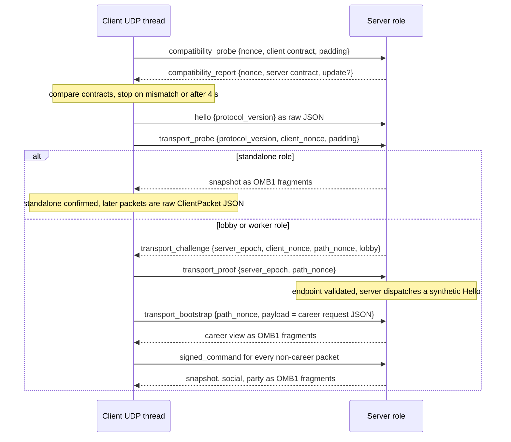
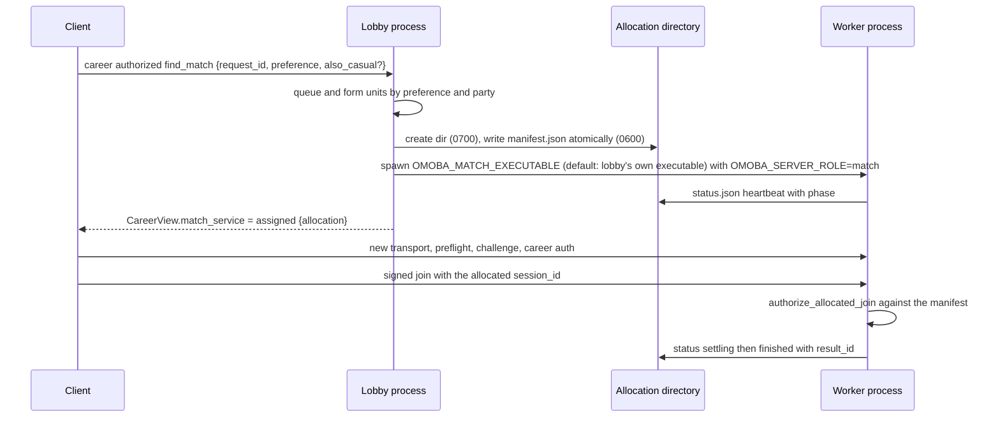
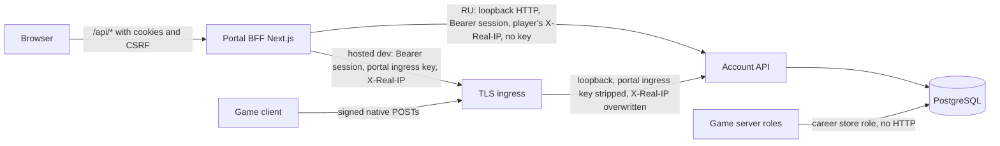

# Protocols and contracts

This page maps every contract that crosses a process or trust boundary in OMOBA: the UDP game protocol and its framing, the compatibility preflight, public admission and signed commands, the lobby-to-worker handoff, the Account API HTTP contract, the player portal's BFF, and the Ekza contracts the game consumes, plus the build-time market switches that turn the Ekza and payment contracts off. For each contract it says who owns the definition, how the contract is versioned, and what has to change when it evolves. Wherever another doc already has the details, this page links to it and does not repeat them.

Snapshot: game dev 6d34f98, portal dev 604bc34, 2026-10-24. See [README](README.md).

## Contract map

| Contract | Peers | Encoding | Version marker | Source of truth | Details |
| --- | --- | --- | --- | --- | --- |
| Compatibility preflight | client, operator CLI → any server role | JSON over UDP, ≤ 2 KiB | `HANDSHAKE_VERSION` + `ReleaseContract` | [`shared/src/compatibility.rs`](../../shared/src/compatibility.rs) | [release-compatibility.md](../release-compatibility.md) |
| Gameplay packets | client, offline sim, harness ↔ server | JSON over UDP, internally tagged | `PROTOCOL_VERSION` | [`shared/src/protocol.rs`](../../shared/src/protocol.rs), [`shared/src/protocol/wire.rs`](../../shared/src/protocol/wire.rs) | [ARCHITECTURE.md § Protocol rules](../ARCHITECTURE.md#protocol-rules) |
| Snapshot framing | server → client | 30-byte binary header + JSON chunk | `OMB1` magic + protocol in every fragment | [`shared/src/transport.rs`](../../shared/src/transport.rs) | this page |
| Public admission and signed commands | client ↔ lobby/worker | JSON over UDP, ≤ 12 KiB, Ed25519 | `omoba.gameplay.command.v1`, carried by `PROTOCOL_VERSION` | [`shared/src/public_transport.rs`](../../shared/src/public_transport.rs), [`server/src/public_transport.rs`](../../server/src/public_transport.rs), [`client/src/net/public_transport.rs`](../../client/src/net/public_transport.rs) | [public-mvp.md](../public-mvp.md) |
| Career/account requests | client ↔ server, inside `ClientPacket::Career` | JSON, Ed25519 | `omoba.career.auth.v1`, `omoba.career.request.v1` | [`shared/src/career.rs`](../../shared/src/career.rs), [`server/src/career_backend.rs`](../../server/src/career_backend.rs) | [match-progression.md](../match-progression.md), [player-handles.md](../player-handles.md) |
| Worker allocation | lobby ↔ worker process (same host, files) | JSON files | manifest `version: 1` | [`server/src/match_allocation.rs`](../../server/src/match_allocation.rs), [`server/src/match_pool.rs`](../../server/src/match_pool.rs) | [public-mvp.md](../public-mvp.md) |
| Lobby → client handoff | lobby → client, inside `CareerView` | JSON | `PROTOCOL_VERSION` | [`shared/src/match_service.rs`](../../shared/src/match_service.rs), [`client/src/match_service.rs`](../../client/src/match_service.rs) | [party.md](../party.md) |
| Account API | game (signed native routes), portal BFF → API | HTTPS JSON | OpenAPI 3.1 document + portal schema 7 + career schema 3 | [`account-api/src/lib.rs`](../../account-api/src/lib.rs) (`dispatch`), [`account-api/docs/openapi.json`](../../account-api/docs/openapi.json) | [account-api/README.md](../../account-api/README.md), [supporter.md](../supporter.md) |
| Portal BFF | browser → Next.js → Account API / Ekza Registry | HTTPS JSON + cookies | path allowlist | omoba-web `src/lib/security.mjs`, `src/app/api/[...path]/route.ts`, `src/app/api/{ekza,sponsor}/[...path]/route.ts` | omoba-web `docs/` |
| Ekza Registry and passport | game client, game server, Account API, portal BFF → Ekza services | HTTPS JSON | SDK git pin + envelope `schema` strings | `ekza-bevy-sdk` (pinned rev in root `Cargo.toml`), [`passport/src/`](../../passport/src/), [`account-api/src/ekza_library.rs`](../../account-api/src/ekza_library.rs), omoba-web `src/lib/market-server.mjs` | [markets.md](../markets.md), [community-sculptures.md](../community-sculptures.md) |
| Market switches | build time | `const` from `option_env!` | `OMOBA_MARKET`, `OMOBA_FEATURE_*` | [`shared/src/market.rs`](../../shared/src/market.rs) | [markets.md](../markets.md) |

### Current version markers

| Marker | Value | Defined in |
| --- | --- | --- |
| `PROTOCOL_VERSION` | `11` | `shared/src/protocol.rs` |
| `HANDSHAKE_VERSION` | `1` | `shared/src/compatibility.rs` |
| `CATALOG_REVISION` | `standard-kits-8` | `shared/src/loadout.rs` |
| `GEOMETRY_ID` | `verdant-confluence-compact-v2` | `shared/src/map.rs` |
| `GAMEPLAY_REVISION` | `dawnweaver-2026-10-11-reference` | `shared/src/compatibility.rs` |
| `POLICY_PROTOCOL_VERSION` / `POLICY_HANDSHAKE_VERSION` | `11` / `1` | `shared/src/protocol/wire_enums.rs` |
| Snapshot fragment magic | `OMB1` | `shared/src/transport.rs` |
| Allocation manifest | `version: 1` (exact) | `server/src/match_allocation.rs` (`Manifest::validate`) |
| Portal schema | `[1..=7]` required exactly | `account-api/src/lib.rs` (`PORTAL_SCHEMA`, `validate_portal_schema`) |
| Core career schema | `[1, 2, 3, 4]` required exactly (3 = revocable device keys, 4 = admission limits and profile retention) | `career-store/src/career_store.rs` (`CareerStore::runtime_from_pool`); described in `account-api/README.md` |
| Ekza SDK | pinned git rev `d18ec72…` (crate version 0.9.0 at that rev) | root `Cargo.toml` |
| Registry envelopes | `ekza.avatar.catalog.v2`, `ekza.asset.catalog.v2` | `ekza-bevy-sdk` `src/registry.rs` (avatar, string literal in `catalog_v2`) and `src/assets.rs` (`CATALOG_SCHEMA`, asset) |

These values change from release to release. Read them from the source when it matters, not from this table.

## 1. UDP game protocol

### 1.1 Encoding

- `shared::protocol::wire` is the only definition of the protocol. Server, client, offline practice and harness all use these types, and none of them keeps its own copy (module docs in `wire.rs`; CHANGELOG "Shared wire protocol": the harness mirror was removed).
- The encoding is `serde_json`. Packets are internally tagged with `#[serde(tag = "type", rename_all = "snake_case")]`, for example `{"type":"join",...}`. Plain enums are snake_case strings. Career requests are tagged by `action`. `QueueView` and `MatchServiceView` are tagged by `state`, and `GameState` by `type`.
- Field order is the JSON key order the server emits, and golden tests pin it (§1.7). `SnapshotMeta` (`protocol_version`, `server_epoch`, `match_id`, `snapshot_tick`) is `#[serde(flatten)]`ed into `snapshot`.
- `serde(default)` encodes the leniency the client relies on for legacy snapshots. An additive field gets a default. An optional field that is usually absent also gets `skip_serializing_if`, so the bytes of existing packets stay the same (`Snapshot.debug_access`).
- The only binary element is the snapshot fragment header (§1.5).

### 1.2 Packet families

`ClientPacket` (client → server, `shared/src/protocol/wire.rs`):

| Family | Variants | Scope/replay fields | Handler |
| --- | --- | --- | --- |
| Session | `hello{protocol_version}`, `ping`, `leave`, `request_rematch` | — | `server/src/runtime/handlers/session.rs` |
| Join and draft | `join{team, character, hero_class, avatar, sprite_character, handheld, prematch, session_id, passport_ticket}`, `prematch{request}` | `join`: `session_id`, `passport_ticket`. `PrematchRequest`: `server_epoch`, `match_id`, `generation`, `request_id` (`shared/src/prematch.rs`) | `handlers/join.rs`, `server/src/prematch.rs`, `server/src/passport_admission.rs` |
| Gameplay commands | `transform{dash_sequence,…}`, `cast{target, slot}`, `cast_skill`, `interact`, `utility`, `basic_attack`, `upgrade_skill`, `buy_item` | `server_epoch`, `match_id`, `request_id` on `cast_skill`, `interact`, `utility`, `basic_attack`, `buy_item` | `common::command::apply` (shared with the offline sim) |
| Account and meta | `career{request}`, `social{request}`, `party{command}` | career has its own signatures (§4). `SocialRequest`: `request_id`, `server_epoch`, `match_id`, `session_id`, `deny_unknown_fields` (`shared/src/social.rs`). `PartyCommand`: none | `career_backend.rs`, `social.rs`, `party.rs` (party is ignored by match workers) |
| Match service | `takeover_vote{server_epoch, match_id, player_id, generation, policy}` | yes | `server/src/session_recovery.rs` (`handle_takeover_vote`), routed from `runtime/dispatch.rs` (`handle_packet_authorized`) |
| Debug and tools | `set_god_mode`, `set_speed_boost`, `practice{command}`, `sandbox{request}` | `SandboxRequest`: `server_epoch`, `match_id`, `request_id` (`shared/src/sandbox.rs`) | `shared::debug`, `server/src/sandbox.rs` ([ARCHITECTURE.md](../ARCHITECTURE.md)) |

`ServerPacket` (server → client):

| Variant | Carries | Framing tick namespace |
| --- | --- | --- |
| `snapshot` | flattened `SnapshotMeta`, `your_id`, `join_error`, `players`, world lists, `game_state`, optional `vision`/`sandbox`/`scoreboard`/`prematch`/`debug_access` | `snapshot_tick` |
| `career` | `server_epoch`, `sequence`, `CareerView` (profile, queue, `match_service`, takeovers, `challenge`, `auth_nonce`, …) | `1<<63 \| sequence` (`career_runtime.rs`) |
| `social` | `server_epoch`, `match_id`, `sequence`, `SocialView` | `1<<62 \| sequence` (`social.rs`) |
| `party` | `server_epoch`, `sequence`, `PartyView` | `(1<<63)\|(1<<62) \| sequence` (`party.rs`) |

`JoinRejection` (`match_full`, `session_active`, `protocol_mismatch`, `map_geometry_mismatch`, `avatar_not_authorized`, `offline_kit_unsupported`) reaches the client in `snapshot.join_error`. The player-facing text is localized (`client/i18n/*/error.json`).

### 1.3 Connection sequence

The client runs one UDP I/O thread per transport (`client/src/net/transport.rs`, `run_udp_client`). Each new transport opens with a preflight: first connect, Retry, reconnect, server change and lobby → worker redirect all count. The first connect happens at boot, or in a market with legal documents (RU) only once the player accepted them (`client/src/legal.rs`, LR-06). Offline practice (`client/src/net/offline.rs`, `LocalPractice`) uses the same `ClientPacket`/`ServerPacket` channels in-process, with no socket and no preflight.

The client re-sends `Hello` every `T_RETRY` = 2 s (`client/src/session_config.rs`, heartbeat in `run_udp_client`). Until the transport is confirmed standalone or a gameplay signer for the current challenge epoch exists, each `Hello` tick also sends a `transport_probe` (`PublicClientTransport::send`). On a public role, a `Hello` sent before the signer is ready is dropped; afterwards it travels as a signed command.

### 1.4 Server roles

`OMOBA_SERVER_ROLE` selects the role (`server/src/match_service.rs`, `MatchService::from_env`; empty or unset = standalone, anything else unknown is refused):

| Role | Inbound format | Endpoint admission | Notes |
| --- | --- | --- | --- |
| `standalone` (default) | raw `ClientPacket` JSON, ≤ 8 KiB (`MAX_CLIENT_REQUEST_PAYLOAD_BYTES`) | at most 64 unverified prejoin endpoints. Unverified endpoints get one small status snapshot per datagram, ≤ 1 per 250 ms (`runtime/prejoin.rs`) | LAN, beta host, harness. Career storage only with `OMOBA_DATABASE_URL` |
| `lobby` | `PublicClientDatagram` only, ≤ 12 KiB | return-path challenge + signed commands (§3) | queue, worker pool, handoff (§5). Never admits a `join`: `authorize_allocated_join` returns false in the lobby, which answers "This match is reserved for its allocated roster." (`match_allocation.rs`, `runtime/dispatch.rs` `handle_packet_authorized`). Matches run only on workers. Public roles require `OMOBA_DATABASE_URL` (`runtime::run`) |
| `match` (worker) | same as lobby | same, plus manifest membership | spawned by the lobby with an allocation manifest (`OMOBA_MATCH_ALLOCATION` required). Public roles require `OMOBA_DATABASE_URL`, and the worker refuses to start when `SERVER_ADDR` differs from the manifest `bind` ("Worker bind differs from allocation", `runtime::run`) |

In every role, a datagram from an internal bot address (`[::]:N`) never runs as a network command (`bots::is_bot_address`, `ServerRuntime::handle_packet`, also checked in `PublicTransport::compatibility_reply` and `receive`).

Receive order per datagram (`runtime/dispatch.rs`, `receive_packets`):

1. Size cap for the role: 8 KiB standalone, 12 KiB public. Oversized datagrams are dropped with a rate-limited log.
2. Compatibility probe: answered in every role before role admission (`PublicTransport::compatibility_reply`).
3. Public roles: `PublicTransport::receive` (§3). Standalone: decode as raw `ClientPacket`.

### 1.5 Snapshot framing and ordering

`shared/src/transport.rs`:

- `encode_snapshot` splits one JSON payload (≤ `MAX_SNAPSHOT_BYTES` = 65 507) into datagrams of ≤ 1200 bytes. Header layout, little-endian: `"OMB1"`(4) · protocol u16 · server_epoch u64 · tick u64 · index u16 · count u16 · total u32, 30 bytes in all.
- `SnapshotAssembler` keeps at most 4 pending assemblies and drops them after 2 s. It also remembers the last 16 completed `(epoch, tick)` keys to drop duplicates, rejects conflicting fragments, and never emits a partial payload. A datagram without the magic is passed through whole as legacy JSON.
- A fragment with another protocol number fails with `TransportError::Version` before any allocation. The client turns that into `NetThreadSignal::ProtocolMismatch`.
- Framing is per recipient: the server frames for any endpoint that sent `Hello` (`player.framed_snapshots`, `handlers/session.rs`), and the client always sends `Hello` first. Joining a standard (modular-kit) class without framing is refused as `ProtocolMismatch` (`handlers/join.rs`). Career, social and party views are always framed, each in its own tick namespace (table above), so their assemblies never collide with world snapshots.
- An oversized snapshot is trimmed by dropping the oldest cosmetic `combat_events`, never gameplay state (`server/src/snapshot.rs`, `serialize_snapshot_datagram`). An oversized career view alternates `last_result` and the query payload, or else reports an error (`career_runtime.rs`, `encode_career_datagrams`).
- The client applies a complete snapshot only when `SnapshotOrder::accept` passes. That requires the same `protocol_version`, a nonzero epoch and match, and a monotonic `(server_epoch, match_id, snapshot_tick)`. `server_epoch` is the process start time in UTC nanoseconds `| 1` (`runtime/mod.rs`, `fresh_server_epoch`). A snapshot with a non-empty `geometry_id` that differs from the client's `GEOMETRY_ID` raises `MapGeometryMismatch`; an empty (legacy) value is accepted (`client/src/net/ingest.rs`).

### 1.6 Bounds

| Bound | Value | Source |
| --- | --- | --- |
| Standalone request datagram | 8 KiB | `runtime/dispatch.rs` |
| Public datagram / inner command payload | 12 KiB / 8 KiB | `shared/src/public_transport.rs` |
| Compatibility probe | ≤ 2 KiB (`MAX_PROBE_BYTES`) | `shared/src/compatibility.rs` |
| Server snapshot payload | 65 507 B (IPv4 UDP max) | `shared/src/transport.rs`, `server/src/snapshot.rs` |
| Receive pass | ≤ 128 datagrams or 2 ms | `MAX_PACKETS_PER_TICK`, `RECEIVE_BUDGET_MILLIS` |
| Snapshot cadence / player timeout | 50 ms / 5 s | `SNAPSHOT_INTERVAL`, `PLAYER_TIMEOUT` |
| Client receive buffer | 65 536 B (never truncates a legal datagram) | `client/src/net/transport.rs` |
| Client bounded incoming queue | 8 packets. When full, newer packets are dropped, not queued | `forward_complete_server_datagram` |

### 1.7 How the UDP protocol evolves

The policy lives in [ARCHITECTURE.md § Protocol rules](../ARCHITECTURE.md#protocol-rules). In summary:

1. **Additive and compatible:** a new field gets `#[serde(default)]`, and when it is usually absent, `skip_serializing_if`. No version bump.
2. **New enum variant:** if any field in a datagram fails to decode, the client drops the whole datagram. `wire_enums.rs` lists every enum reachable from `ClientPacket`, `ServerPacket`, `PublicClientDatagram`, `PublicServerDatagram` and `CompatibilityDatagram`, with its variants and an exhaustive match that has no `_` arm, so a new variant fails to compile. Each enum is classified `Strict` or `Tolerant`. For a strict enum, bump `PROTOCOL_VERSION`. Otherwise, make the enum tolerant in a release that ships before the variant is first sent.
3. **Incompatible change:** bump `PROTOCOL_VERSION`. `policy_matches_the_protocol_version` then fails until `POLICY_PROTOCOL_VERSION` is reviewed (it also pins `HANDSHAKE_VERSION` to `POLICY_HANDSHAKE_VERSION`). `every_serde_enum_in_shared_is_classified` scans `shared` and fails on any new serde enum that is neither listed nor named in `NOT_UDP_WIRE`.
4. Record the new contract in `CHANGELOG.md` ("protocol N, catalog X, gameplay Y") and roll it out server first ([release-compatibility.md](../release-compatibility.md)).

Tests that pin the wire:

| Test | Pins |
| --- | --- |
| `wire.rs`: `golden_strings_match_the_server_before_the_move`, `golden_snapshot_decodes_back_to_the_same_bytes` | exact bytes of a populated snapshot, `join`, `transform`, `basic_attack`, `set_god_mode` and `social`, captured from 0.23.0-rc.6 |
| `wire.rs`: `every_client_packet_variant_round_trips`, `every_server_packet_variant_round_trips`, `legacy_snapshots_decode_with_the_client_defaults`, `snapshot_debug_access_is_additive` | round trip and legacy defaults |
| `wire_enums.rs` (five tests): `policy_matches_the_protocol_version`, `every_listed_enum_is_named_once`, `every_serde_enum_in_shared_is_classified`, `tolerant_enums_decode_an_unknown_value`, `strict_enums_reject_an_unknown_value` | enum evolution |
| `transport.rs` tests, `harness/tests/framed_snapshots.rs`, `udp_datagrams.rs`, `release_lifecycle.rs`, `matchmaking.rs` | framing and live UDP against a real server (standalone path; the harness does not speak public transport) |
| `client/src/net/transport.rs`, `session.rs` tests | 8 KiB boundary, full-size decode, an old-protocol frame tearing the session down |

## 2. Compatibility preflight

The envelope (`CompatibilityDatagram::{CompatibilityProbe, CompatibilityReport}`) is deliberately independent of `PROTOCOL_VERSION`, so a server can still describe its contract to a client whose gameplay protocol differs. `ReleaseContract` carries `handshake`, `release`, `protocol`, `catalog`, `geometry` and `gameplay`. `compare` ignores `release`, because compatible patch releases may differ. The bump policy per field is the table directly under the first heading of [release-compatibility.md](../release-compatibility.md). Since LR-14 the report may also carry an additive `update` object, `UpdateNotice { min_release, url? }`: the server's own release and `<portal>/download` from the portal origin compiled into the server. Older clients ignore it and older servers never send it, so `HANDSHAKE_VERSION` stays 1.

Mechanics (`shared/src/compatibility.rs`, `client/src/net/transport.rs` `verify_server_compatibility`, `server/src/public_transport.rs` `compatibility_reply`):

- The client sends a 16-byte hex nonce and its contract, padded to 512 characters. It re-sends every 500 ms for up to 4 s on a connected socket and handles at most 32 receives per loop.
- The server replies only to a well-formed probe (padding 512–1024, a valid contract) that passed the role's datagram size cap (§1.4) and does not come from a bot address. Its reply is never larger than the request. Replies have a per-second budget per process (LR-16, `server/src/admission.rs` `Budget`): at most 8 per source IP and 32 per network (IPv4 /24; IPv6 /64 is one IP, /48 one network), then 64 in all, of which the last 16 only a source's first probe of that second may take (`OMOBA_LIMIT_PROBES_*`). So one source, spoofed or not, cannot lock everyone else out. The budget keeps that second's counters for sources it answered and nothing else: no account, seat or match.
- Until a correlated report verifies the server, the client sends nothing else. There is no legacy bypass.
- The nonce correlates attempts. It does not authenticate the server.
- The update notice is optional and is sent only while the reply still fits the request. The client drops a notice whose release does not parse or whose link is not plain HTTPS (`UpdateNotice::valid`). It opens a notice link only when the link lies on its own trusted portal (`client/src/update.rs`).

### What an outdated client sees

| Situation | Detected by | Result |
| --- | --- | --- |
| Contract differs (handshake, protocol, catalog, geometry or gameplay) | client `ReleaseContract::compare`, then `mismatch_side` on the release labels and the update notice | `ClientSession::compatibility_verdict`. **Update required** (`client/i18n/*/update.json`): Home replaces Play with a download button for `<portal>/download?platform=…` (`client/src/update.rs`). **Servers updating** when this game is newer than the server: Home retries every 30 s. Settings add the category (`net.compatibility.<issue>`). Teardown `CompatibilityMismatch`, join error `ProtocolMismatch`, automatic reconnect stopped. Retry runs a fresh check (`client/src/net/session.rs`) |
| No valid report within 4 s (server offline, or older than the handshake) | `CompatibilityIssue::Unavailable` | "Server unverified: offline or updating…", handled as a transport failure. It never claims a mismatch |
| Framed fragment carries another protocol | `SnapshotAssembler` → `TransportError::Version` | `JoinRejection::ProtocolMismatch` text ("Client and server network protocols differ…"), reconnect stopped |
| `hello` with another `protocol_version` reaches a standalone server | `handle_hello` | the status snapshot carries `join_error: "protocol_mismatch"` |
| Unframed snapshot whose `protocol_version` differs | `client/src/net/ingest.rs` | `ProtocolMismatch` |
| Public role receives a `transport_probe` with another `protocol_version` | `PublicTransport::receive` | silently dropped. A client that skipped the preflight only times out |
| Unknown strict enum value in a datagram | serde | whole datagram dropped, rate-limited decode log. `wire_enums.rs` exists to keep this from shipping |

Release tooling: `make -s compatibility-manifest` and `make compatibility-check`, or `cargo run -p shared --example compatibility -- manifest|compare|check`. Exit codes: 0 compatible, 2 mismatch, 3 unavailable ([release-compatibility.md](../release-compatibility.md), [RELEASING.md](../RELEASING.md#compatibility-gate)).

## 3. Public transport: admission and signed commands

Lobby and worker roles accept only `PublicClientDatagram` (`shared/src/public_transport.rs`). Every datagram from a bot address is dropped.

| Datagram | Purpose | Server checks (`server/src/public_transport.rs`) |
| --- | --- | --- |
| `transport_probe{protocol_version, client_nonce, padding}` | request a return-path challenge | same `PROTOCOL_VERSION`. 16-byte hex nonce. Padding 256–512 (client sends 384, `PROBE_PADDING_BYTES`). Probes have their own budget with the same limits as compatibility replies (§2): 8/s per source IP, 32/s per network, 64/s in all with 16 kept for new sources. ≤ 512 endpoint records, at most 8 per source IP (`OMOBA_LIMIT_ENDPOINTS_PER_IP`). A probe from a known endpoint must carry the same `client_nonce` as the first one and arrive ≥ 500 ms after the previous probe. The reply is never larger than the request |
| `transport_challenge{server_epoch, client_nonce, path_nonce, lobby}` (server) | 32-byte random `path_nonce` per endpoint record | — |
| `transport_proof{server_epoch, path_nonce}` | prove the return path | epoch and path nonce must match. The first proof must arrive within 5 s (`CHALLENGE_TTL`) of the record's creation; an unvalidated record is dropped 5 s after creation. The server then dispatches a synthetic `Hello`. A repeated proof dispatches `Hello` again but does not extend the path's lifetime |
| `transport_bootstrap{path_nonce, payload}` | unsigned carrier for **career** packets only | endpoint validated, path nonce matches. Payload ≤ 8 KiB and must decode to `ClientPacket::Career` |
| `signed_command{command}` | every other `ClientPacket` | see below |

**Path lifetime.** A validated path expires 30 s (`VALIDATED_TTL`) after validation or after the last accepted signed command. Proofs and bootstraps do not extend it (`touched` is set only on first validation and on each accepted `signed_command`). In practice the client recovers on its own: until its signer is ready, every 2 s `Hello` tick also sends a probe, so an endpoint that only does career bootstrap is re-challenged and the client adopts the new `path_nonce`. Once a signer exists, the 2 s `Hello` travels as a signed command and keeps the path fresh.

**Client-side challenge checks** (`client/src/net/public_transport.rs`, `handle_challenge`): the echoed `client_nonce` must match, `server_epoch` must be nonzero and not lower than the stored challenge's epoch, and `path_nonce` must be 32-byte hex. The `lobby` flag is ignored (Open questions).

`SignedCommand` signs the exact inner JSON string, not a re-serialization, inside the `omoba.gameplay.command.v1` tuple. The tuple's fields, in order, are in [identity-and-accounts.md › Signature domains](./identity-and-accounts.md#signature-domains). The server checks all of the following:

- the endpoint is validated, and epoch, match and path nonce match it;
- `session_id` and `session_nonce` match the endpoint's `GameplayPrincipal`;
- `sequence` is nonzero and strictly increasing per session nonce (a new session nonce restarts the counter);
- payload ≤ 8 KiB;
- the signature passes Ed25519 `verify_strict` with the principal's device key;
- the payload is not a `career` packet (account operations keep their own replay counter);
- a `join` names the principal's `session_id`.

The client resets its `sequence` to 0 whenever the principal's `session_nonce` changes and increments before signing, so the first command carries 1. Each endpoint is limited to 120 packets per second (probes are counted separately).

The principal comes from the career backend (`career_backend.rs`, `gameplay_principal`). It exists only after `Authenticate` (§4) succeeded on this endpoint, while a profile is loaded, and while the device key's active check is fresher than 30 s. A device revoked from the account loses it on the next refresh. On the client, the `GameplaySigner` is bound to `server_epoch` and `match_id`. Gameplay commands sent before signing is ready are **dropped, not buffered**. The UI retries joins (`client/src/net/public_transport.rs`).

Trust boundary ([public-mvp.md](../public-mvp.md)): this layer authenticates client commands. It does not encrypt UDP or authenticate the server, and clients still need a trusted server address. The limits bound application work. They are not a DDoS capacity.

## 4. Career requests inside UDP

`ClientPacket::Career{request: CareerRequest}` is the account channel on game servers (`shared/src/career.rs`, `server/src/career_backend.rs`):

1. `challenge{public_key, nickname, session_id}` → the server returns `AuthChallenge{public_key, nonce, server_epoch, session_id, nickname}` in `CareerView.challenge`. TTL 30 s. A new challenge clears the endpoint's previous authorization.
2. `authenticate{challenge, signature}` signs the challenge as an `omoba.career.auth.v1` tuple. Login runs on the off-tick SQL worker, and unknown keys never create a profile ([account-api/README.md](../../account-api/README.md)). One Login per endpoint and challenge is in flight at a time (a retry within 10 s adds no work), a full worker queue is not an error (the client retries), and a Login that finds the database not yet connected waits up to 10 s before "Profile storage is unavailable". A game sign-in of a new key creates a profile only within the new-profile limits of its source IP and in total (LR-16, [data.md](data.md)); a refusal sets `CareerView.error_code` to `new_profile_limit` or `new_profiles_paused`, which the client shows in its own words (`client/i18n/*/admission.json`) and after which it stops re-sending that sign-in. `error_code` is additive (no protocol bump). The backend keeps at most 512 career clients and 8 per source IP; at an IP's limit its stalest client idle for 30 s gives way. On success `CareerView.auth_nonce` carries the session nonce the client signs with: it is both the `session_nonce` of `authorized` requests and the `GameplayPrincipal.session_nonce` of signed gameplay commands (§3).
3. `authorized{session_nonce, sequence, request: CareerAction, signature}` signs an `omoba.career.request.v1` tuple. The server requires the auth nonce as `session_nonce`, a strictly increasing `sequence` and a device-key check fresher than 30 s. Actions: `find_match`, `cancel_queue`, `history`, `detail`, `friends`, `friend`, `profile`, `lookup_player`, `rename`, `supporter_status`, `equip_supporter_aura`, `social`. Any other unsigned account request is refused ("Account requests require a valid signature").

Both tuples, field by field, are in [identity-and-accounts.md › Signature domains](./identity-and-accounts.md#signature-domains).

**Key freshness.** About every 10 s the backend queues a `RefreshAccess` job per authenticated client that re-checks its device key (`career_backend.rs`, presence tick). When the last successful check is 30 s old, the backend clears the authorization, `auth_nonce` and challenge and reports "Account authorization could not be refreshed. Reconnect when the account service is available." Idle career clients are forgotten after 120 s.

Results are not an HTTP operation. A worker writes match results through a durable local outbox and the career store's PostgreSQL role. The Account API only reads them (`account-api/src/lib.rs` module doc; README "Projection and retention").

- Outbox path: `OMOBA_CAREER_OUTBOX`, default `.omoba/career-outbox`. The lobby sets `<allocation dir>/outbox` for each worker (`CareerBackend::new`, `match_pool.rs` `worker_command`).
- Recovery of expired, unsettled matches depends on the role (`RecoveryScope`): disabled in the lobby; a worker recovers only its own `server_epoch`; a recovering worker (`OMOBA_MATCH_RECOVERY=1`) recovers the origin epoch read from its allocation's `status.json`, or nothing if it is missing or 0; standalone recovers globally.

## 5. Lobby → worker allocation handoff

This section owns the allocation file shapes, the worker environment and the pool timers. The narrative lifecycle and the lobby's scheduling bounds are in [system.md › Allocating a match](./system.md#allocating-a-match) and [system.md › Lobby scheduling bounds](./system.md#lobby-scheduling-bounds). The match root's layout, ownership and retention are in [data.md › Match root](./data.md#match-root-allocation-manifests).

**Lobby ↔ worker (private, same host).**

- Queue: `server/src/match_service.rs` (`Lobby`). The lobby never runs a match itself (§1.4).
- Pool: `server/src/match_pool.rs` (`Pool::from_env`):

  | Setting | Default | Rule |
  | --- | --- | --- |
  | `OMOBA_MATCH_ROOT` | `.omoba/matches` | canonicalized. An advisory lock on `<root>/.coordinator.lock` (mode 0600) allows one lobby per root |
  | `OMOBA_MATCH_CAPACITY` | 16 | 1–100 workers |
  | `OMOBA_MATCH_FIRST_PORT` | 41000 | consecutive ports; `first_port + capacity` ≤ 65535 |
  | `OMOBA_MATCH_BIND_IP` | `127.0.0.1` | manifest `bind` = `<bind_ip>:<port>`, the worker's `SERVER_ADDR` |
  | `OMOBA_MATCH_PUBLIC_HOST` | `127.0.0.1` | manifest `endpoint` = `<public_host>:<port>`, what the client dials. ≤ 200 chars, no `/`, space or newline. Never `0.0.0.0` or `::`. The lobby refuses to start when it or its workers bind beyond loopback while this is unset or loopback (`127.0.0.0/8`, `::1`, `localhost`) |
  | `OMOBA_MATCH_EXECUTABLE` | the lobby's `current_exe()` | worker binary |

- Startup: the lobby rediscovers manifests from the root (children outlive a lobby restart) and archives terminal slots right away when their last heartbeat is older than 35 s. It refuses to start when the root exceeds its size bounds ([system.md › Lobby scheduling bounds](./system.md#lobby-scheduling-bounds)).
- Each allocation directory `<root>/<allocation_id>/` is created with mode 0700.
- The lobby spawns the worker (`worker_command`) with these settings:
  - `OMOBA_SERVER_ROLE=match`, `OMOBA_MATCH_ALLOCATION=<dir>/manifest.json`, `OMOBA_MATCH_RECOVERY=0|1`, `OMOBA_CAREER_OUTBOX=<dir>/outbox`;
  - `SERVER_ADDR=<bind>`, `OMOBA_TEAM_SIZE=5`;
  - `OMOBA_MATCH_MODE=release` for 10 humans, otherwise `practice`;
  - it removes `OMOBA_MAP_CONFIG`, `OMOBA_TARGETING_QA` and `OMOBA_BOT_DIFFICULTY` (the local-only map, targeting-QA and bot-level overrides); everything else is inherited from the lobby's environment. stdout and stderr go to `<dir>/worker.log`.

| File | Writer | Shape / rule |
| --- | --- | --- |
| `manifest.json` | lobby, once | `{version:1, allocation_id:<32 hex>, endpoint, bind, preference, humans:[{profile_id, session_id, team}], join_deadline_ms}`. ≤ 16 KiB. 1–10 unique humans (unique profiles and sessions), ≤ 5 per team. `humans_only` (Ranked) needs exactly 10. `bot_practice` is one party (≤ party size) on one team. Only `humans_only` runs `release` rules; `quick` (Casual PvP, 1–10 humans) and `bot_practice` run `practice` (`Manifest::match_mode`). Join deadline is allocation time + 180 s |
| `status.json` | worker heartbeat, at most once per second. The lobby writes `failed` on spawn failure or on exit without a status | `{allocation_id, server_epoch, heartbeat_ms, phase: ready\|forming\|running\|settling\|finished\|failed\|recovering, result_id, ends_by_ms?}`. `ready` until someone joins, then `forming`; `settling` while the result or abandonment is not yet settled. A recovering worker reports its origin epoch. `ends_by_ms` (Unix ms, only while `running`) is when the match ends at the latest: the duration cap or, while no human is connected, the abandoned-match reaping (`ServerRuntime::latest_match_end`). Read only when ≤ 4 KiB and its `allocation_id` matches |
| `cancel.json` | the lobby (refused once the status is `running` or `settling`), or the worker when an allocated member cancels before the round starts | content `true`; presence = cancelled |
| `worker.log`, `outbox/` | worker | logs, durable results |

All JSON is written atomically: temp file (mode 0600), fsync, rename, directory fsync (`atomic_json`).

Timers (`match_pool.rs`, worker side in `match_service.rs`):

| Timer | Value | Rule |
| --- | --- | --- |
| Join deadline | allocation time + 180 s | carried in the manifest. A worker whose round has not started settles it as `Abandoned` once it is cancelled or the deadline passes |
| Heartbeat | every 1 s | the worker rewrites `status.json` |
| Readiness | heartbeat younger than 10 s | a slot is **ready** only when it is not recovering or cancelled and `status.json` shows `ready\|forming\|running` with a fresh heartbeat (`Slot::ready`). Spawning a process is not enough |
| Worker exit | 30 s after `finished` or `failed` | the worker process exits |
| Abandoned match | no human on a network endpoint for 180 s (`SESSION_RECLAIM_WINDOW`) + 30 s while `running` | seats a human left stay bot-controlled until then. The worker settles the round as `Interrupted` (unrated, no winner), logs `MATCH_METRIC event=abandoned_reaped`, stops simulating and admits nobody; `settling`, then `failed` once stored (`match_lifecycle.rs`) |
| Duration cap | `OMOBA_MATCH_MAX_DURATION_SECS`, default 2700 (45 min), 1–86400 | a running match past the cap settles as `Interrupted` and logs `MATCH_METRIC event=duration_capped`; the worker retires as above. Workers inherit the lobby's value; an invalid value stops the server at startup |
| Relaunch | heartbeat older than 100 s, or no status 100 s past the join deadline, or the child exited | `Pool::poll` relaunches a non-terminal slot with no live child, with `OMOBA_MATCH_RECOVERY=1`, only when the bind port is free, and at most 4 times per poll |
| Recovery worker exit | more than 120 s after boot | the recovery worker settles the round as `Abandoned` and reports `recovering`. Once its outbox holds no pending result and the store confirms recovery, it writes `failed` and exits |
| Port hold | 35 s after the last heartbeat | a terminal slot keeps its port while a child is attached or for 35 s (`Slot::occupies_port`) |
| Archive | 35 s at startup, 120 s while running | a terminal slot is moved to `<root>/archive/<allocation_id>`: at startup when its heartbeat is older than 35 s, while running when it is 120 s old and no live child is attached |

**Lobby → client.** The handoff goes out as `CareerView.match_service`:

- `MatchServiceView::Assigned{allocation: MatchAllocation{allocation_id, endpoint, preference, team, human_count, bot_count, rated (preference == Ranked), join_deadline_ms}, in_match?}`;
- otherwise `Waiting{preference, humans, needed, elapsed_secs, bot_fill_after_secs, capacity_wait, searching?, casual_offer_after_secs?, also_casual?}`, `Allocating` or `Failed{code}` (`queue_full`, `already_queued`, `capacity_busy`, `worker_spawn_failed`, `profile_has_another_session`, `allocation_cancelled_or_expired`, `ranked_party_cohort`, `arena_limit`, `practice_cooldown`).
- Per-source limits (LR-16; the lobby remembers each profile's FindMatch source IP, in memory only). A roster whose every human comes from one IP that already holds `OMOBA_LIMIT_ARENAS_PER_IP` (default 1) live arenas alone gets `arena_limit` instead of an arena; vs Bots is refused at once, a bot-filled Casual roster when its fill is due. An IP that left `OMOBA_LIMIT_PRACTICE_ABANDONS` (3) vs Bots allocations unplayed (terminal before they ran) within 10 minutes gets `practice_cooldown` for vs Bots for `OMOBA_LIMIT_PRACTICE_COOLDOWN_SECS` (120 s). A mixed-IP match never counts against an IP.

**Queues (LR-08).** `MatchPreference` keeps its protocol 11 wire names: `humans_only` is Ranked, `quick` is Casual PvP, `bot_practice` is vs Bots. Everything LR-08 adds is additive (`serde(default)`, skipped when empty), so protocol 11 peers keep working and the protocol stays 11:

- `find_match.also_casual` (only sent when true): a Ranked search that also searches Casual PvP. Omitted, the signed `omoba.career.request.v1` bytes are those an older client signed. The lobby honours it only after `casual_offer_after_secs`.
- `Waiting.searching`: entries searching this queue, every cohort included (`None` for vs Bots). `casual_offer_after_secs`: Ranked only, 300. `also_casual`: the lobby also searches Casual PvP for this entry (for a party, once every member asked).
- `Failed{ranked_party_cohort}`: a Ranked party whose members are not one rated cohort; the client shows its own copy (`queue.failed.<code>`), an older client the code.

The client validates the endpoint (`persistence::validate_game_server_addr`), sends `SessionUiCommand::ConnectAllocated`, and re-sends its retained `join` once it is authenticated on the worker (`client/src/match_service.rs`).

**In-match state (LR-13).** Every allocated human joins before a worker's match starts, so a slot whose fresh receipt is `running` is a seat its player left or lost. The lobby then answers `Assigned` with `in_match: {ends_within_secs?}`: seconds until the match ends at the latest, from the receipt's `ends_by_ms`.

- `FindMatch` adds no queue entry while the profile holds that seat. The view is computed from the receipt on every career view, without waiting for a lobby tick.
- Once the worker reports `finished` or `failed` for a match the lobby saw running (`Slot::ran`), the next tick drops the assignment without an error, and the next `FindMatch` queues. `allocation_cancelled_or_expired` is reported only for an allocation that failed before it ran.
- The client never hands off to an in-match allocation. The searching screen shows the `rejoin` copy ("You are still in a match · it ends in N min at the latest") with **Resume** and keeps retrying `FindMatch`. Resume sends `SessionUiCommand::ResumeMatch`: the saved resume hint when it names the same allocation, otherwise the view's allocation with this search's lock-in, which the worker reads as a reclaim. A blocked join returns to the lobby (`net/recovery.rs` `resume_actions`, `MatchServiceClient::resume_in_match`).
- The field is additive (`serde(default)`, skipped when absent). A protocol 11 client without it reads a plain handoff, as before. A new `MatchServiceView` variant would need a protocol bump (`MatchServiceView` is strict in `wire_enums.rs`), and protocol 12 is reserved for LR-67.

**Worker admission** (`authorize_allocated_join`):

- Only an authenticated `(profile_id, session_id)` listed in the manifest may join.
- Before the round starts, joins are accepted until `join_deadline_ms`, and not after cancellation.
- After the start, only an already-joined session can reclaim its seat. The roster is frozen.
- The worker forces `prematch = true` and the team comes from the manifest.
- A recovering or aborted worker admits nobody.
- World replication requires manifest membership (`MatchService::can_observe`).

## 6. Account API HTTP contract

`account-api` is an Axum service over the career store and a `portal` schema (`account-api/src/lib.rs`). TLS terminates at an ingress. It runs no DDL at startup and has no route that settles matches or changes rewards.

**Startup** (`account-api/src/main.rs`, `App::connect`):

- Required env: `OMOBA_DATABASE_URL`; `OMOBA_PORTAL_ORIGIN`, an exact HTTPS origin with no path, query or trailing slash (`http://127.0.0.1:3010` / `http://localhost:3010` only with `OMOBA_ALLOW_INSECURE_LOCAL=1`); `OMOBA_PORTAL_SECRET`, 32 bytes in hex.
- `OMOBA_ACCOUNT_BIND` defaults to `127.0.0.1:40550` and must be loopback. Optional: `OMOBA_TRUST_LOOPBACK_PROXY=1`, `OMOBA_RELEASE_CATALOG`. `omoba-account-api migrate` applies migrations instead of serving.
- Schema checks: career schema exactly `[1, 2, 3, 4]` (`CareerStore::runtime_from_pool`) and portal schema exactly `[1..7]` (`validate_portal_schema`).
- Configuration checks: billing, social (VK) and Ekza settings must parse, and a build without `supporter` refuses Apple or Solana billing settings.
- Any failure prints `Account API: <code>` and exits 1. Startup refusal codes: `unsupported_portal_schema`, `invalid_billing_configuration`, `billing_configured_without_supporter`, `invalid_social_configuration`, `ekza_unavailable` (no Ekza origin can be derived). A career-schema mismatch passes through `game_error` and prints as `invalid_request`. None of these codes is ever returned in an HTTP response.
- Background loops: projection (`read::project`, 128 per pass) plus `cleanup` every 5 s; Apple reconciliation (`supporter::reconcile_apple`) every 300 s.

### Routes by exposure

The API serves every `/v1/*` route through one dispatcher (`dispatch`). **Exposure is an ingress policy**, not something the API process enforces. The repo's ingress configs (`ops/vps/dev/account_api_dev.py`, `ops/vps/ru/Caddyfile.ru`) both work like this:

- they expose `GET /health/live` and `/health/ready`, and an explicit POST allowlist of native routes;
- the dev fragment requires the portal ingress key (`X-Omoba-Portal-Key`, set from the portal's `OMOBA_ACCOUNT_INGRESS_KEY`) on every other `/v1/*` path and strips it before forwarding. `Caddyfile.ru` passes no other path: the RU portal calls the API on loopback ([ops/vps/ru/README.md › Topology](../../ops/vps/ru/README.md#topology));
- they answer anything else with 403;
- they overwrite `X-Real-IP` with the connecting peer (`header_up X-Real-IP {remote_host}`) and cap request bodies at 64 KB.

Which native routes a host lists follows its market. That per-host list is deployment data, kept in [system.md › Account API ingress allowlists](./system.md#account-api-ingress-allowlists). According to [markets.md](../markets.md), the global market has no production Account API.

In the table, **native** means on the ingress POST allowlist and called by the game; **BFF** means called only by the portal server, behind the portal ingress key (dev) or on loopback only (RU); **public** means open. The rate-limit buckets for each route are in [identity-and-accounts.md › Revocation, expiry and limits](./identity-and-accounts.md#revocation-expiry-and-limits).

| Group | Routes | Auth | Exposure |
| --- | --- | --- | --- |
| Device enrollment | `POST /v1/auth/devices/{create,status,complete,recover}` | Ed25519 `omoba.device.enroll.v1` by the pending enrollment key (`shared/src/device_account.rs`) | native |
| In-game recovery codes (LR-18) | `POST /v1/auth/devices/recovery-codes` (`status`: the account's protection; `rotate`: a new code set) | Ed25519 `omoba.recovery.native.v1` by the active device key, single-use nonce (`shared/src/device_account.rs`) | native (every market) |
| Web pairing, game side | `POST /v1/auth/pairings/{lookup,approve,deny}` | `lookup`: none (rate-limited). `approve`/`deny`: signed `omoba.web.pair.v1` (`shared/src/web_account.rs`) | native |
| Web pairing, browser side | `POST /v1/auth/pairings` (create), `/status`, `/complete`, `/cancel` | create: none. Others: pair id + poll secret from the pair cookie | BFF |
| VK ID | `POST /v1/auth/social/{vk,ticket,attach}` | VK code exchange, or the ticket from the social cookie. Unconfigured VK answers `404 not_found`, after the shared `social-sign-in` rate charge | BFF |
| VK link | `POST /v1/auth/social/link` | Ed25519 `omoba.social.link.v1` by the active device key | native (VK markets) |
| Native Supporter | `POST /v1/supporter/native` | Ed25519 `omoba.supporter.native.v1` (`shared/src/supporter.rs`) | native (Supporter markets, iOS) |
| Apple notifications | `POST /v1/supporter/apple/notifications` | Apple-signed payload ([supporter.md](../supporter.md)) | separately configured; in neither repo ingress config |
| Public reads | `GET /v1/releases`, `GET /v1/supporters` (only with `supporter`), `GET /v1/players/{profile_id}` (reads an optional bearer session) | none | BFF; the game reads `releases` for updates (`passport/src/release_catalog.rs`, LR-14) |
| Session routes | everything else: `/v1/me…`, `GET /v1/players`, `GET /v1/matches/{id}`, `POST /v1/auth/logout`, devices, recovery codes, class builds, Ekza library, Supporter dashboard/checkout | `Authorization: Bearer <64 hex>` | BFF |
| Health | `GET /health/live`, `/health/ready` | none | public |

Signed native bodies are JSON tuples with a domain prefix, verified by Ed25519 with hex-encoded 32-byte keys and 64-byte signatures ([identity-and-accounts.md › Signature domains](./identity-and-accounts.md#signature-domains)). Browser sessions (lifetimes, the per-account cap, HMAC-only storage of tokens) are described in [identity-and-accounts.md › Web sessions](./identity-and-accounts.md#web-sessions). Their HTTP signals are `409 session_limit` when the cap is reached and `403 fresh_confirmation_required` when revoking another session without a session created in the last 10 minutes.

Market gating inside the API:

- `supporter*` and `me/supporter*` → 404 without `supporter`;
- `me/ekza-library*` → 404 without `ekza`;
- VK routes are disabled (404) unless configured, and a build without `vk_sign_in` refuses to start with VK settings ([account-api/README.md](../../account-api/README.md)).

### Envelope, limits, idempotency

- **Headers:** every `/v1/*` response, success or error, is built by `reply()` and carries `x-request-id`, `cache-control: private, no-store` and `x-content-type-options: nosniff`. A `429` adds `retry-after: 60`. A successful health response is plain `Json` and carries only `x-request-id`, which the `observe` middleware adds to every response; a failed `/health/ready` is an error envelope and gets all three.
- **Success:** `200` with a JSON body.
- **Error envelope:** `{"code": "<stable_code>", "request_id": "<random>"}` (`Error::into_response`; OpenAPI `Error` schema). Common runtime codes (`lib.rs`, `auth.rs`, `accounts.rs`, `class_builds.rs`): `invalid_request` 400, `session_expired` 401, `fresh_confirmation_required` 403, `not_found` 404 (also returned for forbidden or foreign resources, so existence is not revealed), `state_changed` 409, `idempotency_conflict` 409, `session_limit` 409, `body_too_large` 413, `rate_limited` 429, `database_unavailable` / `request_timeout` 503. Feature modules add their own codes (for example `handle_taken`, `device_limit`, `payment_*`, `ekza_unavailable`, `provider_unavailable`). Startup refusal codes are listed under Startup above and never reach a client.
- **Limits:** router body ≤ 64 KiB (`DefaultBodyLimit`), query ≤ 2048 bytes, 12 s per request. Class-build documents ≤ 8 KiB. The database pool has 8 connections, an 8 s statement timeout and a 3 s lock timeout.
- **Rate limits:** per-minute buckets shared by replicas through PostgreSQL (`portal.rate_limits`); buckets and keys are in [identity-and-accounts.md › Revocation, expiry and limits](./identity-and-accounts.md#revocation-expiry-and-limits). The per-IP identity is the socket peer, or `X-Real-IP` only when `OMOBA_TRUST_LOOPBACK_PROXY=1` and the peer is loopback (the header is then required). A BFF request carries the browser's address when the portal calls the API on loopback and forwards the `X-Real-IP` its own ingress overwrote (RU). Through an ingress that overwrites the header (hosted dev) it is the address of the portal host; that case is tracked in [system.md › Open questions](./system.md#open-questions).
- **Idempotency:** `Idempotency-Key` is required for `me/friend-actions`, `me/profile`, `me/settings` (16–80 chars, `[A-Za-z0-9-]`; `accounts.rs`) and for class-build mutations. A replay with a different body returns `409 idempotency_conflict`.

### Evolving the HTTP contract

1. Change `dispatch`, then [`account-api/docs/openapi.json`](../../account-api/docs/openapi.json). It is the published wire description, and it currently lags the code (see Open questions).
2. A schema change is a new `account-api/migrations/NNN_*.sql`. `migrate` applies migrations, as the owner role, only from a hard-coded list, so the file must also be included as a `pub const …_MIGRATION` (`include_str!`) in `lib.rs` and added to the `(version, migration)` list in `migrate()`, and `PORTAL_SCHEMA` gets the new version. Older binaries then refuse to start against it.
3. A browser-reachable route must also be added to the portal allowlist (§7). A native route must also be added to the ingress allowlist in `ops/vps/*`.
4. A new signed native operation gets its own versioned domain string in `shared` (`omoba.<area>.<op>.vN`) and a row in [identity-and-accounts.md › Signature domains](./identity-and-accounts.md#signature-domains).

## 7. Portal BFF (omoba-web)

The browser never talks to the Account API directly. The OpenAPI `info.description` says so, and the README says the API must not be exposed broadly as a browser backend. The catch-all `src/app/api/[...path]/route.ts` works as follows:

- **Configuration** (`portalConfig`): HTTPS origins, with loopback HTTP only for local fixtures. A configuration error answers `503 configuration_unavailable`. Contour pinning (`contour.mjs`; the portal names its contours `production` and `dev`): the dev portal reaches only the dev Account API, and a request whose host belongs to the other contour answers `503 configuration_unavailable`. `OMOBA_ACCOUNT_MODE=disabled` answers `503 account_service_disabled` for allowed paths and `GET /api/csrf`, and `404 not_found` otherwise.
- **Allowlist** (`allowedPath`):

  | Method | Allowed `path` (relative to `/v1/`) |
  | --- | --- |
  | GET | `me`, `me/matches`, `me/statistics`, `me/friends`, `me/sessions`, `me/devices`, `players`, `players/{64hex}`, `matches/{id≤128}`, `releases`, `me/class-builds[/{64hex}]`, `supporters`ˢ, `me/supporter`ˢ, `me/supporter/solana/orders`ˢ, `me/ekza-library`ᵉ |
  | POST | `me/friend-actions`, `me/devices/{lookup,approve}`, `me/recovery-codes`, `auth/logout`, `auth/pairings[/{status,complete,cancel}]`, `me/class-builds`, `me/supporter/solana/{checkout,confirm}`ˢ, `me/ekza-library/{connect,poll}`ᵉ, `auth/social/{attach,ticket}`ᵛ |
  | PATCH | `me/profile`, `me/settings`, `me/class-builds/{64hex}`, `me/supporter/{aura,recognition}`ˢ |
  | DELETE | `me/sessions/{64hex}`, `me/devices/{64hex}`, `me/class-builds/{64hex}`, `me/ekza-library`ᵉ, `me/social/vk`ᵛ |

  ˢ `supporter` feature, ᵉ `ekza`, ᵛ `vkSignIn`. A disallowed path returns `404 not_found`. Native routes (`auth/devices/*`, including `auth/devices/recovery-codes`, `auth/pairings/{lookup,approve,deny}`, `auth/social/link`, `supporter/native`) are never reachable through the BFF. `POST /v1/auth/social/vk` is called only by the dedicated `/api/auth/vk/callback` route (`src/lib/vk-id.mjs` `vkCallback`, headers from `src/lib/vk-route.ts` `upstreamHeaders`).
- **Mutations** (non-GET): the `Origin` must equal the portal origin, and `x-csrf-token` must equal the CSRF cookie (64 hex, timing-safe; `mutationAllowed`). Otherwise `403 csrf_rejected`. The token comes from `GET /api/csrf`.
- **Requests:** POST/PATCH bodies must be `application/json` (`400 json_required`), ≤ 8 KiB (`413 body_too_large`), valid UTF-8 objects (`400 invalid_json`). Class-build and recognition bodies are forwarded as raw bytes so the Rust parser sees duplicate keys. Queries are ≤ 2048 (`400 invalid_query`). Upstream calls have a 12 s timeout, refuse redirects, and accept a response ≤ 2 MiB of JSON, otherwise `502 invalid_service_response`. `Retry-After` is passed through. BFF responses carry `Cache-Control: private, no-store` and `Vary: Cookie`.
- **Forwarded headers:** only `Authorization: Bearer <session cookie>`, `Content-Type`, a validated `Idempotency-Key` (16–128 `[A-Za-z0-9_-]`), `X-Real-IP` when `OMOBA_TRUST_LOOPBACK_PROXY=1` (otherwise `503 trusted_ingress_required`), and the server-only portal ingress key `X-Omoba-Portal-Key`. One helper builds these for the BFF, the VK callback and the server reads (`accountUpstreamHeaders`). `accountIngressHeaders` attaches the key to every enabled Account API that is not on loopback, in any contour or market; a loopback API (the RU host, `http://127.0.0.1:40550`) gets none. `portalConfig` enforces the pairing: an enabled non-loopback API needs a 64-hex `OMOBA_ACCOUNT_INGRESS_KEY`, a key that is set must be well formed, and a portal on a public origin calling the loopback API needs `OMOBA_TRUST_LOOPBACK_PROXY=1` (local test doubles with `OMOBA_ALLOW_INSECURE_LOCAL=1` excepted). `src/instrumentation.ts` runs that check at startup (`assertPortalConfig`), so a bad configuration refuses to serve. No browser-supplied actor, URL or forwarding header is forwarded. Server-side page reads (`src/lib/server-api.ts`: `GET /v1/me`, `POST /v1/auth/social/ticket`) use the same headers with an 8 s timeout.
- **Pairing and social secrets** are taken from cookies, never from the browser body (`socialTicketBody`, the pairing branch):
  - pairing routes reject any non-empty browser body (`400 invalid_json`), and `status`, `complete` and `cancel` without a valid pair cookie answer `401 pairing_expired`;
  - `POST /api/auth/pairings` first cancels an existing pairing upstream (`/v1/auth/pairings/cancel`, 5 s timeout, `503 account_service_unavailable` on failure), then creates a new one;
  - `auth/social/ticket` accepts an empty body, `auth/social/attach` only `{code}`; a missing ticket cookie is `404 social_ticket_expired`, and an upstream `404` on `auth/social/ticket` clears the social cookie.

**Cookies.** This table is the portal's cookie inventory; other pages link here. The BFF cookies (`cookieNames`, `cookieOptions`, `ekzaCookieNames`, `sponsorCookieNames`) are host-only, `HttpOnly`, `SameSite=Lax` and `Path=/`. On HTTPS they are `Secure` and carry the `__Host-` prefix; loopback HTTP uses the bare names. Every deletion is re-sent with the same attributes (`expireCookie`), because a browser ignores a `__Host-` deletion without `Secure`.

| Cookie | Holds | Max-Age | Set by | Cleared by |
| --- | --- | --- | --- | --- |
| `omoba-session` | Account API session token, sent upstream as `Authorization: Bearer` | 7 days | pairing completion; VK callback for a linked identity | logout (also when the upstream answers 401, which returns `{status: "revoked"}`) |
| `omoba-pair` | `<pair_id>.<poll_secret>` | 360 s | `POST /api/auth/pairings` | pairing completion or cancel, VK sign-in to a linked identity, logout |
| `omoba-csrf` | double-submit token | 1 day (86 400 s) | `GET /api/csrf`, which keeps an existing token and renews its Max-Age | pairing completion, VK sign-in to a linked identity, logout |
| `omoba-vk` | VK ID PKCE attempt (state, verifier, method, return path) | 600 s | `GET /api/auth/vk/start` | every callback outcome (single use), logout |
| `omoba-social` | unlinked VK ID ticket | until the ticket's `expires_at`, at most 1800 s | VK callback for an unlinked identity | upstream `404` on `auth/social/ticket`, VK sign-in to a linked identity, logout |
| `omoba-ekza-{link,device,csrf}` | Ekza Registry link token, device-flow code and CSRF token for `/api/ekza/*` (a separate Registry BFF, not the Account API) | link: the Registry's expiry, 60 s–90 days. Device: 30–900 s. CSRF: 1 day | `/api/ekza/*` | sign-out clears all three, after a best-effort Registry revoke. The device cookie goes once its poll completes, the link cookie when the Registry rejects it |
| `omoba-ekza-placement`, `-placement-device`, `-placement-csrf` | the same set for `/api/sponsor/*` (placement scope) | same bounds | `/api/sponsor/*` | same rules. A link with the wrong scope is also cleared (`403 link_scope`) |

The language preference is not a BFF cookie. Page script sets it (`src/components/locale-provider.tsx`, `src/lib/locale.mjs`): `omoba_locale`, shared across `.omoba.io` on production hosts, or the host-only `omoba_locale_dev` on the dev contour. It is not `HttpOnly` and lasts one year.

**Registry BFFs.** `/api/ekza/*` and `/api/sponsor/*` return 404 without the `ekza` feature, reject any query string (`400 invalid_query`), require the same Origin + CSRF check for mutations, and call the Registry through `registryRequest` (`src/lib/market-server.mjs`: fixed origin from `ekzaConfig`, contour-pinned; no redirects; 5 s budget including the body). Neither forwards a raw browser body:

- `/api/ekza/*` builds every upstream request itself (device start/poll, library, claim/unclaim, sign-out).
- `/api/sponsor/*` accepts a body only on `create`: JSON, ≤ 8 KiB, validated by `parsePlacementRequest` and forwarded as the rebuilt object. Every other action rejects a non-empty body (`400 invalid_request`).

## 8. Ekza contracts the game uses

The pinned `ekza-bevy-sdk` (git rev in the root `Cargo.toml`, `make sdk-pin-check`) owns the client types for the catalogue (`RegistryClient`), typed assets (`AssetStore`), passport (`PassportClient`) and account library (`account::AccountClient`); Omoba wraps them in `passport/src/`. Omoba also makes direct HTTPS calls in four places:

- `passport/src/sponsorship.rs`: community placements, own `reqwest` blocking client;
- `passport/src/store.rs` `refresh_catalogue`: the client avatar store's `/v2/avatars` read;
- `account-api/src/ekza_library.rs`: library consent, own async `reqwest` client;
- the portal BFF: `src/lib/market-server.mjs` `registryRequest` (§7).

**Origins.** An origin is **never taken from a game packet**. Game binaries:

- Build defaults: `OMOBA_DEFAULT_REGISTRY_URL` and `OMOBA_DEFAULT_PASSPORT_URL`, set by `scripts/release.py`; without them the SDK defaults apply.
- Client: the connection profile pins the Ekza Registry and passport origins once per process (`set_registry_url`, `set_passport_url`). Desktop builds can override them with `OMOBA_REGISTRY_URL` / `OMOBA_PASSPORT_URL`, which the profile folds in ([connection-profiles.md](../connection-profiles.md), `client/src/connection_profile.rs`).
- Game server and tools: the same variables are operator overrides. `community::registry_url` uses the chosen profile, then `OMOBA_REGISTRY_URL`, then the compiled default. `PassportApi::from_env` uses the chosen profile, then `OMOBA_PASSPORT_URL`, then the SDK-wide `EKZA_PASSPORT_URL`, then the compiled default.

The Account API does not take a Registry origin from env. `EkzaConfig::for_portal` derives it from `OMOBA_PORTAL_ORIGIN`: the dev portal origin maps to the dev Registry and Studio, any origin under a dev zone that is not exactly the dev portal is refused, and every other origin maps to the prod Registry and Studio. `OMOBA_EKZA_LOCAL_FIXTURE_ORIGIN` is a loopback-only test seam.

| Contract | Endpoint (caller) | Consumer | Rule |
| --- | --- | --- | --- |
| Avatar catalogue v2, server | `GET /v2/avatars?project=omoba&platform=desktop&profile=humanoid-glb-v1` (SDK `RegistryClient::catalog_v2`). Requires envelope `schema == "ekza.avatar.catalog.v2"` and `count == items.len()` | server free-avatar admission (`passport/src/community.rs` `fetch_free`) | only `access: free` items admit without a ticket (`free_only`). The slug is a hash of identity + rendition |
| Avatar catalogue v2, client store | direct `GET {registry}/v2/avatars?project&platform&profile` (`passport/src/store.rs` `refresh_catalogue`), no redirects, 10 s connect / 30 s total, body ≤ 8 MiB. Requires only an `items` array; no schema or count check | client avatar store | `x-studio-status: unavailable` or a non-2xx status is an outage (the cached list stays). Only a `404` (Registry without the v2 API) falls back to the SDK v1 store refresh. Items pass `templates_v2` for Omoba's selector and are persisted as `store.json` |
| Typed assets v2 | `GET /v2/assets?kind=weapon&project=omoba&platform=desktop&profile=handheld-glb-v1` (SDK `assets_v2`). Envelope `ekza.asset.catalog.v2` with `count == items.len()`; no legacy fallback | server weapon admission (`weapon_store::fetch_approved`), client weapon store (`weapon_store::refresh` → SDK `AssetStore::refresh`) | the item must pass `assets::validate_item` for the exact selector. The slug shape is `ekza-<32 hex>` |
| Account library | `POST /v1/account/device`, `POST /v1/account/device/poll`, `GET /v1/account/library`, `DELETE /v1/account/session` | client Ekza link (SDK `AccountClient` via `passport/src/account.rs`, `client/src/ekza_account.rs`); Account API library consent (own client, `account-api/src/ekza_library.rs`); portal `/api/ekza/*` (`registryRequest`) | listing only. It grants no admission |
| Community placements | `GET /v1/projects/omoba/placements/active` (manifest ≤ 32 KiB, `refresh_after_seconds` 30, `max_stale_seconds` 90, ≤ 1 placement), renditions `/v1/studio/assets/{sha}/rendition` checked by size and SHA-256 (`passport/src/sponsorship.rs`, own client, 3 s connect / 12 s total) | client (profile `map-prop-glb-v1`) | cosmetic only. No packet field ([community-sculptures.md](../community-sculptures.md)) |
| Passport tickets | client: `ticket` (bearer, body `{projectId, avatarId, mint, sessionId}`). Server: `ticket/consume` (body `{ticket, projectId, sessionId}`). Both in SDK `src/passport/client.rs` (`NativeSession::ticket`, `PassportClient::consume`), wrapped by `passport/src/lib.rs` (`ticket`, `PassportApi::consume`) | `client/src/passport.rs`, `server/src/passport_admission.rs` | one-use, bound to project and game session. Ticket 16–4096 chars, checked on both sides; the returned ticket must match the requested avatar, mint and support |

Server-side admission (`server/src/passport_admission.rs`, `PassportAdmissions`):

- Admission is asynchronous and off the tick, with at most 16 pending.
- **Weapons:**
  - A handheld item not in the shipped manifest must be an `ekza-` slug present in the server's own `/v2/assets` read.
  - That read is trusted for 300 s, and an unknown slug triggers at most one re-read per 10 s.
  - During an outage the last good list is kept.
  - A weapon approval then still goes through avatar admission.
- **Avatars:**
  - Shipped roster entries are free.
  - A protected slug without a ticket is admitted only if this server's own catalogue read lists it as free.
  - With a ticket, the server consumes it and checks that the consumed rendition matches the slug.
  - A reconnect that retains a protected avatar must name the same slug (`runtime/dispatch.rs`).
- **Decision:** completions are applied on the next receive pass. A denial sets `join_error = avatar_not_authorized`.

Umbrella context, including the Registry lifecycle and the HTTP-contract table: `ekza/ARCHITECTURE.md`, `ekza/adr/0001-web2-first-asset-lifecycle.md`, `0002-approved-revision-continuity.md`.

## 9. Market switches

`shared::market::{MARKET, FEATURES}` are `const`s computed from `option_env!("OMOBA_MARKET")` and `OMOBA_FEATURE_{EKZA,SUPPORTER,VK_SIGN_IN}`. An unknown value is a compile-time panic. `scripts/markets.py` mirrors the presets, and `scripts/test_release.py` checks the two against each other ([markets.md](../markets.md)). The `ekza-bevy-sdk` crate stays linked in every build. The switches remove **behaviour and requests**, not the dependency. The free markets (ru, cn) turn `ekza` and `supporter` off; ru also turns `vk_sign_in` on.

| Contract | `ekza` off (free markets: ru, cn) | `supporter` off (free markets: ru, cn) | `vk_sign_in` on (ru) |
| --- | --- | --- | --- |
| Client | Ekza Registry and passport pinned to a closed loopback port, desktop overrides ignored. No store, account link, weapon library or placements (`connection_profile.rs` `for_market`, `client/src/passport.rs` `initialize_store`). A saved Ekza weapon falls back to the class default | no Supporter panel or StoreKit bridge | "Sign in with VK ID" through the portal, native `auth/social/link` |
| Game server | `PassportAdmissions::for_market(false)`: no passport API, Registry fetches fail without a request. Protected avatars and `ekza-` weapons are denied, shipped content stays free | — | — |
| Account API | `me/ekza-library*` → 404 | `supporter*`, `me/supporter*` → 404. Refuses to start with Apple/Solana settings | VK routes active when configured |
| Portal BFF | Ekza library routes, `/api/ekza/*`, `/api/sponsor/*` → 404 | Supporter routes and `supporters` → 404 | `auth/social/*`, `me/social/*` allowed |
| UDP protocol | unchanged. `Join.passport_ticket` and `HandheldSelection::Item` remain on the wire but are refused | unchanged (`supporter_aura` stays, granted only from stored grants) | unchanged |

The market is never serialized (`Market` docs). The release contract does not include it, so a client of one market can pass the compatibility preflight against a server of another market. Market endpoints are baked in, and the release tooling refuses another market's servers ([markets.md](../markets.md)).

## 10. Change checklist

| If you change… | Also do |
| --- | --- |
| a field in `wire.rs` | default it, keep the golden bytes (or bump the protocol), extend the round-trip fixtures |
| a variant of a wire enum | classify it in `wire_enums.rs`. A strict enum needs `PROTOCOL_VERSION` + `POLICY_PROTOCOL_VERSION`. Otherwise ship tolerant decoding first |
| a shared simulation rule without wire changes | bump `GAMEPLAY_REVISION` |
| catalogue or kit contracts / map geometry | bump `CATALOG_REVISION` / `GEOMETRY_ID` |
| the compatibility envelope | bump `HANDSHAKE_VERSION`, keep the envelope parseable, review `POLICY_HANDSHAKE_VERSION` |
| public transport datagrams or a signing tuple | new domain suffix (`.v2`) and a protocol bump. Server and client ship together. Update [Signature domains](./identity-and-accounts.md#signature-domains) |
| allocation manifest/status | keep old directories readable across lobby restarts (manifests are rediscovered from disk) |
| an Account API route | `dispatch`, OpenAPI, BFF allowlist or ingress allowlist, market gate, Postgres test |
| an Account API schema | new migration file, `pub const` + `migrate()` list entry, `PORTAL_SCHEMA` |
| an Ekza endpoint or selector | SDK pin + `make sdk-pin-check`, `passport/` wrapper and the direct callers (`store.rs`, `sponsorship.rs`, `account-api/src/ekza_library.rs`, portal `registryRequest` users), server admission, market gate |
| any of the above for a release | `make compatibility-manifest`, server first, then clients ([release-compatibility.md](../release-compatibility.md)) |

## Open questions

Tracked on other pages: per-IP rate limits behind the hosted dev ingress's `X-Real-IP` overwrite are in [system.md › Open questions](./system.md#open-questions). Drift in older docs is listed in [README › Known drift in older docs](./README.md#known-drift-in-older-docs).

1. **OpenAPI drift.** `account-api/docs/openapi.json` has `info.version` `0.21.0-rc.1` (the workspace is 0.44.0 at the snapshot). It omits `/v1/auth/devices/*`, `/v1/me/devices*`, `/v1/me/recovery-codes`, `GET /v1/supporters` and `PATCH /v1/me/supporter/recognition`, and declares no security on the `me/supporter*` routes.
2. **Unreachable routes?** `POST /v1/me/supporter/apple/{prepare,verify}` exist in `dispatch` but appear in neither the BFF allowlist nor any ingress native list. Native StoreKit uses `/v1/supporter/native`. Their intended caller is unclear.
3. **Global production Account API ingress.** [markets.md](../markets.md) says the global market has none, and the repo holds only the dev and RU ingress configs. Their native lists differ the way the market presets do: dev has the Supporter route, RU has the VK link route ([system.md › Account API ingress allowlists](./system.md#account-api-ingress-allowlists)). That is not written down as a rule.
4. **Protocol 11 rationale.** The comment above `PROTOCOL_VERSION` still describes version 10. `CHANGELOG.md` records "protocol 11" only as part of a coordinated contract bump.
5. **Lobby/worker binary skew.** `Manifest` checks `version == 1`, but `Status` has no version. Recovery relaunches whatever `OMOBA_MATCH_EXECUTABLE` (or lobby executable) is configured at that moment. Rules for contract skew between a restarted lobby, running workers and a replaced binary are not documented.
6. **Pre-handshake clients on public roles** get no reply when their `transport_probe` carries another protocol: they see a timeout, not a mismatch message. Is that intended now that every supported client runs the preflight?
7. **`TransportChallenge.lobby`** is sent by the server but ignored by the client's `handle_challenge`, so its purpose is unclear.
8. **Idempotency-Key bounds differ.** The BFF forwards keys of 16–128 `[A-Za-z0-9_-]`, but `accounts.rs` accepts only 16–80 `[A-Za-z0-9-]`, so some keys the BFF accepts end as `invalid_request`.
9. **Career-schema startup message.** A career schema other than `[1, 2, 3, 4]` makes the Account API exit with `Account API: invalid_request`, because `game_error` maps the store's message to that code. An operator cannot tell it apart from other invalid-request failures without reading the code.
