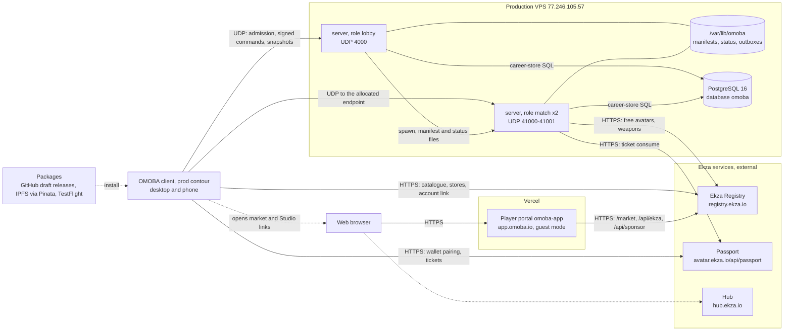
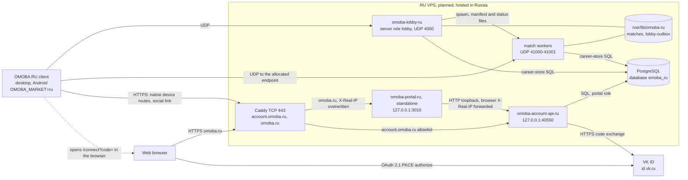

# System and deployment

This page maps the whole OMOBA system: every process and service, who talks to whom over which protocol and port, how the two build axes (contour and market) choose servers and hosts, and where state lives. The page is a map and a record of why things are shaped this way. Detailed procedures stay in the linked runbooks. The code structure inside the crates is in [ARCHITECTURE.md](../ARCHITECTURE.md).

Snapshot: game dev 6d34f98, portal dev 604bc34, 2026-10-24. See [README](README.md).

## System context

- OMOBA uses an authoritative server. One Rust binary, `server`, runs in three roles: standalone, lobby and match worker. The Bevy `client` runs on desktop and phones. `omoba-account-api` is the only HTTP service the game repository owns. The player portal is a Next.js backend-for-frontend (BFF) over that service and lives in the separate `omoba-web` repository.
- External services:
  - The Ekza Registry, passport and Studio provide avatars, weapons and cosmetics. Only builds with the `ekza` feature use them.
  - VK ID handles sign-in for the RU market.
  - Vercel hosts the global and dev portals.
  - Pinata/IPFS, GitHub Releases and App Store Connect distribute packages; RU packages come from the RU host, with IPFS as the mirror.
- Each build is compiled for one **contour** (`prod`, or `dev` for the separate OMOBA Dev app; the portal spells them `production` and `dev`) and one **market** (`global`, `ru`, `cn`). Nothing switches contours or markets at run time ([markets.md](../markets.md), [connection-profiles.md](../connection-profiles.md)).

## Components

| Component | Code | Runs on | Role |
| --- | --- | --- | --- |
| Game client | `client/` (Bevy) over `shared/`, `common/`, `passport/` | Player machines: macOS, Windows and Linux; iOS (`mobile/ios/`); Android (`mobile/android/`) | Input, prediction, presentation and UI. Sends UDP to the lobby and match workers from a network thread (`client/src/net/transport.rs`). Calls Ekza and the Account API over HTTPS through `passport`. Includes socket-free offline practice (`client/src/net/offline.rs` over `common::offline::PracticeSession`; no career, no matchmaking). Desktop builds take lobby, Registry and passport overrides from the environment and phones take none (`desktop_override`, `client/src/connection_profile.rs`). The Account API endpoint is read from the runtime environment on every platform (`WebAccountApi::from_env`). In a market with legal documents (RU) the client opens no lobby transport, reads no release catalog and starts no VK, device or pairing request until the player accepted them on the first-launch card (`client/src/legal.rs` `bound_and_accepted`, LR-06). |
| `server`, role `lobby` | `server/`, `MatchService::Lobby` (`server/src/match_service.rs`) | Production VPS, dev VPS, RU VPS | Public entry point. Handles transport admission, signed career sessions, the matchmaking queue, parties and social. Allocates and supervises match workers (`server/src/match_pool.rs`). It hosts no match itself. |
| `server`, role `match` | Same binary, started by the lobby | Same host as its lobby | Runs one allocated match from an immutable manifest (`server/src/match_allocation.rs`) and settles the result to PostgreSQL. |
| `server`, role `standalone` | Same binary (the default role) | Any computer: practice-host scripts in desktop packages, LAN, local development, the harness | One world with no public admission (bounded pre-join, `server/src/runtime/prejoin.rs`). The process builds its store with `CareerBackend::new` (`server/src/career_backend.rs`). Without `OMOBA_DATABASE_URL` it starts no `omoba-career` worker thread and serves guests only. |
| Shared simulation | `common/` | Linked into `server` and `client` | Authoritative combat with no transport, authentication or persistence (`common/src/lib.rs`). The server hosts it over the network. The client runs it socket-free for offline practice. |
| Account API | `account-api/` (`omoba-account-api`: Axum, SQLx), linking `career-store/` | Dev VPS and RU VPS as a service. Every host also runs its `migrate` subcommand. | HTTP over the career database. Serves the portal (pairing, sessions, devices, friends, Supporter, class builds, Ekza library link, VK ID) and the client's native device routes. Binds loopback only (`account-api/src/main.rs`). The same process runs two background loops (`main.rs`). Apple reconciliation runs every 300 s and does nothing without Apple configuration. Every 5 s it projects settled results (128 per batch, one writer elected by a PostgreSQL advisory lock) and then runs bounded expiry cleanup ([account-api README › Projection and retention](../../account-api/README.md#projection-and-retention)). |
| Apple verification policy | `billing/apple-verifier/` (Node module) | Not deployed from this repository | The business policy a loopback Apple verifier sidecar applies after signature verification. It is not yet bound to Apple's official server library ([supporter.md](../supporter.md)). |
| Player portal | `omoba-web` (Next.js 16): `src/app/api/[...path]` BFF, `src/app/api/{auth,ekza,sponsor}` | Vercel (`omoba-app` for production, `omoba-app-dev`); a self-hosted standalone build for RU | Browser UI. Its server side calls the Account API and the Ekza Registry. It has no database connection of its own. |
| PostgreSQL | Core career schema (`career-store`) and the `portal` schema (`account-api/migrations/001…007`) | One database per contour and market | Profiles, results, rating, friends, device keys, portal sessions and grants ([account-api README](../../account-api/README.md), [data.md](data.md)). |
| Ekza Registry, passport, Studio | External (Ekza repositories) | `*.ekza.io`. The dev Registry and dev Studio run on the dev VPS. | Avatar and weapon catalogue and assets, protected-avatar tickets, authoring. Only `ekza`-feature builds use them. |
| `arena-sync` | `arena-sync/` (CLI) | Developer machines | Pulls Ekza Arena avatar cards from a Solana RPC (default: localnet) into `client/assets/avatars/` and its `manifest.json` (`arena-sync/src/main.rs`). It is not a runtime dependency. |
| Distribution | `scripts/release.py`, `.github/workflows/release.yml` | GitHub draft releases, IPFS via Pinata, App Store Connect; the RU host (`omoba.ru/downloads/`, Caddy) for RU | Player packages. It is not a runtime dependency. |
| Test tooling | `harness/` | Developer machines and CI | Black-box UDP players against a real `server` binary. |

## Server roles and the lobby–worker model

`OMOBA_SERVER_ROLE` selects the role (`MatchService::from_env`). `OMOBA_MATCH_MODE` selects `release`, `dev` or `practice` rules ([RUNBOOK.md](../../RUNBOOK.md), `Makefile`).

| Role | Selected by | Bind | Database | Client admission | Used for |
| --- | --- | --- | --- | --- | --- |
| `standalone` | Unset or `standalone` | `SERVER_ADDR`, default `0.0.0.0:4000` (`DEFAULT_BIND_ADDR`) | Optional | At most 64 unverified endpoints. Snapshots carry only status until an endpoint is verified (`runtime/prejoin.rs`). | Practice hosts, LAN, local development |
| `lobby` | `OMOBA_SERVER_ROLE=lobby` | `SERVER_ADDR` | Required. Startup fails with "Public roles require OMOBA_DATABASE_URL" (`server/src/runtime/mod.rs` `run`). It also fails when the lobby or its workers bind beyond loopback while `OMOBA_MATCH_PUBLIC_HOST` is unset or loopback (`match_pool.rs` `public_worker_host`). | Public transport admission plus Ed25519-signed commands (`server/src/public_transport.rs`) | Public entry point |
| `match` | Set by the lobby | Manifest `bind`, which must equal `SERVER_ADDR` | Required | Public admission plus manifest membership | One match: `release` with 10 humans, `practice` otherwise (`worker_command`) |

### Allocating a match

Sources: `server/src/match_service.rs`, `server/src/match_pool.rs`, `server/src/match_allocation.rs`, `client/src/match_service.rs`. This is the lifecycle in outline. The file shapes, the worker's environment and every timer (readiness, port hold, relaunch, archive, join deadline) are in [protocols.md §5](protocols.md#5-lobby--worker-allocation-handoff). The directory layout, ownership and retention are in [data.md › Match root](data.md#match-root-allocation-manifests).

1. The client reaches the lobby over UDP, passes return-path validation and opens a career session signed with its device key.
2. A `FindMatch` request with a queue (Ranked, Casual PvP or vs Bots; wire names `humans_only`, `quick`, `bot_practice`) enters the queue. The [matchmaking rules](#matchmaking-rules) below decide who plays together.
3. The lobby takes a free port from its worker pool and writes an immutable `manifest.json` into a new allocation directory under `OMOBA_MATCH_ROOT`. The manifest names the players and their teams, the worker's bind address, the public endpoint the client will dial and a join deadline.
   - It then spawns the worker, by default its own binary, in role `match`. The worker inherits the lobby's environment except a few local-only overrides, and gets its own career outbox inside the allocation directory.
   - If the spawn fails, the lobby writes a `failed` status and reports `worker_spawn_failed`.
4. The worker reports its phase in a `status.json` heartbeat. The lobby hands out the endpoint only while the worker reports `ready`, `forming` or `running` with a fresh heartbeat and is neither recovering nor cancelled (`Slot::ready`). A spawned process alone is not enough.

   The client then switches its UDP session to that endpoint (`SessionUiCommand::ConnectAllocated`).

   A `running` receipt is never a fresh handoff: the profile left that match or lost its connection. The lobby answers with the in-match state (`Assigned{in_match}`, with the latest end), adds no queue entry, and the client offers **Resume** instead of connecting (LR-13, [protocols.md §5](protocols.md#5-lobby--worker-allocation-handoff)).
5. A worker whose match has not started gives up when it is cancelled or its join deadline passes, and settles the round as `Abandoned`.
   - A cancel writes `cancel.json`. The lobby writes it, and the worker writes it itself when an allocated player cancels there before the start (`career_runtime.rs`). The lobby refuses to cancel once the worker is `running` or `settling`.
   - The worker settles every result through its own career outbox and exits 30 s after reaching a terminal phase (`finished` or `failed`).
   - Every running match ends (`server/src/match_lifecycle.rs`). A worker whose humans all left keeps their heroes under bot control, but once no human has been on a network endpoint for `SESSION_RECLAIM_WINDOW` (180 s) plus 30 s, it settles the round as `Interrupted` and retires (`MATCH_METRIC event=abandoned_reaped`). Any running match also ends at `OMOBA_MATCH_MAX_DURATION_SECS` (default 2700 s, 45 minutes) as `Interrupted` (`event=duration_capped`). A retired worker stops simulating, reports `settling` and then `failed` once the result is stored, and exits; a standalone server starts a fresh round instead.
   - If a child exits without writing any status, the lobby writes a `failed` status for it.
6. The lobby moves terminal allocations to `archive/`: at startup, and while running (`Pool::poll`) once the heartbeat is old enough and no live child is attached.
7. An advisory lock (`.coordinator.lock`) allows only one lobby per match root. After a restart, the lobby rediscovers workers from their manifests and adopts them. A crashed match is settled as interrupted and is never resumed mid-frame ([public-mvp.md](../public-mvp.md)). Recovery works like this:
   - The lobby relaunches a worker in recovery mode (`OMOBA_MATCH_RECOVERY=1`) when no child is attached and either the child exited or its heartbeat is stale. A worker that never wrote a status counts as stale some time after its join deadline.
   - First it probes that the manifest's bind port is free. A live adopted worker still holds that port, so it is never duplicated.
   - The recovery worker settles the match as `Abandoned` and reports `recovering`. At least 120 s after boot, once its outbox has drained and the store confirms recovery, it writes `failed` and exits (`tick_match_service`).

### Lobby scheduling bounds

- The lobby polls the pool at most once per second and launches at most 4 new workers per pass (`Lobby::tick`). Each poll also relaunches at most 4 recovery workers (`Pool::poll`).
- The queue holds at most 128 entries (`MAX_WAITING`, error `queue_full`). An entry expires 15 s after its last explicit `FindMatch` retry. A Home heartbeat does not renew it.
- The lobby tracks at most 512 requests. A request is dropped 120 s after its last touch unless it is queued or assigned.
- `capacity_busy` means every worker port is in use. An allocation that fails before its match ran is reported to its players as `allocation_cancelled_or_expired`. When a match the lobby saw running ends, its seats free without an error and the next `FindMatch` queues (LR-13).
- The lobby refuses to start with more than 100 retained allocations or 4096 entries in the match root (`Pool::from_env`).
- The pool settings (`OMOBA_MATCH_ROOT`, `OMOBA_MATCH_CAPACITY`, `OMOBA_MATCH_FIRST_PORT`, `OMOBA_MATCH_BIND_IP`, `OMOBA_MATCH_PUBLIC_HOST`, `OMOBA_MATCH_EXECUTABLE`) and their defaults are in [protocols.md §5](protocols.md#5-lobby--worker-allocation-handoff). The deployed values per host are in the [port summary](#port-summary).

### Matchmaking rules

Sources: `server/src/match_service.rs` (`units`, `searches`, `select`, `split_teams`, `waiting_view`), `career-store/src/matchmaking.rs` (`fits_cohort`, `same_cohort`); [party.md](../party.md); [bot-practice-and-social.md](../bot-practice-and-social.md); policy in [match-progression.md › Queues](../match-progression.md#queues-ranked-casual-pvp-and-vs-bots).

- **Queues (LR-08).** `MatchPreference::Ranked` (wire `humans_only`), `Casual` (wire `quick`) and `BotPractice`. The wire names predate the split, so protocol 11 clients keep working: an old Quick request searches Casual PvP.
- **Rated cohort.** One policy for the lobby, the career queue and the store's rated start: one newcomer bracket (`ProfileSummary::newcomer`) and at most `MAX_RATING_SPREAD` (300) between the lowest and highest rating (`fits_cohort`, `same_cohort`). The lobby has no literal of its own, so a Ranked roster always passes the store's check.
- **Parties.** A party queues as one unit of at most 5 players. It becomes a unit only once every member it waits for has queued with the same preference. A Ranked party whose members are not one rated cohort is never seated; its members see `Failed{ranked_party_cohort}`.
- **Selection.** vs Bots first, then Ranked, then Casual PvP; within a queue the roster whose earliest entry queued first wins.
  - vs Bots allocates the first such unit at once: one player or one party, all on one team.
  - Ranked anchors a cohort at each unit's lowest rating and admits units that fit it while two teams of at most 5 can be seated. It needs 10 humans and never fills with bots.
  - Casual PvP admits every unit that searches Casual, whatever its rating or cohort. It needs 10 players, or fills the rest with bots once any member has searched Casual for 30 s (`CASUAL_BOT_FILL`).
  - After 300 s (`RANKED_CASUAL_OFFER`) a Ranked entry may also search Casual PvP (`FindMatch.also_casual`) and keeps its Ranked place: a full Ranked roster still goes first. Its Casual bot fill counts from when it took the offer. A party searches Casual only once every member took it.
- **Teams.** Parties stay together. Head counts are made as even as possible, then rating sums as close as possible. A lone party plays Green.
- **Mode.** Only a Ranked allocation runs `release` rules, and the view marks only it `rated` (`Manifest::match_mode`). Casual PvP and vs Bots run worker `practice` rules: bots take the empty seats (none when ten humans queued Casual), and the round settles as `public-casual-v1`, never rated.

### Inside one server process

Source: `server/src/runtime/`.

- **Tick loop.** One loop drives the simulation with a minimum step period of 10 ms: it sleeps for whatever remains of `SIMULATION_STEP_SLEEP`. A step that takes longer than 10 ms does not sleep (`runtime/mod.rs`).
- **Ports.** Datagram I/O and tick time go through the `Transport` and `Clock` traits (`runtime/ports.rs`). Tests swap in `MemoryTransport` and `ManualClock`. Career storage goes through `CareerPort` (`server/src/career_port.rs`), which `CareerBackend` implements. Some I/O bypasses these ports: the Registry and passport HTTP calls, and the manifest and status files, which the lobby and workers write directly with `match_allocation::atomic_json`.
- **Career thread.** SQL and outbox writes run on a separate `omoba-career` thread with bounded queues (`career_backend.rs`). The thread exists only when `OMOBA_DATABASE_URL` is set.
- **Ekza checks.** Registry and passport checks run on short-lived threads, at most 16 pending at a time (`passport_admission.rs`).
- **Receive budget.** Each tick reads at most 128 datagrams and spends at most 2 ms receiving, in every role (`runtime/dispatch.rs`, `shared/src/public_transport.rs`).

## Communication paths

All game traffic is UDP, and datagrams are JSON-encoded (`serde_json`; `server/src/runtime/dispatch.rs`, `client/src/net/transport.rs`).

- **Public roles.** Commands are wrapped in `PublicClientDatagram`, with a return-path probe and an Ed25519 `SignedCommand` (`shared/src/public_transport.rs`).
- **Admission limits.** Public admission tracks at most 512 endpoints, at most 8 per source IP. Probes are budgeted per second per source IP, per network and in all, with a reserve for new sources (LR-16, `server/src/admission.rs`). The challenge TTL is 5 s, the validated-path TTL is 30 s, and each endpoint may send at most 120 packets per second (`server/src/public_transport.rs`). Public datagrams are at most 12 KiB, and signed commands at most 8 KiB. On the RU host the kernel drops a source's datagrams beyond a per-address rate first (`ops/vps/ru/nftables-omoba.conf`). Every limit and its setting: [ops/vps/ru/README.md › Admission limits](../../ops/vps/ru/README.md#admission-limits-lr-16).
- **Snapshots.** For clients that negotiated framing, snapshots are split into `OMB1` frames of at most 1200 bytes (`shared/src/transport.rs`, `server/src/snapshot.rs`).
- **Compatibility probes.** Every role answers them, standalone included, from a per-second budget per process: 8 per source IP, 32 per network, 64 in all with 16 kept for new sources ([release-compatibility.md](../release-compatibility.md), LR-16).
- **Trust.** UDP is neither encrypted nor server-authenticated, so clients must trust the server address ([public-mvp.md](../public-mvp.md)).
- **Contracts.** Every cross-boundary contract below is specified in [protocols.md](protocols.md). The rules for evolving the UDP protocol are in [ARCHITECTURE.md › Protocol rules](../ARCHITECTURE.md#protocol-rules).

| From | To | Protocol | Endpoint | Source |
| --- | --- | --- | --- | --- |
| Client | Lobby | UDP | The build's compiled lobby (see [build axes](#build-axes-contour-and-market)), or desktop `GAME_SERVER_ADDR` | `client/src/session_config.rs` `startup_server_addr` |
| Client | Match worker | UDP | `endpoint` from `MatchAllocation` | `shared/src/match_service.rs`, `client/src/match_service.rs` |
| Client | Standalone server | UDP | `host:4000` by default | `server/src/runtime/mod.rs` |
| Any client or tool | Any role | UDP compatibility probe: a JSON handshake that authenticates nothing | Lobby or worker port | `shared/src/compatibility.rs`, `PublicTransport::compatibility_reply`, [release-compatibility.md](../release-compatibility.md) |
| Lobby | Match worker | Process spawn plus files (`manifest.json`, `cancel.json`, `status.json`) | Same host | `server/src/match_pool.rs`, [protocols.md §5](protocols.md#5-lobby--worker-allocation-handoff) |
| Lobby, workers, standalone with a database | PostgreSQL | SQL through `career-store` | Loopback | `server/src/career_backend.rs` |
| Match-hosting processes | Ekza Registry | HTTPS: free-avatar list, weapon catalogue | `OMOBA_REGISTRY_URL`, otherwise compiled | `server/src/passport_admission.rs`, `passport/src/community.rs` |
| Match-hosting processes | Ekza passport | HTTPS: consume a protected-avatar ticket | `OMOBA_PASSPORT_URL`, otherwise compiled | `passport/src/lib.rs` `PassportApi::from_env` |
| Client | Ekza Registry | HTTPS through `ekza-bevy-sdk`: catalogue, stores, account link, placements | The connection profile's Registry | `passport/src/store.rs`, `client/src/connection_profile.rs` |
| Client | Ekza passport | HTTPS: wallet pairing, tickets | The connection profile's passport | `passport/src/lib.rs` |
| Client | Account API | HTTPS POST, no redirects: pairing, device enrollment and recovery, Supporter, VK link. HTTPS GET `v1/releases` at boot (in RU after the legal acceptance, LR-06) and after an update-required mismatch (LR-14, `release_catalog.rs`) | Runtime environment, otherwise compiled (`OMOBA_ACCOUNT_API_URL` + `OMOBA_PORTAL_ORIGIN`). `OMOBA_ALLOW_INSECURE_LOCAL=1` allows loopback HTTP. A dev build accepts only `account.dev.omoba.io` with `app.dev.omoba.io`. | `passport/src/web_account.rs` (`from_env`, `validate_contour_endpoints`), `device_account.rs`, `supporter_account.rs` |
| Client | System browser | Opens a URL: market, Studio, `<portal>/connect?code=` | Connection profile or market portal (see [link targets](#build-axes-contour-and-market)) | `client/src/connection_profile.rs`, [markets.md](../markets.md) |
| Browser | Portal | HTTPS | `app.omoba.io`, `app.dev.omoba.io`, `omoba.ru` | omoba-web `docs/vercel.md`, `ops/vps/ru/Caddyfile.ru` |
| Portal BFF | Account API | Server-to-server, no redirects. A non-loopback API (hosted dev, HTTPS) gets the portal ingress key, which the dev Caddy checks and strips. A loopback API (RU, `http://127.0.0.1:40550`) gets no key and, with `OMOBA_TRUST_LOOPBACK_PROXY=1`, the browser's `X-Real-IP` ([protocols.md §7](protocols.md#7-portal-bff-omoba-web)). | `OMOBA_ACCOUNT_API_URL` | omoba-web `src/lib/security.mjs` (`accountIngressHeaders`, `accountUpstreamHeaders`), `src/app/api/[...path]/route.ts` |
| Portal BFF | Ekza Registry | HTTPS: `/market`, `/api/ekza/*`, `/api/sponsor/*` | `registry.ekza.io` or `registry.dev.ekza.io` | omoba-web `src/lib/market-server.mjs`, `sponsor-server.mjs` |
| Account API | PostgreSQL | SQL as the portal runtime role | Loopback | `account-api/README.md` |
| Account API | VK ID (`id.vk.ru`) | HTTPS authorization-code exchange. Tokens are not stored. | RU only | `account-api/src/social.rs` |
| Account API | Ekza Registry | HTTPS Ekza library link | `ekza` builds only | `account-api/src/ekza_library.rs` |
| Account API | Apple verifier sidecar | Plain HTTP to loopback. `OMOBA_APPLE_VERIFIER_URL` must be `http://127.0.0.1` or `http://[::1]`, and all four `OMOBA_APPLE_VERIFIER_*`/`OMOBA_APPLE_*` settings are required together. Policy is in `billing/apple-verifier/`. Reconciliation runs every 300 s and does nothing without Apple configuration. | `supporter` builds only. Disabled without operator configuration. | `account-api/src/supporter.rs` `BillingConfig::from_env`, `reconcile_apple`; [supporter.md](../supporter.md) |
| Account API | Solana RPC | HTTPS (`OMOBA_SOLANA_RPC_URL` must be `https`); `OMOBA_SOLANA_*` | `supporter` builds only. Disabled without operator configuration. | `account-api/src/supporter/solana.rs` |
| Release tooling | Pinata | HTTPS pin, then a read back through the gateway, checked against SHA-256 | `api.pinata.cloud`, gateway `ekza.mypinata.cloud` | `scripts/release.py` `pinata_pin`, `publish` |
| Release tooling | A market's download host (RU) | rsync over ssh into `/opt/omoba-ru/downloads/v<version>/` (never replacing a file), then an HTTPS read back checked against SHA-256 and size | `--rsync-target`, `<portal><downloads_path>` from `scripts/markets.py` | `scripts/release.py` `publish_to_host`, `verify-downloads` |

## Build axes: contour and market

Both axes are compile-time settings. A wrong value fails the build; there is no runtime fallback.

- **Contour** (`scripts/contours.py`): `prod` or `dev`.
  - A `dev` build sets `OMOBA_DEFAULT_CONFIG_DIR_SUFFIX=dev` plus the dev endpoint defaults: `OMOBA_DEFAULT_GAME_SERVER_ADDR`, `OMOBA_DEFAULT_REGISTRY_URL`, `OMOBA_DEFAULT_PASSPORT_URL`, `OMOBA_ACCOUNT_API_URL` and `OMOBA_PORTAL_ORIGIN`.
  - `prod` builds have exactly one connection profile and no server UI.
  - `dev` builds offer the Dev, Local and Custom profiles. A new choice takes effect at the next start (`client/src/connection_profile.rs`).
  - The portal reads `OMOBA_CONTOUR=production|dev` (omoba-web `src/lib/contour.mjs`).
- **Market** (`shared/src/market.rs`, `scripts/markets.py`): `global`, `ru` or `cn`, set with `OMOBA_MARKET`.
  - Release tooling can override individual features of the market preset with `--feature <ekza|supporter|vk_sign_in>=on|off`, several at once, each name at most once. Every override that differs from the preset becomes `OMOBA_FEATURE_<NAME>=on|off` (`parse_feature_overrides`, `market_env`).
  - Turning `ekza` off, as the free markets (`ru`, `cn`) do, pins the Registry and passport to a closed loopback port (`http://127.0.0.1:9`) and removes the market and Studio links (`for_market`). The server then admits only shipped content and never calls Ekza.
  - The portal reads the same variables (omoba-web `src/lib/market-profile.mjs`).

| Build | App identity | Settings folder | Lobby | Ekza Registry / passport | Account API / portal | Hosts |
| --- | --- | --- | --- | --- | --- | --- |
| `global` · prod | Phones: `space.ekza.omoba.beta` ("Omoba Beta"). macOS: `Omoba.app`, `space.ekza.omoba.desktop`. | `omoba-bevy` | `77.246.105.57:4000` (`BETA_GAME_SERVER_ADDR`), unless the release compiles `--server` (in CI: the `server` input or the repository variable `OMOBA_RELEASE_SERVER`) | `registry.ekza.io` / `avatar.ekza.io/api/passport` | None compiled / `app.omoba.io` in guest mode | Production VPS; Vercel `omoba-app` |
| `global` · dev | Phones: `space.ekza.omoba.dev` ("OMOBA Dev"). macOS: `Omoba Dev.app`, `space.ekza.omoba.desktop.dev`. | `omoba-bevy-dev` | `lobby.dev.omoba.io:4100` (Dev profile) | `registry.dev.ekza.io` / closed loopback | `account.dev.omoba.io` / `app.dev.omoba.io` | Dev VPS; Vercel `omoba-app-dev` |
| `ru` · prod | Android: `space.ekza.omoba.ru` ("OMOBA"). macOS: `space.ekza.omoba.desktop.ru`. No iOS. | `omoba-bevy-ru` | `lobby.omoba.ru:4000` | None (closed loopback) | `account.omoba.ru` / `omoba.ru` | RU VPS (planned) |
| `ru` · dev | The OMOBA Dev phone app (`space.ekza.omoba.dev`) with RU features. macOS: `space.ekza.omoba.desktop.ru.dev`. | `omoba-bevy-ru-dev` | Dev lobby | None (closed loopback) | Dev Account API / dev portal | Dev VPS |
| `cn` | — | `omoba-bevy-cn` | Not decided | None | Not decided | Packaging refused (`blocked` in `scripts/markets.py`) |

Sources: [connection-profiles.md](../connection-profiles.md), [markets.md](../markets.md), `scripts/release.py` (`MAC_BUNDLE_ID`, `Flavor.bundle_id`, `resolve_flavor`), `scripts/contours.py` (`MOBILE`), `mobile/android/build.py` (`identity_for`), `client/src/platform.rs` (`config_directory_name`), `.github/workflows/release.yml` (`RELEASE_SERVER`).

Link targets the client opens (`client/src/connection_profile.rs`: `production_profile`, `contour_profile`, `local_profile`, `for_market`):

| Build or profile | Market link | Studio link |
| --- | --- | --- |
| Production profile (`prod` builds) | `app.omoba.io/market` | `hub.ekza.io/studio` |
| Contour (Dev profile) | `app.<contour>.omoba.io/market` | `studio.<contour>.ekza.io/studio` |
| Local profile | `127.0.0.1:3010/market` | `127.0.0.1:5188/studio` |
| Builds without `ekza` | None | None |

Each market has its own database, accounts and device keys. The settings folder names both the market and the contour, so one install never reads another's device key ([ops/vps/ru/README.md](../../ops/vps/ru/README.md)).

## Hosts

### Port summary

| Service | Production (global) | Dev VPS | RU VPS (planned) | Local default |
| --- | --- | --- | --- | --- |
| Lobby | UDP 4000 | UDP 4100 | UDP 4000 | UDP 4000 |
| Match workers | UDP 41000–41001 (capacity 2) | UDP 41100 (capacity 1) | UDP 41000–41001 (capacity 2) | From UDP 41000 (capacity 16), bound to 127.0.0.1 |
| Worker public host | `77.246.105.57` | `lobby.dev.omoba.io` (A record only, no AAAA) | Host IPv4 from `lobby.env` | `127.0.0.1` |
| Account API | Not a service (only `migrate` runs) | `127.0.0.1:40550` behind Caddy as `account.dev.omoba.io` | `127.0.0.1:40550` behind Caddy as `account.omoba.ru` | `127.0.0.1:40550` |
| Portal | Vercel, `app.omoba.io` | Vercel, `app.dev.omoba.io` | `127.0.0.1:3010` behind Caddy as `omoba.ru` | `127.0.0.1:3010` |
| PostgreSQL | The existing PostgreSQL 16 instance, reached through localhost (port and packaging unconfirmed), database `omoba` | Dev Supabase Postgres at `127.0.0.1:54322`, database `omoba_dev` | `127.0.0.1:5432`, database `omoba_ru` | Any (disposable for tests) |
| Registry / Hub | `registry.ekza.io` / `hub.ekza.io` | `registry.dev.ekza.io` / `hub.dev.ekza.io` on the same VPS | None | `127.0.0.1:8018` / `127.0.0.1:5188` (Local profile) |

### Production host (global market)

One VPS runs the lobby and its bounded worker pool. It shares the host with Ekza services: Ekza Space on TCP 3001 and Studio over HTTPS ([ops/vps/README.md](../../ops/vps/README.md)).

| Item | Value | Source |
| --- | --- | --- |
| Unit | `omoba-lobby.service`, user `omoba`. It sets `OMOBA_SERVER_ROLE=lobby`, `OMOBA_MATCH_MODE=release` and `OMOBA_REGISTRY_URL=https://registry.ekza.io` (workers inherit it). It runs `/opt/omoba/current/server`, which is also `OMOBA_MATCH_EXECUTABLE`. It has `Requires=docker.service`. | [omoba-lobby.service](../../ops/vps/omoba-lobby.service) |
| Limits | The lobby and its workers share one cgroup: `MemoryHigh=600M`, `MemoryMax=700M`, `CPUQuota=150%`, `TasksMax=128`. With `KillMode=control-group`, a service restart restarts the whole group and relies on durable interrupted-match recovery. | Same |
| Binaries | Linux `server` and `omoba-account-api`, built with Rust 1.95.0 and `--release --locked`. Installed in `/opt/omoba/releases/<source>/` with a `current` symlink. | [ops/vps/README.md](../../ops/vps/README.md) |
| Durable files | `/var/lib/omoba/matches` and `/var/lib/omoba/lobby-outbox` (owner-only) | Same |
| Database | `omoba`, with three roles: `omoba_owner` (migrations; its login is disabled afterwards), `omoba_game` (runtime) and `omoba_portal` (reserved, NOLOGIN). Grants come from `account-api/ops/grants.sql`. | Same |
| Secrets | `/opt/omoba/database.env`, readable by root only. Systemd loads it before dropping to user `omoba`. | Same |
| Portal | Vercel `omoba-app` at `https://app.omoba.io`. Only `OMOBA_PORTAL_ORIGIN` and `OMOBA_ACCOUNT_MODE=disabled` are set. Contour, market, Registry and Studio stay unset and default to `production` and `global`. `OMOBA_ALLOW_INSECURE_LOCAL` and `OMOBA_TRUST_LOOPBACK_PROXY` must never be set on Vercel. The workshop and `/market` work; account routes answer `503 account_service_disabled`. | omoba-web `docs/vercel.md` |
| Deploy | A manual runbook. The repository has no ship tool for production. | [ops/vps/README.md](../../ops/vps/README.md) |

With no Account API compiled in and none in its runtime environment, the global `prod` client reports that website pairing, device enrollment and Supporter checkout are not configured (`WebAccountApi::from_env`).

### Dev VPS (dev contour)

The dev VPS is a dedicated host and is never the production VPS. Tools read its address from `DEV_IP`. Only synthetic accounts use it. Runbook: [ops/vps/dev/README.md](../../ops/vps/dev/README.md).

| Item | Value | Source |
| --- | --- | --- |
| Lobby | `omoba-lobby-dev.service`, user `omoba-dev`, lobby on UDP 4100, worker on UDP 41100. It uses the same hardening as production, so it doubles as a rehearsal of the production unit. Limits: `MemoryHigh=448M`, `MemoryMax=512M`, `CPUQuota=100%`, `TasksMax=96` and `OOMScoreAdjust=300`, so under memory pressure the kernel kills the lobby before the database. Unlike production, it has no `Requires=docker.service`. | [omoba-lobby-dev.service](../../ops/vps/omoba-lobby-dev.service) |
| Passport | `OMOBA_PASSPORT_URL=http://127.0.0.1:9/api/passport` is a closed port, because no dev passport exists and the SDK default is production. | Same |
| Database | `omoba_dev` (roles `omoba_dev_owner`, `omoba_dev_game`, `omoba_dev_portal`) inside the dev Supabase Postgres container. It lives in that stack's Docker volume and can be lost; the next ship recreates it. | [dev README](../../ops/vps/dev/README.md) |
| Account API | `omoba-account-api-dev` on `127.0.0.1:40550`, connecting as `omoba_dev_portal`. `account_api_dev.py` has the following guards and outputs: • It runs only as root on the host whose `hostname -I` lists the documented dev address. • It refuses production markers and an exposed database port, and requires an unprivileged portal role. • It writes `/opt/omoba-dev/account-api.env`, the portal ingress key file `/opt/omoba-dev/account-api-ingress.key` and a Caddy fragment at `/opt/ekza-dev/secrets/caddy/account-api.caddy` for the dev Registry's Caddy. • Before activating, it checks the dev contour, the exact revision, the binary's SHA-256 and that the portal schema versions match the ones the release serves. | `ops/vps/dev/account_api_dev.py` (`guard`, `fragment`, `validate_activation`) |
| Ekza | `registry.dev.ekza.io` and `hub.dev.ekza.io` run on the same VPS and are deployed from the ekza-registry repository; the Ekza Studio editor is `studio.dev.ekza.io` on Vercel. | omoba-web `docs/vercel.md` |
| Portal | Vercel `omoba-app-dev` at `app.dev.omoba.io`, with `OMOBA_CONTOUR=dev`, `noindex` and a DEV badge. With accounts enabled it must use exactly `https://account.dev.omoba.io` and a 64-hex portal ingress key (`OMOBA_ACCOUNT_INGRESS_KEY`). | omoba-web `docs/vercel.md`, `src/lib/security.mjs` `contourPortal` |
| Deploy | `lobby_dev.py ship` runs a plan, then `--check`, then `--apply`: preflight, stage, upload, database, activate, with rollback. It refuses every production marker. `account_api_dev.py` sets up the dev Account API, and omoba-web `scripts/vercel-dev.sh` deploys the dev portal. | [dev README](../../ops/vps/dev/README.md) |

### RU host (planned)

A single VPS in Russia is meant to serve everything Russian players reach. Russian personal-data law (152-FZ) requires VK-linked accounts, sessions and IP rate limits to be stored in Russia. RU builds already contain the DNS names, which start answering once the host is deployed. Runbooks: [markets.md › RU release runbook](../markets.md#ru-release-runbook) and [ops/vps/ru/README.md](../../ops/vps/ru/README.md). The host is not deployed yet. `ops/vps/ru/ru_host.py` sets a fresh Ubuntu host up and ships to it (LR-01), `ops/vps/ru/ru_backup.py` backs it up off-host (LR-03), and `ops/vps/ru/ru_monitor.py` with an external probe alerts the owner (LR-17, ops part); the lobby's own metrics are still open ([launch-readiness.md](../plans/launch-readiness.md)).

| Item | Value | Source |
| --- | --- | --- |
| Lobby | `omoba-lobby-ru.service`, user `omoba-ru`, with the same limits as production. It runs `/opt/omoba-ru/current/omoba-server`, the `omoba-server` binary from the RU server bundle (`release.py build server --market ru`, built with `OMOBA_MARKET=ru`), and sets no Registry or passport URL. It starts after `postgresql.service` (`After=`/`Wants=`) and restarts on any exit every 5 s with no start limit (`Restart=always`, `StartLimitIntervalSec=0`). | [omoba-lobby-ru.service](../../ops/vps/ru/omoba-lobby-ru.service) |
| Account API | `omoba-account-api-ru.service` on `127.0.0.1:40550`, with `OMOBA_TRUST_LOOPBACK_PROXY=1`, the VK ID app id and the social secret. Limits: `MemoryMax=256M`, `CPUQuota=50%`. It refuses payment settings and serves no Ekza library. Same PostgreSQL ordering and restart policy as the lobby. | [omoba-account-api-ru.service](../../ops/vps/ru/omoba-account-api-ru.service), [account-api.env.example](../../ops/vps/ru/account-api.env.example) |
| Portal | `omoba-portal-ru.service`, user `omoba-portal-ru`: the omoba-web standalone build with `OMOBA_MARKET=ru` (`/opt/omoba-ru/portal/current/server.js` on Node.js from `/opt/omoba-ru/node/current`) on `127.0.0.1:3010`, `Restart=always`, `MemoryMax=512M`, `CPUQuota=100%`, no Next.js telemetry. It calls the Account API directly on `http://127.0.0.1:40550` with no portal ingress key and forwards the browser's `X-Real-IP`, which Caddy writes (`OMOBA_TRUST_LOOPBACK_PROXY=1` on the portal and the API). It refuses to serve without that flag, or with a non-loopback API and no valid key. | [omoba-portal-ru.service](../../ops/vps/ru/omoba-portal-ru.service), [portal.env.example](../../ops/vps/ru/portal.env.example), [README › Topology](../../ops/vps/ru/README.md#topology), omoba-web `src/lib/security.mjs` |
| Ingress | Caddy on TCP 443 with automatic HTTPS. `account.omoba.ru` allows `GET /health/live` and `/health/ready` and the native POST allowlist (see [below](#account-api-ingress-allowlists)); everything else, every portal route included, gets 403. `omoba.ru` serves the packages under `/downloads/` from `/opt/omoba-ru/downloads` and proxies everything else to the portal. Both proxies overwrite `X-Real-IP` with the client's address. | [Caddyfile.ru](../../ops/vps/ru/Caddyfile.ru) |
| Database | Ubuntu's PostgreSQL 16+ with the `und-x-icu` collation, on `127.0.0.1:5432` only. Database `omoba_ru` (UTF8, collation C.UTF-8), owner role `omoba_owner` (no login outside migrations) and the runtime roles `omoba_game` and `omoba_portal`, whose passwords are generated on the host into the root-only env files | [ops/vps/ru/README.md](../../ops/vps/ru/README.md) |
| Downloads | `make release-ru-publish` copies the packages to the host (rsync, read back over HTTPS), pins the IPFS mirror and writes `releases.json`: URLs on `omoba.ru/downloads/`, `mirror_url` on IPFS, `test_status` «Открытая бета», `region` `ru`, `channel` `direct`. It is installed as `OMOBA_RELEASE_CATALOG`, and the portal lists it through the Account API `releases` read (`account-api/src/lib.rs`). The game reads the same list to offer an update (LR-14), so it is installed before a contract-changing server switch. Caddy logs only the download requests (shortened addresses, no headers, 90 days) and `ru_host.py downloads` counts them per platform on the host with `ru_downloads.py` (LR-23). | [README › Downloads](../../ops/vps/ru/README.md#downloads) |
| Backups | `ru_backup.py`, installed by `bootstrap` with three timers: a nightly set (`pg_dump -Fc`, the match and outbox archive, a manifest) encrypted and signed with GnuPG and copied to storage in Russia (S3-compatible or SFTP; 14 daily and 8 weekly kept), a monthly restore drill into a scratch database, and an hourly check that alerts (journal, Telegram when configured) when no backup succeeded for 26 h. `ru_host.py escrow` encrypts the host's secrets on the host to the escrow holder's key. | [ru_backup.py](../../ops/vps/ru/ru_backup.py), [README › Backups](../../ops/vps/ru/README.md#backups-escrow-and-restore-drill) |
| Monitoring | Every RU unit has `OnFailure=omoba-alert-ru@%n.service`, which runs `ru_monitor.py unit-failed`; a drop-in for `postgresql@.service` gives it to every PostgreSQL cluster unit. `omoba-monitor-ru.timer` runs `ru_monitor.py check --alert` every 5 minutes: RU services, Caddy, the PostgreSQL cluster (its `postgresql@<version>-main.service`, since `postgresql.service` is only a wrapper that stays active, and a `pg_isready` connection on port 5432), failed backup runs and stopped backup timers, free disk below 15% and match workers whose `status.json` heartbeat is older than 5 minutes. Alerts go to the journal and to the host's one Telegram bot (`/opt/omoba-ru/alerts.env`, which the backup alerts share), with hourly or daily reminders and a "resolved" message. Outside the host, `scripts/market_probe.py` runs every minute on a probe host (`omoba-probe@ru.timer`) against the lobby's UDP compatibility check, `/health/ready` and the portal, and alerts after 2 failed rounds. A journald drop-in caps the journal at 1 GiB and 30 days. | [README › Monitoring and alerts](../../ops/vps/ru/README.md#monitoring-and-alerts), [ops/probe](../../ops/probe/README.md) |
| Host and deploy | `ru_host.py` runs on the Mac and pipes itself to `ssh root@<RU VPS> python3 -`. `bootstrap`: Ubuntu packages only, firewall (ufw: SSH, TCP 443, UDP 4000 and the arena range from the lobby unit), key-only SSH (`sshd_config.d/00-omoba-ru.conf`), users, env files, database, units. `ship` / `ship-portal`: staged immutable releases, the pre-migration backup (`ru_backup.py`) and migrations before the switch, verification and rollback; `ship` refuses to migrate while backups are not configured or the backup fails. `status` checks everything read-only; `reboot-check` proves a reboot needs no manual step. The public names come from the RU profile in `scripts/markets.py` (`ru_host.py names`) and reach the host in each payload; DNS and the `Caddyfile.ru` sites are checked against them. It refuses the production and dev hosts on both sides and, for bootstrap, an address `whois` does not place in Russia. | [ru_host.py](../../ops/vps/ru/ru_host.py), [README](../../ops/vps/ru/README.md), [release-checklist.md](../../ops/vps/ru/release-checklist.md) |

The VK ID flow, the `/connect` page and the guarantee that the website never creates or moves a game profile are documented in [markets.md › Sign in with VK ID](../markets.md#sign-in-with-vk-id) and omoba-web `docs/markets.md`. The identity side is in [identity-and-accounts.md](identity-and-accounts.md).

### Account API ingress allowlists

Routes, authentication and exposure for the whole Account API are specified once in [protocols.md §6](protocols.md#6-account-api-http-contract). This section records only the deployment difference between the two ingress configurations in this repository. Each passes these signed native client routes without the portal ingress key and also allows `GET /health/live` and `/health/ready`. Every other `/v1/*` route needs the key on the dev fragment and is refused on RU, whose portal calls the API on loopback. The native lists follow each host's market features. [account-api/README.md](../../account-api/README.md) lists the union, with each conditional route marked.

| Native POST route | Dev fragment (`account_api_dev.py` `NATIVE`) | RU (`Caddyfile.ru` `@native`) |
| --- | --- | --- |
| `/v1/auth/pairings/{lookup,approve,deny}` | Yes | Yes |
| `/v1/auth/devices/{create,status,recover,complete}` | Yes | Yes |
| `/v1/supporter/native` | Yes | No (RU sells through YooKassa on the portal and has no StoreKit bridge; LR-67b adds the YooKassa webhook route) |
| `/v1/auth/social/link` | No | Yes (RU has `vk_sign_in`) |

### CN market

No servers, sign-in providers or hosting have been decided. `resolve_flavor` refuses to package `cn` while it is marked `blocked` in `scripts/markets.py`. The documented rule is to lift that block only once its servers exist and `release.py preflight --market cn` passes ([markets.md › Adding a market](../markets.md#adding-a-market)).

### Local development and self-hosting

- **Make targets** ([RUNBOOK.md](../../RUNBOOK.md), `Makefile`):
  - `make server`: release mode.
  - `make server-dev`: instant start.
  - `make practice`: the built server plus the client, with native bots and no database or wallet.
  - `make practice-server` and `make game`: `make game` connects to `GAME_SERVER_ADDR`, default `127.0.0.1:4000`.
- **Local profile.** A `dev` build's Local profile points at a lobby on `127.0.0.1:4000`, a Registry on `127.0.0.1:8018`, a portal on `127.0.0.1:3010` and Studio on `127.0.0.1:5188`. The local Account API runs on `127.0.0.1:40550`, and `OMOBA_ALLOW_INSECURE_LOCAL=1` allows plain-HTTP loopback origins ([account-api README](../../account-api/README.md)). A `dev` build's client still accepts only the hosted dev Account API (`validate_contour_endpoints`), so a local Account API needs a `prod`-contour client build.
- **Practice hosts.** Every desktop package ships a practice host: `Host Practice Server.command` on macOS, `Host Practice Server.bat` on Windows, and `host-practice.sh` with an example `omoba-practice.service` on Linux. Each runs the standalone role in practice mode on UDP 4000 ([RELEASING.md › Hosting for a playtest](../RELEASING.md#hosting-for-a-playtest), `scripts/release.py` `stage_linux`, `mac_practice_command`).
- **Self-hosted public lobby.** The setup with PostgreSQL is in [public-mvp.md](../public-mvp.md).

## Where state lives

This table says which process owns each kind of state and on which machine. Schemas, file layouts, retention and backup are in [data.md](data.md).

| State | Location | Writer | Source |
| --- | --- | --- | --- |
| Profiles, handles, XP, rating, settled results and receipts, friends, device public keys | PostgreSQL core schema | The game server, through `career-store`. The Account API has restricted grants: nickname, friends, device enrollment and revocation; no XP, rating or outcomes. | [account-api README](../../account-api/README.md) |
| Browser sessions, pairings, enrollments, Supporter grants, class builds, Ekza library links, VK identities (stored as HMACs), result projections, rate limits, audit | PostgreSQL `portal` schema | Account API | `account-api/migrations/` |
| Allocation manifest, cancel marker, worker status heartbeat, per-match career outbox, `worker.log` | `<OMOBA_MATCH_ROOT>/<allocation_id>/`. Terminal allocations move to `archive/` ([data.md › Match root](data.md#match-root-allocation-manifests)). | The lobby writes the manifest, the cancel marker and a `failed` status when a worker cannot start or exits before reporting. The worker writes its status and outbox, and the cancel marker when an allocated player cancels before the start. | `server/src/match_pool.rs`, `match_allocation.rs`, `career_runtime.rs` |
| Lobby career outbox | `OMOBA_CAREER_OUTBOX`, for example `/var/lib/omoba/lobby-outbox` (default `.omoba/career-outbox`) | Lobby career thread | `server/src/career_backend.rs` |
| Queue, parties, transport admission | Lobby memory; lost on restart | Lobby | `match_service.rs`, `public_transport.rs` |
| Live match world | Worker memory. A crashed match is settled as interrupted, never resumed. | Worker | [public-mvp.md](../public-mvp.md) |
| Release binaries | `/opt/omoba*/releases/<id>/` with a `current` symlink. The dev VPS also keeps `deployments.jsonl`. | Operator or `lobby_dev.py` | Ops READMEs |
| Runtime secrets | Root-only env files on hosts; sensitive Vercel environment variables | Operator | Ops READMEs, omoba-web `docs/vercel.md` |
| Client settings, device key (`career_identity.json`), connection choice, per-profile Ekza link and caches, match-resume hint | Settings folder `omoba-bevy[-<market>][-<contour>]`, or `OMOBA_CLIENT_CONFIG_DIR` | Client | `client/src/platform.rs`, [connection-profiles.md](../connection-profiles.md) |
| Portal browser state | HttpOnly cookies set by the portal BFF (cookie table: [protocols.md §7](protocols.md#7-portal-bff-omoba-web)), plus a script-set language cookie (`omoba_locale` shared across `.omoba.io`, or the host-only `omoba_locale_dev` on dev) and workshop drafts in `localStorage`. | Portal BFF; the browser for language and drafts | omoba-web `src/lib/security.mjs`, `src/lib/locale.mjs`, `src/components/workshop.tsx` |
| Avatars, weapons, placements | Ekza Registry (external) | Ekza | The umbrella Ekza `ARCHITECTURE.md` (outside this repository) |
| Packages | `dist/v<version>[-<market>][-dev]/` with `SHA256SUMS.txt`, `compatibility.json`, `downloads.json`, `ipfs.json` and `releases.json`; GitHub draft releases; IPFS pins; the RU host's `/opt/omoba-ru/downloads/` | Release tooling | `scripts/release.py`, [RELEASING.md](../RELEASING.md) |

## Release and rollout path

The build and CI mechanics are in [build-and-release.md](build-and-release.md). This is the order in which things reach players.

- **Builds.** `scripts/release.py build <platform> [--contour dev] [--market ru] [--feature <name>=on|off ...]` builds every package. No build inherits a compile-time endpoint default from the shell (`scripts/test_release.py`).
- **CI.** `release.yml` builds the desktop and Android packages into a draft GitHub release. It has no market input, so RU packages are built locally with `make release-ru` ([build-and-release.md › CI workflows](build-and-release.md#ci-workflows)).
- **iOS.** Built in Xcode on a Mac. It is uploaded to App Store Connect only with `--upload`.
- **Publishing.** `release.py publish` uploads packages to the market's download host when it has one (RU) and pins them to IPFS, and verifies the bytes it reads back from each. `release.py verify-downloads` checks what the portal lists.
- **Preflight.** `release.py preflight --market <m>` checks only what the market defines: the lobby DNS name, `<account>/health/ready` and the portal `/`. `global` defines none of these, so it has no checks and reports not ready. `cn` is blocked (`preflight_report`).
- **Order.** Servers roll out first. Before distributing clients, probe the target lobby **and** a staged worker with `make compatibility-check` against the build's `compatibility.json` ([release-compatibility.md](../release-compatibility.md)).
- **Schema and rollback.** Schema changes are forward-only. A rollback points `current` at an earlier release that is compatible with the current schema. Never drop the database or delete live match directories (ops READMEs).

## Fail-closed guards between contours and markets

- **Client.**
  - A `dev` build refuses the production VPS on any port, and any `omoba.io` or `ekza.io` name outside `dev.*`. This applies to custom profiles, `GAME_SERVER_ADDR` and match allocations (`endpoint_allowed_for`, `client/src/session_config.rs`).
  - A `dev` build accepts only `https://account.dev.omoba.io` with `https://app.dev.omoba.io` as its Account API and portal (`validate_contour_endpoints`).
  - A build without `ekza` ignores Ekza endpoint overrides (`endpoint_override`).
- **Release tooling.** `release.py` refuses cross-contour endpoints, another market's zone, the global lobby in a market build, `--registry`/`--passport` without `ekza`, and blocked markets (`resolve_flavor`).
- **Server.** Public roles refuse to start without a database. A build without `ekza` never contacts Ekza.
- **Account API.** It binds loopback only, requires an exact HTTPS portal origin, and refuses payment settings without `supporter`, settings of a payment provider its market does not sell through (LR-67) and VK ID settings without `vk_sign_in`. It also refuses to start unless the portal schema is exactly v1–v7 and v9 (`PORTAL_SCHEMA`, `account-api/src/lib.rs`; `account-api/src/main.rs`; [account-api README](../../account-api/README.md)).
- **Portal.** There is no fallback to `production` (omoba-web `docs/vercel.md` › Contours, `docs/markets.md`).
  - **Build.** `next.config.ts` fails the build on a malformed contour or market value (`assertContour`, `assertMarket`).
  - **Startup.** `src/instrumentation.ts` throws at startup on a malformed value, or on a build made for another contour, market or feature set (`assertBuiltContour`, `assertBuiltMarket`), so the server answers 500 to every request.
  - **Each request.** The root layout (`src/app/layout.tsx`) re-checks only that the values are well formed (`assertContour`, `assertMarket`) and, for the contour, that the request host belongs to it (`assertContourHost`).
- **Ops tooling.** `lobby_dev.py` refuses production hosts, units, users, paths and databases. `account_api_dev.py` runs only on the dev host. `vercel-dev.sh` refuses the production Vercel project.

## Related documents

- [protocols.md](protocols.md), [identity-and-accounts.md](identity-and-accounts.md), [data.md](data.md), [build-and-release.md](build-and-release.md): the contracts, identity, storage and build detail behind the paths on this page
- [ARCHITECTURE.md](../ARCHITECTURE.md): code map and protocol rules
- [public-mvp.md](../public-mvp.md): lobby, capacity and admission limits
- [markets.md](../markets.md)
- [connection-profiles.md](../connection-profiles.md)
- [party.md](../party.md)
- [RELEASING.md](../RELEASING.md)
- [release-compatibility.md](../release-compatibility.md)
- [supporter.md](../supporter.md)
- [account-api/README.md](../../account-api/README.md)
- [ops/vps/README.md](../../ops/vps/README.md)
- [ops/vps/dev/README.md](../../ops/vps/dev/README.md)
- [ops/vps/ru/README.md](../../ops/vps/ru/README.md)
- [RUNBOOK.md](../../RUNBOOK.md)
- [plans/launch-readiness.md](../plans/launch-readiness.md): launch blockers
- [plans/game-directory.md](../plans/game-directory.md): a concept only, one fixed entry point routing to lobbies; not scheduled
- omoba-web `docs/vercel.md` and `docs/markets.md`

## Open questions

- **Client IP behind the hosted dev ingress.** The dev fragment overwrites `X-Real-IP` with the connecting peer (`header_up X-Real-IP {remote_host}`), and the dev Account API runs with `OMOBA_TRUST_LOOPBACK_PROXY=1`, so it keys per-IP limits on that peer. The hosted dev portal (Vercel `omoba-app-dev`, once accounts are enabled there) reaches the API through that ingress, so the API sees Vercel's egress address, not the browser's, and per-IP buckets on portal routes (pairing creation 5 per minute, social sign-in 30 per minute; [bucket table](identity-and-accounts.md#revocation-expiry-and-limits)) are shared by every dev player. This is inferred from the config. The RU host does not have this problem: its portal calls the API on loopback and forwards Caddy's `X-Real-IP` ([ops/vps/ru/README.md › Topology](../../ops/vps/ru/README.md#topology)).
- **Hosted dev accounts.** The last recorded status (2026-10-13, omoba-web `docs/vercel.md`) has `omoba-app-dev` in guest mode. It is not recorded whether `omoba-account-api-dev` has since been activated and the dev portal switched to `OMOBA_ACCOUNT_MODE=enabled`.
- **Production PostgreSQL.**
  - `omoba-lobby.service` has `Requires=docker.service`, but `ops/vps/README.md` does not say what Docker provides there; it may be the PostgreSQL 16 instance.
  - The README gives the database address as "localhost2003" with its separator lost, so the port is not confirmed.
- **Ekza hosting.** This repository does not document where `registry.ekza.io` and `avatar.ekza.io` are hosted. Two sources imply that Ekza Studio and other Ekza services share the production VPS: `ops/vps/README.md`, and the dev tools' production-marker checks, which treat `/opt/ekza-studio`, `/opt/ekza-mirror` and an "NPM edge" as production markers.
- **Lobby and Ekza.** The lobby unit sets `OMOBA_REGISTRY_URL`, and match workers inherit it. Whether the lobby process itself ever calls the Ekza Registry or passport was not confirmed. The admission code runs on the join path (`runtime/dispatch.rs`, `prematch.rs`).
- **RU host.**
  - It is not deployed yet.
  - Production has no guarded ship tool like `lobby_dev.py` or `ops/vps/ru/ru_host.py`.
- **RU-feature dev builds.**
  - They use the dev lobby and the dev Account API, which are global-market binaries without `vk_sign_in` or VK ID settings. The dev ingress also omits `/v1/auth/social/link`. How VK ID sign-in is meant to be tested in the hosted dev contour is not documented.
  - The RU dev Android app uses the same package id as the global dev app (`space.ekza.omoba.dev`).
- **Global downloads.** The Account API download catalog is wired only for RU, and the global portal runs without an Account API. Where global players find package links (GitHub releases, IPFS links, the `omoba.io` landing site) lies outside these repositories.
- **Stale docs.** Older documents in this repository that disagree with this page are listed once in [README › Known drift in older docs](README.md#known-drift-in-older-docs). Outside it, the 2026-10-02 OMOBA section of the umbrella Ekza `ARCHITECTURE.md` still describes the removed server picker.
- **Single region.** The lobby is one coordinator for one region on one host, and workers run only on the lobby's host. Multi-host or regional routing exists only as the game-directory concept.
