# Community sculptures: product and architecture

## Product

A community member lends the map a temporary piece of art and supports OMOBA.
The first release is a free pilot: one curated sculpture location, a fixed
24-hour placement and administrator review. Its purpose is to prove the complete
creator-to-map workflow before charging anyone.

The area opposite the dragon contains Wendigo, a gameplay objective. The pilot
adds a decorative location nearby; Wendigo, collision, navigation, rewards and
competitive rules remain unchanged. A sculpture is never cover, a target, a
stat modifier or a source of rewards. Future locations must be reviewed for
visibility and competitive fairness before they enter the slot catalog.

## User journey

1. An author uploads a `map_prop` in Ekza Studio. Technical processing checks
   its size, geometry, materials and bounded animation. The curator reviews
   content; OMOBA's project owner approves the exact rendition for the game.
2. On OMOBA Web's `/sponsor`, a player selects a location and an eligible model,
   previews it in 3D, supplies a short title/credit and confirms the right to use it.
   A separate `map-placement` consent grants only the placement workflow.
3. The request remains pending. An administrator sees the exact model and all
   submitted text, then approves or rejects it with a reason. Technical checks
   cannot decide whether artwork is appropriate; human review remains mandatory.
4. Approval starts a free slot for 24 hours, using database time. An occupied
   slot returns a conflict; it is never overwritten. There is no hidden queue or
   promise of a reserved date in this pilot.
5. The public manifest exposes active, still-approved placements. Game clients
   fetch it from their own contour's Registry, verify the file and display it.
   Expiry, withdrawal or emergency revocation removes it. Failed refreshes retain
   authorization for at most 90 seconds and never beyond its original expiry.

```mermaid
flowchart LR
    A[Studio: upload model] --> B[Technical validation]
    B --> C[Curator publication]
    C --> D[OMOBA approval of exact rendition]
    D --> E[Web: choose slot and request]
    E --> F[Administrator reviews model and text]
    F --> G[Registry: activate free 24-hour placement]
    G --> H[Public active manifest]
    H --> I[Game: verify and render decoration]
    G --> J[Expiry or revocation]
    J --> H
```

## Ownership and authority

| Concern | Owner |
| --- | --- |
| Model upload, duplicate hash protection, technical processing and publication | Ekza Studio / Registry |
| OMOBA compatibility approval | OMOBA project owner in Studio |
| Requests, moderation history, time interval, slot contention and payment gate | Registry database |
| Selection, consent, preview and own status | OMOBA Web |
| Slot coordinates, visual envelope and cosmetic-only presentation | OMOBA client |
| Match simulation, objectives and balance | Existing game server; unaffected |

The browser supplies identifiers and reviewed text. It cannot set a URL,
transform, price, payment status, start time or duration. Approval binds the asset,
revision and rendition SHA-256. Editing or superseding content requires another
review. Old avatar/weapon clients do not receive a new asset kind unexpectedly.

The database serializes approvals for each slot. Idempotency keys prevent a
double click or retry from creating another request. Per-account pending/live
limits bound the free pilot. Active reads use a half-open UTC interval and current
publication gates; no timer service is needed merely to expire content.

## Payments: next increment

The pilot has no operational crypto checkout. A successful moderation decision
and a verified payment are distinct prerequisites for future paid activation.
Payment intents belong to the placement product; supporter subscription benefits
and creator revenue agreements remain separate.

The existing OMOBA account API already contains a Solana verifier in
`account-api/src/supporter/solana.rs`. Reuse its verified-transaction concepts when
implementing the first placement provider. Do not copy client confirmation data
into a trusted payment ledger or treat possession of a transaction hash as proof.

The future provider contract must include:

- An immutable intent with product, amount in integer base units, network, asset
  identifier, recipient, expiry and an unambiguous payment reference.
- Server retrieval/verification, exact recipient/amount/network/token matching,
  finality rules and uniqueness of transaction allocation. Retried callbacks are
  idempotent; a transaction cannot pay for two placements.
- Explicit pending, verified, failed, expired and refund/reconciliation states.
  Rejection, slot contention, late payment and outages need a customer-visible
  policy before money is accepted.
- Activation only after content is approved, payment is verified and the slot
  is actually available. Do not consume the display period while awaiting review.

Start with one provider/network, then add adapters. Solana, Ethereum, BNB Chain
and Bitcoin have different transaction/finality semantics. USDT must be identified
by its network and token address/mint, not the ticker alone. Provider configuration,
wallets, reconciliation and mobile distribution review are separate release work.

## Growth without changing the first contract

Add curated slot rows and game-owned transforms, then scheduled reservations if
demand warrants them. Add prices and a verified provider only after the free loop
is proven. Later, support artist collections and themed placement events using
the same immutable rendition approval. Do not open arbitrary coordinates or
gameplay-changing geometry as an incidental extension of advertising.

The shared 3D preview SDK supplies the same animated item viewer to Web and
Studio. Animation is opt-in for items, and Studio can explicitly use its
same-origin authenticated model proxy without forwarding credentials to an
external asset origin.

This feature is delivered as separate Registry, Web, game and preview SDK PRs into `dev`.
Creating those PRs does not deploy the pilot, publish a mobile build or enable
payments. See `docs/community-sculptures.md` for runtime and verification details.

## Readable in-game advertising card

An approved placement includes an optional immutable `description` (1,000 Unicode
scalars, plain text, preserved LF/spacing, other control characters rejected).
Studio reviews the exact full text; the owner, slot and active-manifest reads
return the same snapshot. The game opens it only from an actual visible sculpture
click/tap. It reuses modal input capture and scrolling, closes with the common
close/back controls, and disappears with the placement authorization. No external
links, embedded markup, tracking or gameplay targeting are introduced. The GLB
animation remains active while its information card is open.
